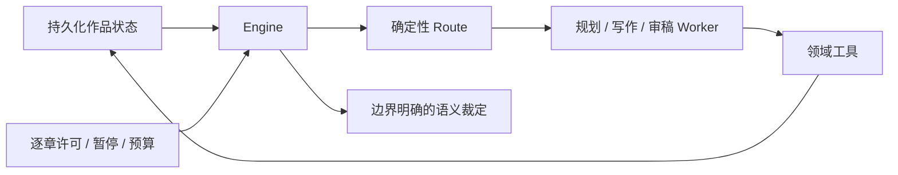

# AI 小说创作：开源项目调研与架构复用

调研日期：2026-11-12。对象：自用起步的中文长篇网文工作台；支持 DeepSeek、OpenAI API；先按作者需求实现独立模块，之后串联建议、半自动、全自动流程；首个能力对标为《凡人修仙传》。

## 1. 结论与证据边界

**推荐复用的主架构是：作者任务模块 + 统一作品资料与版本 + 确定性编排 + 有边界的创作 Agent。** 最有参考价值的控制面来自 ainovel-cli，候选与采纳契约来自 AI_NovelGenerator，局部改写来自 Long-Novel-GPT，写作清单来自 chinese-novelist-skill，事件规划来自 StoryWriter，角色模拟来自 BookWorld。

这是组合设计建议，并非已经证明某个项目可以自动写出《凡人修仙传》级别的作品。当前完成的是公开源码静态核查、研究文献和官方 API 文档核对；未运行第三方项目，未调用付费模型，未做小说质量盲测，也未逐章读取《凡人修仙传》全文。

本轮核查 7 个公开源码仓库的关键实现。提交版本、文件位置和核查范围见[证据索引](05-调研证据索引.md)。下文用“代码观察”表示在所列源码中看到的行为，用“设计判断”表示本项目的推导。未发现明确许可证的仓库，只作为公开源码研究样本。

## 2. 项目筛选结果

| 项目 | 核心形态 | 对本项目的主要价值 | 首版处理 |
|---|---|---|---|
| [ainovel-cli](https://github.com/voocel/ainovel-cli) | Go；确定性 Engine + 裁定器 + 创作 Worker | 自动推进、逐章许可、提交恢复、上下文重建 | 自动化控制面首要参考 |
| [AI_NovelGenerator](https://github.com/YILING0013/AI_NovelGenerator) | Python；任务图 + 工具型助手 + 领域候选 | 来源版本、候选审核、幂等采纳、模型适配 | 数据与交互契约首要参考 |
| [Long-Novel-GPT](https://github.com/MaoXiaoYuZ/Long-Novel-GPT) | Python；大纲、剧情、正文的分块扩写 | 剧情与正文映射、选区改写 | 作者编辑能力参考 |
| [chinese-novelist-skill](https://github.com/PenglongHuang/chinese-novelist-skill) | 文件与 Prompt 驱动的写作流程 | 写前检查、事实词典、角色所知、文风锚点 | 写作方法参考 |
| [story_writer](https://github.com/itsuki2021/story_writer) | StoryWriter 论文的非官方实现 | 事件图、子事件、章节交织、动态历史压缩 | 情节规划参考 |
| [BookWorld](https://github.com/alienet1109/BookWorld) | 世界 Agent + 多角色 Agent 的场景模拟 | 动机、行动、环境反馈、角色记忆 | 后续可选场景推演 |
| [ai-novel-studio](https://github.com/Wangmarco123/ai-novel-studio) | React/Next.js + FastAPI 工作台 | 页面和创作服务组织；也展示了名义 Agent 与实际执行的差异 | UI 与代码审查反例参考 |

不以 Star 数量判断生成质量。仓库持续维护、接口可用、文学质量和可直接复用，是四个不同问题。

## 3. ainovel-cli：把调度与创作分开

### 3.1 代码观察

当前代码的主循环位于 [`internal/host/engine.go`](https://github.com/voocel/ainovel-cli/blob/e05771e136ea32363ca073f88281f46abb8373c0/internal/host/engine.go)。Engine 读取持久状态，通过 `flow.Route` 获取下一步，在派发前后处理推进许可、干预、预算和错误。`Route` 接收显式 `State`，本身不执行 I/O；优先处理基础资料、返工、失效聚合工件、审阅及结构扩展，再进入下一章。[路由源码](https://github.com/voocel/ainovel-cli/blob/e05771e136ea32363ca073f88281f46abb8373c0/internal/flow/router.go)

其控制结构可概括为：

章节提交不是只写一个正文文件：`commit_chapter` 冻结提交参数和草稿快照，以 `PendingCommit` 记录多个提交阶段；恢复时重放冻结意图，而非拿新生成的正文搭配旧事实。[提交源码](https://github.com/voocel/ainovel-cli/blob/e05771e136ea32363ca073f88281f46abb8373c0/internal/tools/commit_chapter.go)

推进政策与创作路由分离。其 Gate 区分自动推进和逐章许可，并校验目标章、提交状态与 checkpoint；预算组件可以在 Worker 边界停机。上下文 builder 则从章节计划、历史摘要、角色快照、伏笔等持久资料重建工作记忆。[推进 Gate](https://github.com/voocel/ainovel-cli/blob/e05771e136ea32363ca073f88281f46abb8373c0/internal/host/advance_gate.go)、[预算组件](https://github.com/voocel/ainovel-cli/blob/e05771e136ea32363ca073f88281f46abb8373c0/internal/host/budget.go)、[上下文 builder](https://github.com/voocel/ainovel-cli/blob/e05771e136ea32363ca073f88281f46abb8373c0/internal/agents/ctxpack/builder.go)

### 3.2 设计判断

适合复用的是职责边界：机械条件由代码判断，文学任务由模型执行，写入由领域服务控制。第一阶段只需要模块运行器；等模块稳定，再增加同形的 Engine，而不是一开始搭完整多 Agent 系统。

不照搬的部分：

- 本项目采用数据库事务时，正文采纳与事实写入可在一个事务中完成，不必原样复制跨文件 Saga。
- 仅在 Worker 边界检查预算可能产生在途费用；应在调用前预留预算，并对未知调用结果保留费用占用。
- 检查到其结构化执行器存在持续纠错直至 context 结束的路径。本项目增加显式次数、费用和耗时上限。[结构化执行器](https://github.com/voocel/ainovel-cli/blob/e05771e136ea32363ca073f88281f46abb8373c0/internal/llmcontract/execute.go)

## 4. AI_NovelGenerator：生成候选与正式写入分离

### 4.1 代码观察

本轮读取的是固定提交的当前实现，不能用早期教程中的桌面脚本架构代替它。`TaskSpec` 为领域任务声明输入、结果模型和 Schema；任务图还校验数据端口与正文生成的资料使用方式。[任务注册表](https://github.com/YILING0013/AI_NovelGenerator/blob/3f1ce0f0028f35b29dafbfac6c9ea0646c153f2d/backend/services/task_flows/registry.py)、[任务图校验](https://github.com/YILING0013/AI_NovelGenerator/blob/3f1ce0f0028f35b29dafbfac6c9ea0646c153f2d/backend/services/task_flows/graph.py)

`CandidateBasisV1` 记录来源对象版本和输入指纹，确认外壳包含 `expected_versions`，过期依据返回冲突。助手运行器具有轮数、工具调用限制、书级租约、检查点和可补读事件；工具侧区分查询、暂存修改、审核和应用。[候选契约](https://github.com/YILING0013/AI_NovelGenerator/blob/3f1ce0f0028f35b29dafbfac6c9ea0646c153f2d/backend/services/llm/candidate_contract.py)、[助手运行器](https://github.com/YILING0013/AI_NovelGenerator/blob/3f1ce0f0028f35b29dafbfac6c9ea0646c153f2d/backend/services/assistant/runtime.py)、[修改服务](https://github.com/YILING0013/AI_NovelGenerator/blob/3f1ce0f0028f35b29dafbfac6c9ea0646c153f2d/backend/services/assistant/changes.py)

模型工厂已经按供应商及 API 模式选择客户端，包括 OpenAI、DeepSeek 的 Responses 与兼容 Chat 接入。[模型工厂](https://github.com/YILING0013/AI_NovelGenerator/blob/3f1ce0f0028f35b29dafbfac6c9ea0646c153f2d/backend/llm/factory.py)

### 4.2 设计判断

本项目复用“读取确定版本 → 生成候选 → 展示修改 → 校验依据 → 采纳”的模式。它直接支持作者选区改写，也能让全自动流程通过政策自动采纳同一种候选，无须维护两套保存逻辑。

首版不实现通用可视化任务图编辑器。固定模块动作已经足够验证作者需求。该项目采用 AGPL-3.0；本轮只研究架构，未复制实现。

## 5. Long-Novel-GPT：让作者能局部修改长文

### 5.1 代码观察

`Writer` 使用 `xy_pairs` 保存上层文本与下层文本的映射，围绕范围对齐、分块、上下文和修改应用工作；`PlotWriter` 与 `DraftWriter` 分别处理剧情和正文，正文可反向提炼剧情。[Writer](https://github.com/MaoXiaoYuZ/Long-Novel-GPT/blob/107c31e54686947a6d00404e332475a60b66e630/core/writer.py)、[剧情 Writer](https://github.com/MaoXiaoYuZ/Long-Novel-GPT/blob/107c31e54686947a6d00404e332475a60b66e630/core/plot_writer.py)、[正文 Writer](https://github.com/MaoXiaoYuZ/Long-Novel-GPT/blob/107c31e54686947a6d00404e332475a60b66e630/core/draft_writer.py)

### 5.2 设计判断

复用“情节卡 ↔ 场景 ↔ 正文段落”的可追溯映射。作者修改某段正文后，系统能定位受影响的场景和计划；修改一张情节卡时，可以提出局部重写范围。

不能据此认定当前实现具备完整的整书自动化恢复。README 中的 Agent/RAG 描述，不能替代对具体执行路径的验证。本轮未在上述关键文件中确认完整检索与长期事务方案；仓库树及元数据未发现明确 LICENSE，不安排直接复制代码。

## 6. chinese-novelist-skill：作者工作清单比角色名称更有用

### 6.1 代码与流程观察

逐章清单集中规定写前读取、正文创作、检查优化和记忆更新，包含上一章结尾、人物最近状态、事实词典、信息边界和文风基准。写作计划与章节摘要被保存为文件，串行及并行模式共用清单。[逐章清单](https://github.com/PenglongHuang/chinese-novelist-skill/blob/507d41567925eab520ad459db08fda83813e8051/references/flows/chapter-checklist.md)

其并行模式允许后批次先依据大纲写作，再统一检查接缝；这只能视作工程取舍，不能证明前后章连续性已得到保证。[写作阶段](https://github.com/PenglongHuang/chinese-novelist-skill/blob/507d41567925eab520ad459db08fda83813e8051/references/flows/phase3-writing.md)

### 6.2 设计判断

复用写作方法，转化为结构化字段和可核查步骤：本章发生的变化、角色已知与误解、资源归属、未兑现承诺、文风样本。不能把“模型收到清单”当成“规则已经执行”。字数、引用位置和版本由程序验证，文学判断保留证据与不确定性。

主线章节默认顺序生成；独立审查、灵感候选可以并行。取消固定章节字数和无限补写，改为作者配置的范围与修订预算。该 Skill 是研究对象，本轮没有安装或执行它。

## 7. StoryWriter：用事件组织章节

### 7.1 论文与实现的区别

StoryWriter 论文区分事件大纲、章节规划和写作，并按当前事件压缩历史。论文报告的语料平均长度约 8,000 个英文词，不能直接外推到百万字中文连载。[论文](https://arxiv.org/abs/2506.16445)

本轮检查的 `itsuki2021/story_writer` 明确为非官方实现。代码先生成事件图，再细化子事件和章节计划；写作时逐子事件检索相关历史、压缩、生成、修订，并将结果保存在 `passage_dict` 中。[顶层流程](https://github.com/itsuki2021/story_writer/blob/61dc4d2bdff55fd42755f40b75e80f34e279e29a/src/story_writer/story_writer.py)、[写作循环](https://github.com/itsuki2021/story_writer/blob/61dc4d2bdff55fd42755f40b75e80f34e279e29a/src/story_writer/workflow/writing_builder.py)

### 7.2 设计判断

复用事件对象和依赖关系，避免“每章只有一句梗概”。每个场景明确前提、人物目标、冲突、选择和结果，并把结果传给后续事件。首版用关系表或 JSON 即可，不需要图数据库。

该实现的已检写作路径主要使用内存累积，顶层在阶段结束后写文件；本项目改为每个场景保存候选与运行记录。不能将非官方复现等同于论文作者实现，也不将其接为产品运行时。该仓库未发现明确 LICENSE。

## 8. BookWorld：角色模拟适合放在场景内部

### 8.1 代码观察

`BookWorld.py` 组织回合、参与角色与场景；`RPAgent` 负责角色动机、目标、规划、交互和状态；`WorldAgent` 处理环境反馈、下一行动者、脚本约束，并提供日志转故事的能力。[模拟入口](https://github.com/alienet1109/BookWorld/blob/a00371637ca805bf4625d4610c74764f9d83bdc2/BookWorld.py)、[角色 Agent](https://github.com/alienet1109/BookWorld/blob/a00371637ca805bf4625d4610c74764f9d83bdc2/modules/main_role_agent.py)、[世界 Agent](https://github.com/alienet1109/BookWorld/blob/a00371637ca805bf4625d4610c74764f9d83bdc2/modules/world_agent.py)

### 8.2 设计判断

它适合复杂谈判、试探、追逃等局部推演。输出应是“可能行动及其代价”，再由章节写作模块选择并叙述。模拟日志不自动成为正式剧情。

不把每个出场人物常驻为 Agent。角色数与回合数都会增加模型调用，且自然涌现不保证卷结构、读者期待或结局闭合。首版先用一次结构化人物动机检查；必要时才加入有回合上限的模拟沙盒。

## 9. ai-novel-studio：必须检查实际调用链

该项目有作者工作台、Provider 服务及自动写作脚本，但所检查的 `/agents/{agent_name}/run` 路由调用 `BaseAgent.run`；该方法返回初始化说明，`WriterAgent` 只声明名称、Prompt 和职责。这条入口尚不能作为实际多 Agent 协作的证据。[入口](https://github.com/Wangmarco123/ai-novel-studio/blob/0c6d98288cec718f09dfda2656d4e0567878e9cd/apps/backend/app/api/studio.py)、[BaseAgent](https://github.com/Wangmarco123/ai-novel-studio/blob/0c6d98288cec718f09dfda2656d4e0567878e9cd/apps/backend/app/agents/base.py)、[WriterAgent](https://github.com/Wangmarco123/ai-novel-studio/blob/0c6d98288cec718f09dfda2656d4e0567878e9cd/apps/backend/app/agents/writer_agent/agent.py)

另外，其自动续写 supervisor 会重启批量脚本，并设定固定章节范围与重启上限。它展示了“脚本串联”的可用起点，也说明后续需要把范围、进度和失败原因提升为产品数据。[supervisor](https://github.com/Wangmarco123/ai-novel-studio/blob/0c6d98288cec718f09dfda2656d4e0567878e9cd/scripts/autowrite_supervisor.py)

这里的判断仅针对已检查路径，不代表整个项目没有真实生成能力。对本项目的要求是：每个模块都必须有真实输入、模型调用或确定性处理、持久输出和作者可验收结果，不能只建角色类。

## 10. 研究文献对架构的约束

| 一手研究 | 可以支持的设计方向 | 不能推出的结论 |
|---|---|---|
| [Re3，2022](https://aclanthology.org/2022.emnlp-main.296/) | 计划、状态注入、生成和修订应形成闭环 | 一次长对话即可稳定创作整本小说 |
| [DOC，2023](https://aclanthology.org/2023.acl-long.190/) | 分层详细大纲与生成时的约束需要配合 | 只有大纲就不需要审稿 |
| [LongWriter，2024](https://arxiv.org/abs/2408.07055) | 长输入能力与长输出能力应分别测试，任务可以分解 | 2024 年测得的长度限制适用于当前所有模型 |
| [Lost in the Middle，2024](https://aclanthology.org/2024.tacl-1.9/) | 应测试重要信息的位置、检索及上下文装配 | 所有当前模型在小说写作上都有相同退化曲线 |
| [StoryWriter，2025](https://arxiv.org/abs/2506.16445) | 事件依赖、章节交织和按事件压缩值得验证 | 英文故事实验已证明中文超长连载质量 |

上述研究支持工作流设计假设。是否改善本项目的小说，仍应使用相同题材、相同预算下的消融试验验证。

## 11. API 核查：兼容格式不等于兼容行为

OpenAI 官方建议新项目使用 Responses API；结构化输出仍需处理拒答、截断和业务校验。[Responses 指南](https://developers.openai.com/api/docs/guides/migrate-to-responses)、[结构化输出](https://developers.openai.com/api/docs/guides/structured-outputs)

本轮 DeepSeek 官方文档已提供 Responses、`json_schema` 和模型能力查询，不能沿用“DeepSeek 只能 Chat Completions + JSON mode”的旧假设。其 Responses 文档说明会话由客户端携带，且 `developer` 被按 `user` 处理；因此高优先级指令必须经过专用适配。[DeepSeek Responses](https://api-docs.deepseek.com/api/create-response/)、[模型列表](https://api-docs.deepseek.com/api/list-models/)

本项目保留供应商能力表、请求转换和响应归一化层。模型名称、窗口、采样参数、缓存与价格使用配置快照；正文写作、规划、审查的模型分工通过中文盲测决定，不预先宣称某模型“最适合写小说”。

## 12. 可执行的复用清单

| 本项目能力 | 参考设计 | 迁移方式 | 实施阶段 |
|---|---|---|---|
| 模块输入输出 | AI_NovelGenerator TaskSpec | 统一 ModuleSpec 与 Artifact Schema | 第一个模块即使用 |
| 生成与采纳 | 候选依据、来源版本、修改组 | 共用采纳服务与版本冲突检测 | 第一个模块即使用 |
| 选区改写 | Long-Novel-GPT 分块映射 | 保存事件、场景、段落关联，展示 diff | 自用模块阶段 |
| 写前及写后检查 | chinese-novelist 清单 | 模板 + 程序检查 + 有证据的审查 | 自用模块阶段 |
| 情节层级 | DOC / StoryWriter | 卷、弧、章、场景及事件依赖 | 规划模块阶段 |
| 可重建记忆 | ainovel-cli ctxpack | 基于已采纳正文重建目标章上下文 | 连载模块阶段 |
| 自动运行 | ainovel-cli Engine / Route | 用模块命令构建确定性状态机 | 半自动串联阶段 |
| 许可与停机 | ainovel-cli Gate | 自动化政策独立于创作模块 | 半自动、全自动阶段 |
| 可靠提交 | PendingCommit 的冻结意图 | 数据库事务 + 幂等回执 + 异步派生 | 串联前完成 |
| 角色沙盒 | BookWorld | 限回合场景推演，结果仅作候选 | 有实际需求后 |

**工程选型建议：独立实现轻量工作台，复用上述架构和契约，不立即 Fork 一个大型项目作为全部产品。** 现有项目的 Go、Python、文件、MongoDB 等边界差异较大；直接拼接运行时会制造多套事实源。首先复用概念、状态和接口形状，直接代码引入另做许可证、依赖和行为验证。

产品模块及整书闭环见[工作台设计](02-作者需求与完整小说工作台设计.md)，工程契约见[Agent 与工程架构](03-Agent与工程架构设计.md)。
