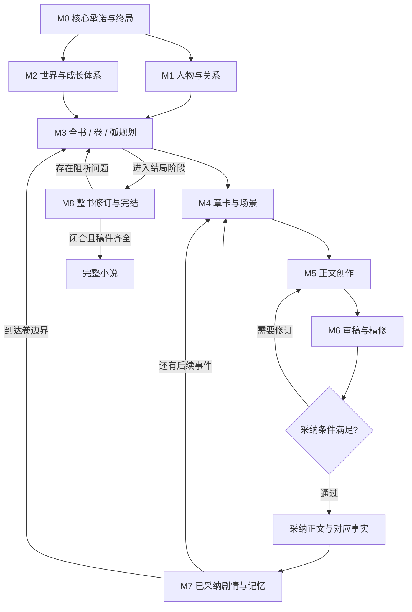

# 作者需求、完整小说闭环与《凡人修仙传》能力对标

版本：设计草案 v0.1；日期：2026-11-12。

## 1. 产品目标和模块划分原则

工作台服务中文长篇网文作者。先让作者独立使用各模块，再把相同模块串联为半自动和全自动创作工程。**模块按作者的写作需求划分，所有产出归属于同一部小说；最终交付必须包含完整叙事，而不只是设定、若干章节或一堆工具。**

首个能力对标是《凡人修仙传》原著。它用于定义长篇成长叙事的复杂度与连续性要求；本项目生成的具体人物、世界和情节由作者另行确定。

已确认的需求：

- 自用起步，按使用体验迭代。
- 建议、半自动、全自动三种模式。
- DeepSeek、OpenAI API 可选择和切换。
- 单个模块解决具体作者问题，模块组合覆盖从构思到完结。

为支持不同写作习惯，本方案另外建议：不要求作者先填完所有设定表，才能开始写一个场景。

未锁定的事项：具体原创故事、每章字数、作品总长度、偏好文风与模型预算。文中的数值均为可修改的项目初始值，不代表原著统计或行业标准。

## 2. “完整小说”的验收定义

完整性包含叙事与工程两个层面。

| 层面 | 必须回答的问题 | 对应产物 |
|---|---|---|
| 核心承诺 | 开篇让读者期待什么，结尾如何回应？ | 故事承诺、主角终局、主题问题 |
| 主线因果 | 前一阶段的选择如何导致下一阶段？ | 主线事件依赖、卷间交接 |
| 人物成长 | 能力、处境、认知或关系发生了什么变化？ | 人物弧与阶段状态 |
| 世界一致 | 成长、战斗、资源和时间是否遵守规则？ | 世界规则、资源与时间记录 |
| 阅读体验 | 各章是否产生有效变化，卷结构是否有起伏？ | 章卡、场景、正文、审稿意见 |
| 承诺回收 | 关键伏笔、冲突和人物去向如何处理？ | 承诺账本、回收或保留理由 |
| 完结交付 | 正文是否齐全，采用了哪个版本，能否导出恢复？ | 版本清单、完结审查、全书稿件 |

**写满计划章数只表示生产进度完成，不表示小说完结。** 全自动模式也要执行结局验收。可以保留续作空间，但必须完成这部小说已承诺解决的主冲突。

## 3. 《凡人修仙传》对标的依据与边界

本轮依据为作者访谈及公开文学评论，不包含全书逐章精读或实证统计。原著起点详情页本次抓取返回 403；未通过其他渠道绕过访问限制，也未取得全书文本。因此不宣称已核实准确总字数、全部境界规则、全量人物关系或逐章伏笔。

在《文艺报》刊载的作者访谈中，忘语将韩立的行动与普通人的选择、抗争和退避联系起来，并说明人物后期的责任变化与实力、处境变化有关。这为本项目提出“行为有动机、成长有阶段”的要求提供了一手依据。[作者访谈](https://www.chinawriter.com.cn/n1/2024/1202/c404024-40373325.html)

文学评论从世界等级、凡人主角和成长叙事讨论该作，也指出重复升级可能造成的单一化问题。这里将其作为评论观点，不作为原著事实数据库；具体设定仍需正文依据。[《忘语修仙小说中的凡人逆袭叙事》](https://www.chinawriter.com.cn/n1/2021/0918/c404027-32230975.html)

以下矩阵是**由对标方向推导的产品需求**，不是原著的量化分析结果。首轮范围是《凡人修仙传》本传，后续《仙界篇》和影视改编不混入同一套对标材料。

### 3.1 对标能力矩阵

| 能力维度 | 工作台要支持什么 | 可检验的失败示例 | 负责模块 |
|---|---|---|---|
| 普通起点与长期追求 | 动机、劣势、优势与代价共同成立 | 只有升级目标，没有个人选择和牵挂 | M0、M1 |
| 谨慎且有变化的人物 | 决策依赖已知信息、风险和价值取舍 | 为推进剧情突然无依据冒险；永远只有同一反应 | M1、M4、M6 |
| 成长与能力约束 | 境界有前提、能力有边界、突破有证据 | 上章受限的能力本章无因解锁 | M2、M6、M7 |
| 资源推动情节 | 获取、消耗、转移、损坏和稀缺性可追溯 | 材料用尽后再次使用；宝物无来源出现 | M2、M4、M7 |
| 势力和关系 | 角色有独立目标，关系随事件改变 | 离开旧地图后所有人物和债务失效 | M1、M3、M7 |
| 信息不对称 | 作者真相、角色所知、读者所知分开 | 未获知秘密的人直接据此决策 | M1、M4、M7 |
| 地域扩展 | 新环境改变限制，同时承接既有后果 | 换地图后重演相同副本且能力自动清零 | M2、M3、M6 |
| 长时间跨度 | 年龄、寿命、闭关、行程与外界变化一致 | 主角闭关多年，所有外部人物却完全未变化 | M2、M7 |
| 延迟回报 | 长线伏笔跨章、跨弧维护 | 已设下的重要承诺被摘要遗漏 | M3、M7、M8 |
| 连载节奏 | 场景功能和读者期待匹配，允许缓冲和沉淀 | 每章强行制造同一种危机或解释性结尾 | M4、M5、M6 |
| 全书闭合 | 阶段目标逐层服务终局，结局承接前文 | 章数耗尽便宣布飞升，核心冲突仍未处理 | M0、M3、M8 |

### 3.2 修仙成长类型包

世界设定模块提供可选的“修仙成长”字段集，但不将本项目固定为某一本作品的设定：

- 成长阶段：前置条件、突破所需、能力变化、代价、失败后果。
- 功法与技能：适用范围、消耗、限制、掌握程度、相克条件。
- 资源与物品：数量或存在性、品阶、归属、消耗和位置。
- 时间与生命：故事时间区间、年龄或年龄范围、寿命、伤势和恢复条件。
- 地理与势力：通行条件、距离或耗时范围、地盘、立场、利益。
- 机遇与优势：提供什么帮助、不能解决什么、怎样被限制或反制。

程序只能验证已结构化的条件。战力高低、人物是否明智等语义判断，仍需要正文证据和人工抽查；不能把小说简化为自动升级游戏。

## 4. 面向作者的模块地图

模块名称使用作者熟悉的任务语言。规划 Agent、检索器、Writer 等技术名称不作为作者主导航。

| 编号 | 作者模块 | 作者正在解决的问题 | 核心产物 |
|---|---|---|---|
| M0 | 构思立书 | 我想写什么，读者为什么追下去，最终写到哪里？ | 作品简报、核心承诺、终局方向 |
| M1 | 人物与关系 | 这个人想要什么，会如何行动，为什么会改变？ | 人物卡、关系、人物弧、信息边界 |
| M2 | 世界与成长体系 | 这个世界如何运行，主角怎样成长且不失控？ | 世界规则、成长体系、资源和势力设定 |
| M3 | 全书与分卷规划 | 如何把一个想法写成有始有终的长篇？ | 全书骨架、卷弧结构、事件依赖 |
| M4 | 章节与场景编排 | 这一章到底发生什么，怎样承上启下？ | 章节卡、场景卡、揭示与回收安排 |
| M5 | 正文创作 | 怎样把情节写出来，怎样续写或改好这一段？ | 正文候选、局部改写、版本差异 |
| M6 | 审稿与精修 | 哪里有问题，怎么修，修完是否更好？ | 有位置依据的问题、修改候选、复检 |
| M7 | 连载记忆与伏笔 | 写到这里，谁知道什么、有什么、还有哪些账？ | 状态账本、时间线、摘要、伏笔与承诺 |
| M8 | 全书修订与完结 | 整本书是否完整，怎样定稿和交付？ | 整书审查、修订计划、完结报告、导出稿 |
| M9 | 对标与素材拆解 | 我想研究哪些叙事能力，哪些可以用于自己的故事？ | 来源明确的对标卡与可执行检查项 |

作品、编辑器、文件导入导出、模型设置属于公共能力。它们支撑所有模块，不单独假装成一个创作 Agent。

## 5. 各模块的独立使用与组合契约

### M0 构思立书

独立输入可以只有一句想法。通过少量问题或候选，形成题材、主角欲望、核心阻力、作品差异和终局方向。作者可以只做脑洞探索，不被强制填完设定。

串联输出 `story_brief`：作品核心承诺、主线目标、主要限制、预期篇幅、结局条件。结局可以暂定，但进入无人值守整书生成前必须有明确方向，否则系统难以判断何时结束。

### M1 人物与关系

支持新建人物、从已有稿件提取人物、检查某次决定是否符合人物处境。人物卡至少包含目标、恐惧、底线、说话方式和当前限制；人物弧区分“初始状态、变化触发、可能终态”。

串联输出 `character_profile`、`relationship`、`character_arc`。角色知道、误以为和不知道的事项由 M7 保存实际发生记录；人物卡里的未来成长设想不覆盖当前状态。

### M2 世界与成长体系

支持独立设计境界、资源、地理、势力和社会规则，也能诊断一套设定中的漏洞。允许只有简单设定开始写作，再逐步补足。

串联输出 `world_rule`、`progression_rule`、`resource_definition`。规则标记硬约束和可调整项。AI 可以提议新设定，不能在写作过程中悄悄修改作者锁定的规则。

### M3 全书与分卷规划

既支持“大纲先行”，也支持从已写正文整理下一阶段。全书先保持粗粒度，当前卷和近期章节逐步细化，避免一次生成数百张几乎不可修改的章卡。

串联输出 `novel_plan`、`volume_plan`、`arc_plan`、`story_event`。事件包含前提和后果；卷末必须交代目标结果、人物变化、世界变化及向下一卷带去的未了事项。终局始终保留，不因滚动规划而消失。

### M4 章节与场景编排

独立使用时，作者可以拿一段梗概请求章纲或场景设计。场景卡说明：人物、时间地点、视角、目标、阻力、选择、结果、读者新增信息。章卡则说明本章的主要变化、承接和结尾留下的期待。

串联输出 `chapter_plan`、`scene_plan`，显式关联人物、事件、规则和伏笔。不能仅用“写得精彩一些”作为写作任务。

### M5 正文创作

提供续写、按章卡写作、选区改写、扩写、压缩、转换视角和多个候选。作者始终可以直接手写。最早的自用闭环是“导入片段 → 提建议或改写 → 对照差异 → 采纳或撤销”。

串联输出 `chapter_draft` 或 `text_patch`，绑定输入版本和场景。正文候选与正式稿分开，局部改写不得覆盖作者同时编辑的新版本。修订范围由作者或流程明确指定。

### M6 审稿与精修

至少分为逻辑连续、人物动机、结构节奏、语言表达四个检查维度。每条问题包含位置、证据、严重度、修改方向和确定性；文学偏好问题不能伪装为客观错误。

串联输出 `review_report`、`revision_patch`。程序负责字数、引用、重复提交和已登记数值等可验证项，模型负责因果、动机与表达等语义项。修稿后重检原问题，避免无限“再润色一遍”。“去 AI 味”按重复解释、空泛表达和声音趋同等可观察问题处理，不承诺检测作者身份。

### M7 连载记忆与伏笔

独立支持“写到第 N 章，我需要回顾什么”“哪些伏笔尚未处理”“角色当时知道什么”。从已采纳正文提取候选事实，作者或流程采纳后进入账本。摘要是检索辅助，原文和作者确认设定仍可追溯。

串联提供 `context_pack`、`fact_delta`、`chapter_summary`、`promise_record`。旧章节重写时，按目标位置恢复历史上下文，不能把最新人物状态倒灌回过去。梦境、传闻、说谎、猜测、计划必须带类型，不能一律抽成世界真相。

### M8 全书修订与完结

检查开篇承诺、主线、关键人物弧、重要伏笔、卷间连续及结局是否闭合。输出按依赖排序的修订任务，可交回 M3—M7 执行，再复检。

串联输出 `book_review`、`revision_plan`、`completion_report` 和指定版本的全书稿。首版支持 Markdown、TXT；DOCX、EPUB 属于后续格式能力。全自动创作与外部平台发布分开，发布不纳入首版自动化。

### M9 对标与素材拆解

首个预置对标卡为《凡人修仙传》，记录对标维度、来源、推导要求和待验证项。从作者获授权提供的文本中，可进一步提取事件、成长、时间和伏笔结构；每项记录回链至原文位置并接受校正。

对标材料单独存储。它为原创作品提供检查维度，不作为原创作品已经发生的事实，也不默认成为每次生成的上下文。

## 6. 模块如何共同产出一部小说



保证组合成立的不是图上的连线，而是四个共同约束：

1. **同一作品身份**：所有卡片、计划、正文和状态都带 `novel_id`，不能靠复制粘贴传递“当前小说”。
2. **同一采纳记录**：下游读确定版本；未采纳候选不会冒充正式剧情。
3. **同一因果链**：场景产生变化，变化更新状态和后续事件；未产生作用的正文需被审查。
4. **同一终局目标**：全书规划与完结模块共同维护必须完成的承诺，不能只追求下一章可写。

M1、M2、M3 允许反复迭代。探索型作者可先写场景，再整理设定和规划；串联时必须明确已经采纳的变化和后续影响。

## 7. 三种模式共用模块

| 行为 | 建议模式 | 半自动模式 | 全自动模式 |
|---|---|---|---|
| 启动方式 | 作者发起某项任务 | 作者选择一章或一段流程 | 作者设定作品目标、范围和预算 |
| 主要输出 | 建议、问题、候选、局部补丁 | 完整章稿及审查、事实更新候选 | 连续章节、卷审查、完结报告 |
| 正式采纳 | 作者操作 | 在选定节点等待作者 | 在预先设定的政策内自动采纳 |
| 推进范围 | 当前任务 | 一章、一个弧或指定步骤 | 指定批次或整书 |
| 需要停止的情况 | 任务结束 | 到审核节点或遇到阻断 | 超预算、连续失败、锁定规则冲突、无法闭合 |
| 改变故事根本设定 | 作者决定 | 作者决定 | 超出授权范围时暂停 |

全自动模式在自己的工作分支或批次版本中采纳正文和事实，后章能读取已稳定提交的前章。结束后作者可统一比较版本；预设允许直接作为当前版本时，可自动完成切换。它不要求每章确认，但也不绕过质量门槛。

模式可以按模块覆盖：例如人物设计采用建议模式，章节生产采用半自动模式，摘要采用自动模式。切换在明确的任务边界生效，在途请求保留原配置快照。

## 8. 工作台信息架构

主导航建议：作品概览、构思、人物、世界、情节、写作、审稿、连载账本、全书定稿。对标与素材放在作品资料入口。

核心写作页采用三栏：

```text
作品 / 卷 / 章目录       正文编辑区                  本章资料与操作
 ├ 当前卷               正式稿 / 候选 / 对比         章卡与场景
 ├ 当前章               作者直接编辑                人物当前状态
 └ 章节状态             续写、选区改写              规则与待回收伏笔
                                                    审稿问题与来源
底部：运行进度、暂停/停止、模型、实际用量与预算
```

每个模块页保持相同操作语义：选择任务与资料 → 看结果 → 编辑或比较 → 采纳。自动化页面展示的是这些任务的执行进度，不展示一排没有明确产物的“Agent 头像”。

作品概览应显示“距离下一阶段缺什么”，例如当前卷未确定结局、某章仍待采纳、某项重要承诺逾期；允许作者直接进入任意模块处理。

## 9. 从对标维度到可复现测试

采用原创测试设定，验证系统能力，不以修改原著角色名字的方式制作测试小说。

| 测试 | 测试情境 | 应有行为 |
|---|---|---|
| 成长前提 | 突破需要三项条件，正文仅完成两项 | 报告缺项；修订或补足因果后才能采纳 |
| 物品守恒 | 唯一材料已在前章消耗 | 下一章再次使用时指出原文证据 |
| 角色所知 | 真相作者已设定，角色尚未知晓 | 不能让其无因据此行动；可记录误判 |
| 时间流逝 | 闭关多年，外界角色存在年龄限制 | 推进外界时间，检查人物处境变化 |
| 跨卷继承 | 主角进入新区域仍负有旧约 | 交接包保留承诺及相关人物状态 |
| 伏笔回收 | 早期线索约定在第三弧揭示 | 提前提供待回收项，完成后回链正文 |
| 历史改稿 | 作者改掉前章的物品转移 | 标记相关下游状态和章节待复核 |
| 防重复 | 连续多个弧使用近似冲突与解决办法 | 提醒结构重复，提出有代价差异的方案 |
| 完结门槛 | 章数完成但主冲突未解决 | 输出未完成清单，不标记整书完成 |

先用这些可判定情境验证工程，再通过作者盲读判断可读性、动机和审美。通过规则测试不等于达到对标作品的文学质量。

## 10. 阶段性整书目标

第一轮整合建议写一部 **36 章、约 9—12.6 万字、3 卷的原创修仙成长小说**，每章初始范围 2,500—3,500 字。这个规模是项目自定的闭环试验：必须有开始、阶段推进和最终结局。

之后扩展至约 100 章和更长作品，逐步检验跨卷状态、长期伏笔、历史修订和累计成本。短篇闭环成功，只证明链路可工作；要接近《凡人修仙传》所代表的超长连载复杂度，还需要更大规模实测。

执行顺序、模块验收和实验方法见[分模块实施计划](04-分模块实施与验收计划.md)。
