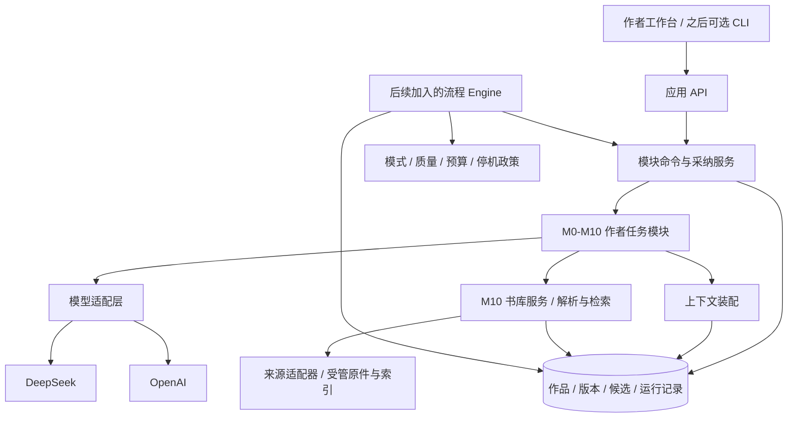
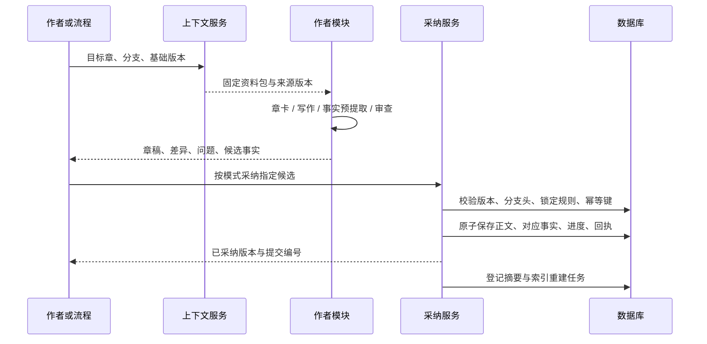

# AI 小说工作台：Agent 与工程架构设计

日期：2026-11-12。本文是拟实施方案，尚未创建应用代码或验证模型效果。产品边界以[作者需求与完整小说工作台设计](02-作者需求与完整小说工作台设计.md)为准，参考实现见[开源调研](01-开源调研与架构复用.md)。

## 1. 总体决策

采用“模块化单体 + 可持久恢复的任务执行”，从自用开始。先实现作者模块，后实现编排；模块的业务服务不依赖网页、某个 Agent 框架或某家模型的会话状态。

初始技术建议：

| 层 | 建议 | 选择原因 |
|---|---|---|
| 工作台 | React + TypeScript + Vite | 以本地交互为主，不需要先引入服务端渲染 |
| 编辑器 | 首版 Markdown/纯文本编辑；后续可接 Tiptap | 优先做好版本、选区和差异比较，避免首版富文本迁移成本 |
| 业务 API | Python + FastAPI + Pydantic | 适合结构化模型调用、领域契约和独立模块开发 |
| 资料与任务存储 | SQLite + 迁移脚本 | 单人、本机使用易部署；数据版本从第一模块保留 |
| 执行 | 一个持久任务 Worker | 浏览器关闭后仍可继续；请求期间不占数据库事务 |
| 模型 | 独立 OpenAI / DeepSeek Adapter | 统一结果，保留协议及能力差异 |
| 检索 | 实体/别名/位置过滤优先；中文词项检索；向量可选 | 先保证事实正确和可追溯，再改善召回 |
| 更大规模 | 有实际并发需求后迁移 PostgreSQL、扩 Worker | 不让自用模块依赖完整云服务栈 |

SQLite 使用本机磁盘、短事务、WAL 和忙等待策略；多个读者不意味着可以无限并行写入，跨机器共享数据库文件也不适用此方案。[SQLite WAL 官方文档](https://www.sqlite.org/wal.html)

### 1.1 从第一阶段到最终形态



第一阶段保留 `CMD / MOD / CTX / MODEL / DB` 的最小实现。Engine 后续通过模块命令串联，不通过操作网页按钮，也不复制另一套写作逻辑。

## 2. 三个必须分开的层

**作者任务层**对应构思、人物、世界、规划、写作、审稿、记忆、完结及资料阅读检索，决定用户看见什么和得到什么。资料获取和关键词检索采用确定性服务，不为接入模块体系而强制调用模型。

**创作执行层**包含规划、写作、审查、事实提取等模型角色。一个作者模块可以只调用一次模型，也可以组合多个角色；多个模块也能共用同一个角色。

**工程控制层**负责队列、状态、重试、采纳、模式、预算和恢复。模型不能自行更改这些控制条件。这一边界参考 ainovel-cli 的 Engine/Route，以及 AI_NovelGenerator 的候选与领域确认设计。[路由](https://github.com/voocel/ainovel-cli/blob/e05771e136ea32363ca073f88281f46abb8373c0/internal/flow/router.go)、[候选契约](https://github.com/YILING0013/AI_NovelGenerator/blob/3f1ce0f0028f35b29dafbfac6c9ea0646c153f2d/backend/services/llm/candidate_contract.py)

## 3. 模块契约：先能单独用，再能编排

每个模块声明 `ModuleSpec`：

```text
module_id / module_version
actions                       支持哪些作者动作
input_schema / output_schemas  输入和产物类型
required_context_by_mode      按创作分工确定必需的最小资料
optional_context              可补充资料
roles                         内部使用的模型角色
acceptance_rules              程序校验、审查与采纳条件
side_effects                  允许产生的候选类型或受管书库操作
```

统一入口为 `run_module(action, input_refs, user_instruction, options)`。表单、选区工具和未来流程 Engine 都调用它。模块返回产物和检查结果；正式作品资料的更改统一走采纳服务。M10 的书目、文件、阅读进度及摘录写入由书库服务管理，返回确定性回执；只有作品资料包及原创内容变更进入作品采纳流程。

例如：

| 作者动作 | 最小输入 | 返回 | 后续可组合用途 |
|---|---|---|---|
| `ideation.explore` | 一句想法 | 构思候选 | M0 作品简报 |
| `character.check_decision` | 人物卡、当前处境、决定 | 动机问题或替代方案 | M4 场景修订 |
| `outline.plan_arc` | 主线方向、人物及世界必要约束 | 弧计划、事件 | M4 章卡 |
| `writing.rewrite_selection` | 固定正文版本、选区、要求 | 文本补丁 | 作者采纳或 M6 修订 |
| `memory.extract_delta` | 固定章稿、前置事实快照 | 候选事实及来源 | 采纳正文时提交 |
| `completion.check_book` | 全书选定版本、承诺账本 | 完结问题清单 | 修订或整书完成 |
| `library.find_books` | 关键词、来源与筛选 | 书目、可用格式与获取方式 | 作者选择下载或前往来源 |
| `library.search_text` | 检索词、书库范围与筛选 | 带版本、位置及覆盖的原文命中 | 阅读、摘录或 M9 拆解 |
| `library.build_reference_pack` | 作品目标、选定摘录与用途 | 资料包候选 | M4/M5 取材、M6 回查 |

独立调用可缺少全书规划，但要返回 `context_completeness`，说明本次检查覆盖了哪些范围。全自动流程对必需输入使用更严格前置校验，不能把独立模块的宽松输入误当成无人值守条件。

模式约束引用[创作模式与写作设置](06-创作模式与写作设置.md)：建议模式的手写入口不要求规划产物，AI 辅助只按本次动作检查最小输入；半自动需要本次情节约束与有效写作设置；全自动需要采用的设定、大纲和整书目标。未有逐章计划时，全自动可先调用规划模块生成，而不是要求作者手工填齐。

跨模块错误统一包含 `code / category / message / retryable / run_id`，必要时附可公开的来源版本与恢复动作。至少区分输入无效、缺少前置资料、依据过期、业务规则阻断、供应商认证失败、临时服务失败和外部调用结果未知。未知错误不能包装为成功，也不能默认可重试。可空字段分别定义含义，例如未知故事时间不等于时间为零；未设置预算只允许明确的手动任务策略，不能作为整书自动运行的无限额度。

## 4. 统一产物与数据契约

### 4.1 Artifact 外壳

```json
{
  "artifact_id": "art_...",
  "novel_id": "novel_...",
  "kind": "chapter_plan",
  "schema_version": 1,
  "revision": 3,
  "status": "candidate",
  "basis": [
    {"artifact_id": "arc_...", "revision": 2},
    {"artifact_id": "character_...", "revision": 4}
  ],
  "base_story_commit_id": "commit_...",
  "producer": {"module_id": "chapter_planning", "run_id": "run_..."},
  "payload": {}
}
```

`payload` 必须通过 `kind + schema_version` 对应的 Schema。`basis` 和输入指纹由服务器根据实际读取生成，不能采信模型自报。模型、Prompt、模板、参数和价格快照在运行记录中保存。

状态区分 `candidate / accepted / superseded / rejected`；依赖失效另外记录 `freshness=stale`，不把“旧但曾经采纳”错误改成“从未存在”。

文本位置绑定不可变正文修订。首版选区契约统一使用 UTF-16 起止偏移，与浏览器字符串索引一致；Python 后端显式转换并校验原文摘要和选区文字，不能直接拿偏移切 Python 字符串。导入时统一换行，保存后不再静默规范化文本；表情及扩展汉字也要覆盖。未来富文本按稳定段落 ID 加段内位置迁移，不复用失效的全文偏移。

### 4.2 作品数据分为三类

| 数据 | 示例 | 对后续正文的意义 |
|---|---|---|
| 作者确认的基础设定 | 世界规则、人物初始身份、硬性限制 | 约束与初始条件 |
| 未来计划 | 将来突破、可能背叛、结局安排 | 可调整的意图，不是已发生事实 |
| 已采纳剧情及派生状态 | 已取得物品、已受伤、已获知线索 | 当前叙事位置的事实依据 |

正文是具体叙事证据，作者确认的基础设定是约束。二者冲突时创建问题或显式修订，不能用“正文优先”静默修改世界规则，也不能为保持设定而悄悄篡改正文。

### 4.3 首阶段与后续表结构

首阶段只建核心对象：`novels`、`artifacts`、`artifact_revisions`、`module_runs`、`model_calls`、`acceptance_receipts`。单任务运行先在 `module_runs` 保存最小状态；长任务需要的候选和部分结果保留为产物。

加入连载与自动化时扩展：

- `story_commits`：一次正文与事实的原子采纳、父提交和历史位置。
- `facts / knowledge_records / promises`：时态事实、角色与读者所知、伏笔和承诺。
- `artifact_dependencies`：计划、正文、摘要、事实之间的版本依赖。
- 情节和人物扩展：`plot_threads / story_events / event_relations / presentations / character_state_deltas`；能力定义和人物掌握记录按实际需求从产物中独立。它们是后续逻辑对象，不要求首版同时建全。
- `workflow_runs / run_steps / run_events`：流程步骤、尝试、可重连事件。
- `budget_reservations`：调用前费用预留及未知结果占用。
- `branches`：自动批次、历史修订或替代剧情分支；模块阶段只保留默认工作版本。
- M10 接入时增加书目、来源版本、不可变原件、解析修订、索引构建、阅读位置、摘录及作品关联；这些工作区资源不强制绑定作品，作品级 `reference_pack` 仍使用 Artifact 外壳。

这些是逻辑对象，不要求第一阶段把所有实体建成完整关系数据库。稳定的关键事实可从 JSON 产物逐步迁移为专表，迁移需要保留版本和来源。

## 5. 最少 Agent 角色与工具边界

| 内部角色 | 负责 | 不允许自行执行 |
|---|---|---|
| Planner | 故事、卷弧、章卡、事件规划 | 把未来事件写成已发生事实 |
| Writer | 场景与正文、指定范围修订 | 修改锁定规则、覆盖新版本 |
| Reviewer | 发现问题、提供证据、复检 | 仅凭一个分数决定整书完成 |
| Memory Extractor | 从固定正文提取状态与承诺变化 | 猜测缺失事实并写入正式账本 |
| 可选 Character Simulator | 有限回合场景推演 | 把模拟日志直接升级为正式剧情 |

M0、M1、M2 的生成起初可共用一次结构化调用，不必为每种表单创建常驻 Agent。复杂工具调用只在任务需要主动查阅多份材料时启用。

允许的领域工具示例：`read_artifact`、`query_context_at_position`、`read_source_span`、`stage_candidate`、`propose_text_patch`、`submit_review`。参数必须经过 Schema、作品归属、版本和权限校验。

正式 `accept_candidate` 由作者命令或流程政策触发。Worker 可请求采纳，但不能绕过服务端政策。它也不能执行任意 SQL、任意文件写入、修改预算或把素材里的文字当作系统指令。

## 6. 上下文和长篇记忆

### 6.1 记忆结构

1. 稳定层：作品简报、锁定世界规则、初始人物、作者文风样本。
2. 结构层：全书终局、当前卷弧、相关事件、当前章卡与场景。
3. 状态层：目标位置的人物处境、资源、关系、所知和未了事项。
4. 叙事层：相关原文、上一章结尾、必要的历史摘要。
5. 工作层：本次要求、候选、审稿问题和待修项。

摘要和向量索引都属于可重建派生数据，不能成为唯一事实源。持久化上下文与对话状态分离的思路，也与 LangGraph 的 checkpointer / store 区分一致；是否引入该框架留待编排阶段评估。[LangGraph 持久化文档](https://docs.langchain.com/oss/python/langgraph/persistence)

### 6.2 一个事实的最小表达

```text
subject_id / predicate / value
fact_kind                     状态、事件、传闻、信念、规则等
story_time_range              世界中的发生/有效时间，可未知或为区间
narrative_position            在第几章哪个场景出现
knower / audience             谁获知、读者何时获知
source_revision + source_span 固定正文或作者确认记录
branch_id / commit_id          所属版本
certainty / unresolved        证据确定程度与待确认事项
supersedes / invalidated_by    状态替换与失效来源
```

必须同时考虑故事时间和叙述顺序。倒叙中“发生得更早”不等于角色或读者当时已经知道；只有时间过滤不足以防止剧透。对信息来源不明的事实保留未知，不自动推定为最新状态。

### 6.3 上下文装配顺序

先按作品、分支、目标叙事位置、来源采纳状态和视角资格过滤，再按相关实体与事件依赖召回，最后做关键词或向量排序。语义相似但属于未来、别的版本或其他角色秘密的内容，不得进入普通事实包。

Writer 读取明确分区：本次任务、硬约束、当前章卡、当前事实、相关证据、可用文风样本、上一段原文。未来计划仅以本章允许的方向和不得提前揭示的约束呈现，不当作角色所知。

预算须满足：输入估算 + 输出预留 + 协议及安全余量 ≤ 模型窗口。优先删除无关摘要与冗余检索结果，关键硬约束和直接承接原文不能被静默截掉。不能统一用英文字符数除以四估算中文 Token；优先用对应计数能力，否则用实际 usage 校准估算并保留余量。

首版无需向量库即可使用精确实体、别名、章节位置和手工选择。加入中文全文检索时显式分词或构建词项索引，不假设英文默认分词适用于中文。Embedding 作为可选独立能力；未核验前不假定 DeepSeek 有可直接调用的 Embedding 接口。不同模型、维度和切分版本的向量不可混用。

### 6.4 多线事件与人物状态的连接

拟采用[多线模型](07-多线叙事与伏笔建模分析.md)：事件拥有统一身份、故事时间、所属或影响的情节线，正文呈现位置另行记录。实线推进、虚线伏笔属于视图语义，不能替代底层关系类型、事件状态和披露资格。

[人物状态模型](08-人物认知与能力状态设计.md)基于档案与已确认事件变化重建目标时点。角色认知记录接触途径和相信/怀疑状态，命题真相与读者披露单列；能力记录掌握来源、当前限制和使用条件。事件状态和人物状态共用采纳与来源版本，不再生成一套独立的“人物事实”。

状态查询绑定分支、目标事件及前/后边界，读者信息另绑定叙述位置。回忆、补叙和历史修订不能直接读取全书最新人物状态；同一事件在多线或多视角呈现时只应用一次状态变化。

### 6.5 外部资料书库与内容检索

M10 管理书目获取、下载／导入、解析、阅读定位、中文全文检索和摘录；M9 管理从原文推导叙事规律，M7 管理原创作品事实。三者复用来源与版本契约，不能共享一份混合事实索引。资料问答和向量检索后续再加，基础阅读与搜索不依赖模型。

工作区级命令允许作品、故事基线及频道配置为空；当前作品范围搜索和资料包则必须校验作品身份、关系及发送资格。跨书检索先过滤可访问范围，命中绑定原件、文本修订和索引版本；覆盖不全需明确说明。中文索引规范化保留到原文位置的映射，重新解析不静默挪用旧定位。

Writer 在“外部参考资料”独立分区读取明确选用的 `reference_pack`，不自动读取全库或整书，不将外部事件纳入故事事实。下载、原件、解析与索引各有状态，失败保留可用原件及旧版本；路径、重定向、解压和不可信 HTML 按安全边界校验。详细对象、命令及来源适配建议见[资料书库设计](12-电子书下载阅读与资料检索设计.md)。

## 7. 单章生产与采纳事务



正文修订后，旧的事实提取和审稿结果必须按正文版本失效并重算。半自动时作者可以处理建议后再采纳；全自动时政策可采纳通过条件的候选。

核心事务包括：验证输入依据仍有效 → 冻结正文修订 → 写对应事实变化及来源 → 推进故事提交 → 写采纳回执和派生任务。LLM 请求与检索不在事务内执行。

全文索引、向量和展示性摘要可异步生成；尚未生成时标记缺失，后续任务回退读取原文或等待必要资料，而不是使用陈旧摘要继续写。正式故事状态不能依赖一个尚未完成的异步提取任务。

## 8. 后续 Engine：模块串联而非自由聊天

Engine 的输入是持久事实，输出是一个类型化的下一步命令。可确定的情况由代码路由；只有用户自然语言干预、无法机械判断的结构取舍等才调用语义裁定。

典型闭环：

```text
检查作品目标与必要资料
→ 选择当前卷弧与下一事件
→ 生成/更新章卡
→ 装配上下文并写作
→ 预提取事实，执行程序和语义审查
→ 在范围内修订并重检
→ 按政策采纳正文与事实
→ 更新可重建记忆
→ 章/弧/卷边界审查
→ 继续，或执行整书完结审查
```

同一故事分支仅有一个主线写作执行者。可以并行生成备选方案、独立审查和导出，但不能让相依章节同时以未确定的前章为基础采纳。主线以外的独立支线，也要先建立依赖边界再并行。

### 8.1 运行状态与编辑状态分开

运行状态：`queued / running / waiting_author / paused / completed / failed / cancelled`。步骤状态：`pending / running / succeeded / failed / skipped`。候选、章稿及事实另有自己的版本与采纳状态。

网络中断不能被记作“需要作者审核”；模型请求完成也不能直接记作“章节已采纳”；流程全部跑完仍要看整书验收是否通过。

### 8.2 初始自动化政策

创作分工、情节约束、写作偏好与执行政策分别保存。半自动的关键不是审核次数，而是保持作者指定情节。以下为字段结构示例，尚非已采用的运行 Schema：

```yaml
creation_mode: assisted
plot_contract:
  fixed_events: [到渡口交易, 发现身份试探, 脱身]
  fixed_outcomes: [交易失败, 获得下处交易的消息]
  forbidden_events: [正面战斗]
  allowed_detail_types: [对白, 动作, 心理, 环境, 衔接]
  unknown_plot_handling: suggest_options
writing_profile:
  inherit: novel_default
  overrides:
    viewpoint: third_person_limited
    pace: balanced
execution_policy:
  scope: chapter
  review_checkpoint: after_chapter
  adoption: manual
  stop_after_chapter: null
  max_revision_rounds: 2
  max_transient_retries: 3
  max_calls_per_step: 8
  auto_accept_new_facts: false
  allow_locked_rule_changes: false
  budget_currency: USD
  budget_limit: null
```

这是产品配置示例，不是模型请求格式；示例中的次数、审核点和采纳方式不是半自动的固定默认值。写作设置从作品、卷弧、章节、场景到任务逐层继承，锁定规则与正式事实独立校验；有效设置连同来源版本在任务启动时冻结。

建议模式只执行作者请求的辅助动作，半自动按情节契约完成细节与表达，全自动自行细化采用的大纲并推进至整书完成。Review 必须检查固定事件和结果是否保持，不能只评判语言流畅。进入全自动时明确预算、范围、模型及采纳政策；新的非冲突事实可以在授权范围内自动采纳，修改锁定设定、扩大范围、改变根本结局等超出政策的动作暂停。

“写到第 N 章停”“改完让我看”“本卷结束暂停”转成持久条件，不能只存在聊天文本中。修改在途模式时，默认在下一个任务边界生效。

## 9. 恢复、幂等与历史修订

### 9.1 从第一模块保留的约束

- 每次生成绑定固定输入版本，作者的后续编辑不能被旧候选覆盖。
- 同一个采纳幂等键只能生成一个回执；重连仅取状态，不自动重复调用模型。
- 流式正文是部分候选，未完成、截断或取消不能进入正式稿。
- 单模块也保存输入、输出和错误，便于重新运行与比较。

### 9.2 串联前补齐的约束

任务领取使用持久租约及递增 token，旧 Worker 即便晚返回也不能提交新状态。进程重启后从最近已稳定步骤继续；已取得且保存的模型结果优先复用。

外部模型调用无法仅靠本地幂等键保证“恰好计费一次”。超时发生在服务端是否已经完成不明确时，将调用记作 `outcome_unknown`，保留费用占用；重试作为新的尝试记录，禁止无界自动重试。

SSE 事件带递增序号，可通过最后已读序号补读。Token 增量可定期合并保存，步骤完成和采纳事件必须持久化。作者立即停止后禁止新的采纳；外部请求取消按供应商能力尽力执行，已产生费用仍记录。

### 9.3 改前文的影响传播

修改早期已采纳正文时创建新修订或分支，找出依赖的事实、摘要、章卡和后续正文，标记待复核。只重建确实受影响的派生数据，不自动重写全书。

如果首次工程尚无精细依赖，采用更保守的“从修改章起检查后续”策略，并明示范围。旧分支保留可回滚。历史写作上下文按目标章恢复，不能直接用全书最新人物表覆盖过去。

## 10. DeepSeek 与 OpenAI 接入

### 10.1 内部模型接口

```text
GenerationRequest
  task_kind / role / instructions
  context_items / output_requirement
  model_profile / generation_options
  deadline / max_output_tokens

GenerationResult
  text / parsed_payload / tool_calls
  finish_status / refusal / incomplete_reason
  usage / provider_request_id
  model_requested / model_reported
  normalized_error
```

统一流事件为 `text_delta / tool_call / usage / completed / failed`。业务模块不直接解析供应商 SSE，也不硬编码某个模型支持的采样参数。

### 10.2 必须实测的能力表

| 能力 | 处理方式 |
|---|---|
| Responses / Chat Completions | Adapter 声明，不通过换 base URL 猜测全部兼容 |
| JSON Schema | 支持时原生约束；仍做 Schema 和业务校验 |
| 仅 JSON mode | 使用明确 JSON 指令、校验及有界修复 |
| 工具调用 | 参数校验、调用标识、结果回传与回合数限制 |
| 思考模式和采样参数 | 每模型映射；不支持的参数拒绝或明确省略 |
| 上下文和最大输出 | 配置与模型能力快照，保留输出及推理占用余量 |
| 缓存与 usage | 按供应商归一化，不重复计算已包含的 Token |
| 远端会话状态 | 只作可选优化，小说资料由本地管理 |

OpenAI 新项目优先 Responses；DeepSeek 当前也提供 Responses 和结构化输出，但其文档说明会话无服务端存储，`developer` 角色按 `user` 处理。本项目在 DeepSeek 适配中将高优先级规则放在其支持的系统指令位置。[OpenAI Responses](https://developers.openai.com/api/docs/guides/migrate-to-responses)、[DeepSeek Responses](https://api-docs.deepseek.com/api/create-response/)

正文使用普通文本流，计划、审稿与事实变化使用结构化结果。结构化约束只保证支持范围内的格式，不保证人物状态、数值和因果正确。[OpenAI 结构化输出](https://developers.openai.com/api/docs/guides/structured-outputs)

模型档案分别配置规划、写作、审查和提取。先用少量中文任务对比，再决定成本与质量分工。记录实际返回模型及时间，防止别名升级后无法解释质量变化。

## 11. 费用、延迟与质量

费用按一次任务的所有调用累计，包含规划、上下文压缩、正文、审稿、事实提取、重试及失败调用。Token 不直接等同于中文字数。

归一化后，计费桶必须互斥：

```text
费用 = 普通输入 × 对应单价
     + 缓存读取 × 对应单价
     + 各档缓存写入 × 对应单价
     + 计费输出 × 对应单价
     + 单独计费的工具费用
```

缓存写入若使用独立总费率，就不再把相同 Token 同时计入普通输入。推理 Token 是否包含在输出中，按供应商 usage 语义处理。OpenAI 当前缓存行为和写入价格因模型而异，不能统一写成“缓存自动免费”。[Prompt Caching 官方文档](https://developers.openai.com/api/docs/guides/prompt-caching)

调用前估计本次最高费用并预留，返回后按实际 usage 结算；没有精确 usage 时保留估算标记。价格配置包含币种、生效时间和来源，预算不混用人民币和美元。

作为量级示例，假设 100 章的全部任务合计消耗 **500 万输入、100 万计费输出 Token，全部输入未命中缓存**。按本轮 DeepSeek 官方美元价格快照，Flash 高峰约 $2.70、非高峰约 $1.35；Pro 高峰约 $10.56、非高峰约 $5.28。这是输入假设下的算术示例，不是小说报价，也不包含另行发生的调用、工具、税费等。[DeepSeek 价格](https://api-docs.deepseek.com/quick_start/pricing/)

延迟按任务分别测量：作者选区改写关注首字与总耗时；整书自动化关注每采纳章的耗时、修订轮数和人工介入率。不要只追求输出速度而忽略改稿成本。

## 12. 质量门槛

程序检查：版本、Schema、引用位置、字符计数、已结构化的资源变化、必要字段及提交一致性。语义检查：因果、动机、信息边界、人物声音和章节功能。作者盲读负责校准可读性与审美。

阻断项包括明确的硬规则违例、关键人物无依据获知秘密、核心资源不可能状态、未完成文本和失效依据。风格偏好、节奏建议和非关键措辞允许保留为建议，避免修订循环无限延伸。

评审结果要引用固定版本及位置，并区分 `confirmed / suspected / preference`。不同模型复核可以用于高风险项，但多模型一致不等于事实正确。

整书门槛独立于章节门槛：核心承诺已回应、主冲突已解决或按作品约定转化、关键人物去向有交代、关键伏笔处理有据、最终选定版本正文齐全。无法完成时报告未闭合项，不伪报完成。

## 13. 本机部署与数据保全

初期 API 监听本机，前端与 API 同源；跨域和访问令牌按本地应用场景配置。API Key 存在操作系统凭据存储或受控环境中，不写入小说 JSON、浏览器持久配置、日志或 Git。

备份通过数据库备份机制及版本化稿件导出完成，避免运行中仅拷贝主 SQLite 文件遗漏 WAL。备份默认不含密钥。导入对标材料、小说正文、模型历史和日志设独立类别；日志默认记录必要元数据，完整稿件日志由作者明确开启。

不假定当前账号具备所有模型权限或在所有运行地区可访问。接入阶段使用作者实际账户与部署环境验证；本轮没有调用其 API。切换模型服务时显示将发送的作品资料范围。

## 14. 未来代码目录建议

```text
apps/web/                    作者工作台
apps/api/                    HTTP 与事件接口
ainovel/modules/             M0-M10 作者任务服务
ainovel/library/             书目、来源获取、解析、阅读定位与资料检索
ainovel/contracts/           产物与模块 Schema
ainovel/domain/              作品、版本、事实、承诺、采纳
ainovel/context/             目标位置装配与检索
ainovel/providers/           OpenAI、DeepSeek 与能力表
ainovel/runtime/             单任务运行器；之后增加流程 Engine
ainovel/storage/             SQLite、迁移、备份
prompts/                     按模块和版本管理的模板
evals/                       连续性、整书闭环和中文质量样本
```

这只是后续实施边界。第一模块只创建它实际需要的目录和表；先保留契约、版本与采纳，再逐步补齐自动化能力。
