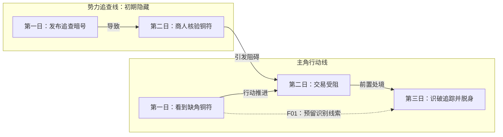

# 多线叙事、同期事件与伏笔关系分析

日期：2026-11-12。状态：架构分析建议，尚未实现；线型、线数和默认检查规则等待自用验证。承接[工作台设计](02-作者需求与完整小说工作台设计.md)及[创作模式](06-创作模式与写作设置.md)。人物认知和能力的状态变化详见[人物状态设计](08-人物认知与能力状态设计.md)。

## 1. 判断：方向合理，需要拆开几个维度

在同一段故事时间里维护多条情节线，有助于长篇小说处理主角行动、其他人物、势力变化、信息传播和跨卷铺垫。它能把“主角没看到的地方发生了什么”纳入规划，也便于检查各线如何影响后续。

建议采用 **故事时间轴 + 情节泳道 + 事件关系 + 披露状态** 的结构。保留“实线表示发展、虚线表示伏笔”的视觉直觉，但不要用一条线型同时表达已发生、未发生、隐藏和铺垫等不同含义。

需要区分：

| 概念 | 解决的问题 | 示例 |
|---|---|---|
| 情节线 | 谁围绕什么目标持续行动，遭遇什么阻力？ | 主角求取资源、某势力追查失物 |
| 故事时间 | 事件在世界中何时发生、持续多久？ | 主角交易时，另一地正在封锁通道 |
| 叙述顺序 | 读者在何章何场景看到事件？ | 先写主角，后来补叙同日的追查 |
| 伏笔关系 | 哪个早期细节支撑后续揭示、结果或理解变化？ | 一道缺口的形状在后文成为识别线索 |
| 人物状态 | 事件后人物知道什么、能做什么、拥有什么？ | 获得消息，误判身份，受伤导致能力不可用 |

**伏笔通常是两个或多个事件、细节之间的关联，不必单独成为一条情节线。** 暗线则可以是一条完整的行动线，只是当下没有完整展示给读者。

## 2. “同一时间”与“同一章”分别处理

同一个故事时段，可以容纳多地、多人的事件；正文不必轮流展示全部事件。某条线也可以经过较长时间才再次进入叙述。

叙事研究区分故事时间、话语时间及叙述行为的时间，支持将“发生顺序”和“讲述顺序”分别表示。这里将其转化为工程字段，是本项目的设计推导。[《叙事学在线手册》Time 条目](https://www-archiv.fdm.uni-hamburg.de/lhn/node/106.html)

每个事件至少保留：

- 世界中的时间点或区间；允许“不晚于某事件”“闭关期间”等相对约束。
- 事件所属情节线，以及受其影响的其他线。
- 正文呈现位置，可有多个呈现或回忆位置。
- 当事人、旁观者、获知者及信息传递路径。
- 规划、候选正文、已采纳正文或作者确认的场外事实等来源状态。

不要求精确到分钟。只有时间先后即可满足检查时，保留先后关系；时间不明时不要由模型随意补出日期。

## 3. 明线、暗线、伏笔和预留计划

### 3.1 明线与暗线

明线是当前向读者展示的行动发展。暗线是有真实目标和因果进展、但暂时隐藏全部或部分内容的行动。两者是叙述呈现上的区别，会随揭示发生变化。

某势力在暗中追查，可以有目标、人员、行动和结果，因此能成为暗线。主角偶然看见的一个特殊标记，通常只是一个伏笔细节，不需要单独建立“标记线”。

暗线需要作者有意确认或保留为计划。不能因为模型猜测“可能有人在幕后追查”，就把它写成已经发生的真相。

### 3.2 预留伏笔与已经埋设

“准备在将来埋一个伏笔”只有规划意义；“正文已经写了某个细节，后文准备回收”才有可供读者回看的铺垫。

建议记录以下生命周期：

```text
计划预留 → 已埋设 → 可选的强化 → 已回收
              ↘ 调整回收方案 / 明确放弃
```

已埋设须有确定版本的正文位置；已回收须有对应的后文依据。只写在大纲里的说明不能被系统判为正文已埋伏笔。重复出现但没有增加意义，也不能自动算有效强化。

伏笔可以关联多个潜在回收方向，探索式写作不必起初知道全部答案。但系统要区分“存在可用线索”和“已经决定唯一真相”，以免反向替作者固定剧情。

创作者的伏笔讨论强调早期线索与后续揭示之间的可理解联系，也讨论误导如何影响读者关注点。这里据此提出来源与回收检查，不把某种写法规定为唯一技巧。[Writing Excuses 17.4](https://writingexcuses.com/17-4-the-gun-on-the-mantel-is-actually-a-fish/)

## 4. 建议的图形语义

| 图形元素 | 单一含义 | 另行记录的内容 |
|---|---|---|
| 横向位置 | 故事时间或相对阶段 | 不用它直接代表章节顺序 |
| 一条泳道 | 围绕目标组织的情节线 | 人物可以跨线，不与角色一一绑定 |
| 事件节点 | 一次有条件和结果的事件 | 标注计划、已写、已采纳及来源 |
| 实线箭头 | 情节推进关系 | 文字区分先后、前置条件与导致 |
| 虚线箭头 | 铺垫与潜在/实际回收的关系 | 标注伏笔编号与回收状态 |
| 汇合节点 | 一次影响多线的事件 | 使用同一个事件 ID，避免重复记账 |
| 文字徽标 | 明线、暗线、未公开、待定 | 披露状态不靠颜色或虚实猜测 |

建议把“未发生”放在节点状态里，把“读者尚不知道”放在披露状态里，把“伏笔”放在关系里。这样虚线可以稳定地表示用户期望的铺垫联系。

### 4.1 原创规划示意

以下全部是说明模型的原创假设，不是《凡人修仙传》原著情节，也不表示这些事件已被实际写入正文。



正式泳道视图中，第一日、第二日等按共享时间列对齐；此图只展示事件关系，横向布局不是精确时间刻度。阅读视图可先呈现主角经历，再补充追查线，但人物的行动仍必须遵守当时所知。

“商人验符”参与两条线的交汇，只记为一个事件或一个共享事件中的动作；不能在两条线各登记一次，造成物品、时间或状态变化重复。

## 5. 同期多线应有几条

没有适用于所有小说的固定数量。需要分别统计全书线数、当前卷弧的活跃线数、当前章实际展示线数；它们不应被合并成一个指标。

首轮自用可以试验 **当前弧跟踪 2—4 条活跃线**，例如：主角阶段目标、重要配角目标、势力变化、核心疑团。这个数量是界面与工作量的初始假设，不是研究结论，也不要求每部作品都多线。

原则是：

- 单线作品照常支持，不为增加线数制造支线。
- 每条线写清目标、当前处境、下一触发和对人物/主线/主题的作用。
- 暂无事件时允许休眠，明确什么条件会使它重新活跃。
- 不要求各线每章平均出现，也不要求所有线最终都物理汇合。
- 一条线长期没有状态变化、作用或回报时，提示作者检查，而不是自动删除。

《凡人修仙传》在本项目中提供超长成长叙事的复杂度方向；本轮没有全书逐章统计，因此不声称原著固定使用几条并行线。

## 6. 情节线与人物轨迹的边界

人物、认知、能力和资源通常是事件所改变的状态维度。它们可以显示为成长或变化轨迹，但不必各自建立一条叙事情节线。

例如“主角能力从阶段 A 到阶段 B”是一条成长轨迹；“为了补齐突破条件而寻找材料、遭到阻挠并作出取舍”才具有独立行动目标和冲突，适合作为情节线。

同一事件可以同时：推进资源线、改变人物信任、让对手获得一条消息，并限制主角的能力。通过事件记录多个变化，比维护几套互不相干的“人物线”“能力线”更容易保持一致。

具体认知、能力和状态表达见[人物认知与能力状态设计](08-人物认知与能力状态设计.md)。

## 7. 对 AI 工作流的影响

### 7.1 规划阶段

Planner 为当前卷弧建立活跃线及事件依赖，标记交汇点、允许披露的信息和伏笔回收窗口。粗规划可以保留未定部分，临近写作再细化。

StoryWriter 使用事件及事件关系组织大纲，并进一步安排事件进入章节，提供了可参考的技术方向。它支持“事件关系独立于章节组织”的架构思路，但不能据此保证本项目的中文长篇质量。[StoryWriter 论文](https://arxiv.org/abs/2506.16445)

### 7.2 选择下一个场景

场景选择综合考虑主目标、因果前置、当前时间、人物可行动性、应披露信息及章节节奏。不能只按时间先后排序，也不能机械地 A 线、B 线轮流各写一次。

同一故事时间里的事件不等于可以同时生成并提交。如果共享人物、资源或信息前置，仍要确定依赖和提交顺序。独立事件可以产生并行候选，合并时必须通过相同的事实校验。

### 7.3 写作与审查

Writer 接收当前场景相关事件、人物在该时点的状态、允许披露内容和必要原文。作者总览能显示幕后真相，不意味着普通视角的正文可直接使用全部真相。

Reviewer 检查：事件前提是否成立、跨线影响是否有路径、信息是否先获得再使用、伏笔是否有真实来源，以及人物与资源是否在不同线中冲突。

## 8. 三种模式下的使用

| 模式 | 多线图的职责 |
|---|---|
| 建议 | 可从作者已经写出的内容整理事件与候选关联；作者可忽略图继续写，不要求先画全图 |
| 半自动 | 作者安排主要情节线与关键交汇，AI 在该范围内补足场景；新增主线方向作为候选提出 |
| 全自动 | 依据设定与大纲生成、维护和调度活跃线，执行交汇、披露、回收及整书闭合检查 |

伏笔是否必须回收、哪些线可以合并或结束，由作品目标和作者约束决定。系统提供可追溯检查，不将每个装饰性细节都当成必须兑现的承诺。

## 9. 最小数据和首版实施

逻辑上先需要五类对象：

```text
PlotThread       目标、涉及人物、活跃/休眠/完成、下一触发
StoryEvent       时间范围、参与者、地点、条件、结果、状态及来源
EventRelation    先后、导致、依赖、跨线影响
Presentation     事件在正文中的呈现位置及允许披露范围
Foreshadow       埋设来源、潜在解释、回收目标/窗口、生命周期
```

首版用事件卡、关系表和按线分组的列表即可。图是这些数据的视图，不是唯一保存格式；以后再增加拖拽泳道图，无需先引入图数据库。

建议落在已有模块中：M3 维护情节线和卷弧事件，M4 编排场景与披露，M7 记录实际变化及伏笔状态，M6 检查逻辑，M8 验证关键线和承诺的完成情况。

## 10. 验证哪些问题

| 检查情境 | 系统应给出的结果 |
|---|---|
| 一条线先使用了另一条线尚未产生的结果 | 定位前置依赖冲突 |
| 两个同时事件没有关联，仅因时间接近被当成因果 | 不建立自动因果；提供候选关联供核对 |
| 人物在未具备特殊能力或移动条件时跨地参与同期事件 | 标记时间、地点及能力条件冲突 |
| 角色尚未收到消息，却据此作出决定 | 定位信息传播缺口 |
| 大纲预留伏笔，正文实际没有写 | 状态仍为计划，不计为已埋设 |
| 删除了伏笔的来源段落 | 将对应关系标记待检查，不继续假定已铺垫 |
| 同一个跨线事件被多个视角回忆 | 保持同一事件身份，不重复更新世界状态 |
| 线已结束，但下游仍依赖未完成结果 | 提醒未闭合依赖，不能仅按完成标记通过 |

这套模型的主要价值是让作者和 AI 能定位缺口、理解关联。它改善可管理性；最终节奏、悬念和阅读吸引力仍需要作者阅读与实际创作验证。
