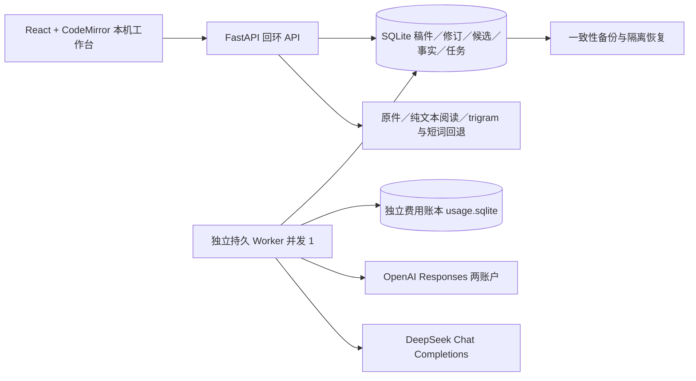

# ainovel 产品验收、技术方案与实施路径

依据：[13 产品使用场景与功能设计](13-产品使用场景与功能设计.md)、[14 小说创作者痛点与需求调研](14-小说创作者痛点与需求调研.md)。本轮由用户明确授权实施；研究推导仍为待验证，不据此引入账号收费、团队协作或平台运营。

## 1. 交付目标与最新约定

运行形态为本机网页：React 工作台负责交互，回环地址上的 FastAPI 服务负责保存、资料与任务，一个独立 Worker 负责模型调用和持久执行。浏览器关闭不取消任务；本机服务与 Worker 需保持运行。

按正文短闭环、资料、长篇状态、半自动整书、全自动整书的顺序落地。原有 48 项离线检查保留；模拟模型跑通批次只证明工程链路，不能证明生成质量。

- 原规模：同一原创简报、两个独立版本，各 36 章，约 3 卷、每章 2500—3500 非空白字符（含标点），各约 9—12.6 万字符。
- **最新费用授权：两个 OpenAI Key 合计不超过 USD 20；DeepSeek 不超过 CNY 80。** 覆盖本轮全部试写、失败、修订和整书调用，不按 Key、批次或重启重置。此前 USD 50 已被 USD 20 取代。
- 用户允许预算不足时缩减生成数量、篇数。缩减必须记录实际章数与字数，不能记为原 36 章规模通过。系统不会在额度不够时继续派发。
- 第二组 Key 通过 `.env` 中 `OPENAI_API_KEY_2` 配置；示例为 [.env.example](.env.example)。三账户配置与价格模板见 [ainovel.example.toml](ainovel.example.toml)。真实值只留本机。
- [原创简报与 36 章作者情节](fixtures/original-story.json)是工程随附的原创验证输入。全自动只接收简报、已选定设定与粗纲，不接收这份逐章情节，也不复用半自动正文。

工程、创作质量、实际收益分别留证、分别判定。阶段结果与真实调用记录见 [实施验收记录](docs/acceptance/实施验收记录.md)，不得从“已有实现”推导“已全部验收”。

## 2. 作者与市场场景

以下是产品覆盖与验证任务，不是市场规模、需求占比或付费意愿结论。新人、兼职、稳定连载、长篇修订等分组来自研究的质性材料与项目目标；对产品收益的推断保持待验证。

| 作者状态／市场使用场景 | 触发与页面入口 | 功能与预期结果 | 验收任务及实际证据 |
| --- | --- | --- | --- |
| 新人、无规划起笔 | 写作 → 新建作品／章 → 直接输入 | 无大纲、人物卡、模型配置也能手写；卡点时给方向 | T01：写到卡点、选择一个方向并继续完成场景；保留前后稿与作者解释 |
| 亲自创作、只要辅助 | 写作 → 局部改写／审稿 → 拒绝／采纳 | 原稿和候选分开，可拒绝、恢复；不配置模型可编辑并查本地资料 | T02、T03：拒绝后继续写，错误采纳可恢复；版本与冲突回执 |
| 已定情节、AI 补写 | 写作 → 按情节补写；整书创作 → 半自动 | 作者决定事件与结果，AI 补动作、对白、心理、环境与衔接 | T04：交易失败且不战斗；逐条检查固定条件，比较采纳前总投入 |
| 兼职、中断后恢复 | 写作 → 作品／版本／目录 → 工作便签 | 恢复章节、光标与下一步说明；查到相关资料和持久任务 | T05：关闭重开，记录回顾分钟、查找次数、复制次数 |
| 稳定连载与长篇修订 | 故事与审阅 → 状态／原文；写作 → 审稿 | 人物当时认知、能力与资源有证据；改前文后相关状态失效 | T06、T07：连续十章与植入矛盾，记录检出、漏报、误报与维护投入 |
| 取材、考据与写法研究 | 资料书库 → 找书／获取／导入 → 搜正文 → 阅读／摘录 | 真实取得原件，短词可查，命中可回源，资料包主动发送 | T08：至少一部许可允许获取的真实作品完成全链路；未解析内容不算全文已查 |
| 稳定更新、理解读者反馈 | 故事与审阅 → 作者反馈 → 复制修订要求 | 作者手动录入；区分事实、理解与偏好；不自动改方向 | T09：一条反馈关联到版本与原文，再形成有范围的修订任务 |
| 作者定情节、批量完成整书 | 整书创作 → 半自动 → 独立版本 | 批量情节、补写、审查、事实更新、有限修订、完结检查和导出 | T10：半自动独立 36 章；稿件齐全，结果忠实，核心冲突闭合 |
| 从设定粗纲自动完成整书 | 整书创作 → 全自动 → 独立版本 | 自动细化章纲、持续生成、检查点、预算与故障恢复、收尾 | T11：另一独立 36 章，无逐章人工情节；提交干预、返修和费用记录 |

创作分工与采纳频率独立：半自动可在作者情节范围内自动采纳通过检查的稿件；全自动也可以章间人工审阅。不能以“逐章点确认”定义半自动。

## 3. 需求、场景与功能追踪矩阵

### 3.1 N01—N12 全覆盖

| 需求 | 场景 U | 功能 F | 验收任务 | 必须保留的证据 |
| --- | --- | --- | --- | --- |
| N01 构思／卡文 | U01、U02 | F02、F07、F08 | T01、T04 | 卡点原文、方向候选、选择依据、继续写出的场景 |
| N02 立书／规划 | U01、U02、U03、U11 | F02—F07、F13 | T01、T11 | 无前置手写、采用设定、规划版本、计划与已发生事实的区别 |
| N03 正文补写 | U04、U05、U11 | F07—F10、F13 | T04、T10 | 固定事件、禁止项、候选、覆盖检查、作者采纳与改动 |
| N04 表达／文风 | U05、U12 | F08—F10、F14 | T03、T04 | 同情节不同写法、具体段落评价、额外投入 |
| N05 长篇连续性 | U06、U07、U10、U11 | F04—F07、F10、F11、F13 | T06、T07、T10、T11 | 来源修订、故事时点、认知与资源、失效范围、复检 |
| N06 审稿／大改 | U07、U10、U12 | F06、F10、F11、F14、F15 | T03、T07、T12 | 有引文的问题、影响与修订报告、原问题复查结果 |
| N07 取材／考据 | U08 | F09、F12 | T08 | 原件哈希、下载或导入回执、覆盖、原文定位、选入资料包的摘录 |
| N08 中断／切换 | U01、U06、U09 | F01、F08、F11、F12、F14 | T05、T06 | 工作位置、便签、任务状态、恢复耗时与复制次数 |
| N09 更新／反馈 | U12（复用） | F08、F10、F11 | T09 | 作者录入的反馈、性质分类、原文、定向修订要求 |
| N10 完结／交付 | U11、U12 | F06、F10、F13—F15 | T10—T12 | 全文、核心承诺、人物去向、未完成项、最终版本与恢复结果 |
| N11 控制／内容保护 | U01、U04、U09、U10、U13 | F01、F08、F12—F16 | T02、T03、T13 | 发送范围、拒绝、版本冲突、幂等采纳、取消与恢复回执 |
| N12 成本／学习负担 | U05、U08、U11—U13 | F09、F12—F16 | T05、T10—T14 | 准备到整理的总投入、用量、价格配置、未知预留、预算拦截 |

### 3.2 U01—U13 全覆盖

| 场景 | 实际入口与操作流程 | 功能 | 验证任务 |
| --- | --- | --- | --- |
| U01 空白起笔 | 写作 → 新建章 → 手写保存 → 按需求助 | F01、F08、F14 | T01、T02、T05 |
| U02 情绪与方向 | 写作 → 创意与定位／大纲规划 → 编辑候选 → 采用 | F02、F06—F08 | T01、T04 |
| U03 男女频与题材 | 故事与审阅 → 采用设定 → 读者与题材／机制／例外 | F02—F04、F09 | T15；具体取向效果由作者判断 |
| U04 给情节补写 | 写作 → 情节、固定条件与表达预设 → 候选对照 → 采纳 | F07—F10、F14 | T04 |
| U05 打斗与描写 | 写作 → 常用写法 → 选区改写／补写 → 比较候选 | F08—F10、F14 | T03、T04；覆盖六种表达样例 |
| U06 人物当时状态 | 故事与审阅 → 主体／时点 → 来源修订；原文查询 | F05、F11 | T06 |
| U07 多线与伏笔 | 采用粗纲 → 人物／承诺记录 → 按章与时点查询 | F05、F06、F11 | T06、T07；图形视图后续扩展 |
| U08 找书取材 | 资料书库 → 官方书目／获取／导入 → 搜索 → 阅读 → 摘录 | F12，供 F04、F08、F09 消费 | T08 |
| U09 接续已有稿 | 写作 → 导入为新章 → 历史／事实 → 下一章 | F01、F08、F11、F14 | T05、T06 |
| U10 修改前文 | 写作 → 保存新修订 → 后章待复检／事实失效 → 重审或恢复批次 | F10、F11、F14 | T07、T13 |
| U11 持续完成整书 | 整书创作 → 分工与范围 → 独立版本 → 运行／暂停／恢复 | F02—F11、F13—F16 | T10、T11、T13 |
| U12 审稿交付 | 写作审稿／作者反馈 → 故事与审阅整书验收 → 导出／备份 | F10、F11、F14、F15 | T09、T12、T14 |
| U13 模型与预算 | 账户与预算 → 脱敏状态、单价、共享账本；任务选择账户 | F16、F13 | T13、T14 |

### 3.3 F01—F16 实现与证据入口

| 功能 | 实现位置／最小能力 | 检查与业务证据 |
| --- | --- | --- |
| F01 作品章节 | `api.py`、`domain.py`；新建、标题、顺序、可恢复归档、导入新章 | `test_api_worker.py`；T01、T05 |
| F02 创作意图 | 采用设定、单次指令与固定条件，均有版本依据 | T01、T04、T15；不强制起笔前建立意图表 |
| F03 读者题材 | 手动维护阅读取向、主辅题材、机制与例外，进入采用设定上下文 | T15；题材专项质量待自用验证 |
| F04 世界社会 | 世界设定模块与手动设定；采用后供生成引用 | T15；不是已做完全部题材百科 |
| F05 人物状态 | 人物设计；事实类型区分认知、能力、资源、关系、计划 | T06；原文逐字依据与版本关联 |
| F06 大纲多线伏笔 | 采用粗纲、全自动 Plan、章级情节与 promise 记录 | T07、T10、T11；复杂事件图后续扩展 |
| F07 章节场景 | 自然语言情节、固定结果、表达设置、滚动写作输入 | T04、T10、T11 |
| F08 正文辅助 | CodeMirror、手写、选区补丁、按情节整章补写与候选 | T01—T04；UTF-16、并行改稿、取消 |
| F09 写法预设 | 基础、对白、打斗、心理、环境、日常、悬念及可编辑设置 | T04；同情节对照与作者认可，非模型自评即可通过 |
| F10 审稿修订 | Review 逐条条件与有出处的问题；有限修订；反馈转定向要求 | T03、T07、T09；引用不匹配不得自动通过 |
| F11 故事影响 | 采纳事务内更新事实；前文变化标记事实和后章失效；原文搜索 | T06、T07；十章工程样本与真实连续稿分别记录 |
| F12 资料书库 | `library.py`；TXT/MD、无 DRM EPUB、官方获取、短词搜索与摘录 | `test_library_backup.py`；T08；覆盖与失败明确 |
| F13 自动运行 | `worker.py`；持久领取、租约、步骤缓存、事件、暂停取消恢复 | `test_api_worker.py`；T10、T11、T13 |
| F14 版本恢复 | 不可变修订、基线比较、幂等采纳、恢复为新版本、两版本独立 | `test_domain.py`；T02、T03、T13 |
| F15 完结导出 | 完结报告、作者三层验收、MD/TXT、SQLite 备份与隔离恢复 | T12、T14；不以章数满作为完结 |
| F16 模型用量 | 双 OpenAI Key／DeepSeek 适配；共享预算、预留、用量和失败记录 | `test_budget_provider.py`；T14；真实模型另行留证 |

## 4. 三层验收与记录方式

### 工程可靠性

T02、T03、T05、T13、T14 中保存、并发、版本恢复、采纳幂等、取消、导出、备份恢复等确定性场景必须通过。存在误覆盖、错误采纳或不可恢复损坏时，不进入真实稿件试用。

故障集：生成期间改稿与切章；发送前取消与流中取消；流中断；未知超时；重复采纳；Worker 重启；旧尝试晚返回；前文改动；余额不足；导入部分失败；备份恢复。未知超时不自动重发，不静默换 Key。浏览器事件断线只重连查询，不创建新生成任务。

中文专项：输入法组合、表情与扩展汉字、CRLF/LF、UTF-16 选区、短词与连续短语、长标题、键盘焦点、320 像素布局、200% 文字放大。自动化输入字符串不能代替真实中文输入法检查；未实测项单列。

### 创作质量

固定事件与禁止项以最终采用稿判定。审查产物给正文位置、逐字依据、原因与修法，分清事实矛盾与审美建议。结构合法和引用命中只证明格式与来源，不能证明意见本身正确。

作者通读并判断表达、情绪、声音、因果、动机与阅读体验；严重连续性错误未解决时整书不通过。模型报告只辅助。当前按每 12 章分组，以各章固定版本开头 450／结尾 900 字符进行分卷检查，再用各章开头 120／结尾 240 字符及分卷报告汇总整书。报告保留读取范围，不冒充通读全部正文。自动章级审查使用目标章与所装配前文，作者最终通读补充全书判断。

### 实际使用收益

工具总投入＝准备＋查找＋提示调整＋等待＋核查＋返修＋整理保存。

同难度原创任务与手写／现用工具比较，交替安排顺序，记录学习效应。时间收益型功能需证明总投入降低且质量可接受；质量提升型功能需记录具体改善及额外投入，并由作者明确认可。没有预设“节省 50%”的门槛；没有真实对照测量时状态是未验证。

### 单任务记录模板

```markdown
任务编号／日期：T__ / ____
对应：N__ → U__ → F__
作者状态与目标：
作品／独立版本／章／源修订：
固定事件和禁止项（与审美偏好分开）：
模型账户／请求模型／返回模型／模板版本／步骤指纹：
原文与候选／采用修订／报告／回源位置：
实际操作、失败、取消、干预和返修原因：
准备__ 查找__ 提示调整__ 等待__ 核查__ 返修__ 整理保存__（分钟）
基线任务、总计、顺序及学习效应：
实际 Token／配置价格估算／未知费用预留：
工程：通过／失败／未执行（依据）
创作质量：通过／失败／未验证（具体段落与作者判断）
使用收益：通过／失败／未验证（测量与作者认可）
限制与下一步：
```

## 5. 技术架构与数据流



### 确定的运行环境

React 19、TypeScript 5.9、Vite 8、CodeMirror 6；Python 3.14、FastAPI、Pydantic、HTTPX；Node.js 24 LTS 构建。精确依赖分别锁在 `package-lock.json`、`uv.lock`；运行版本见 `.node-version`、`.python-version`。TypeScript 选 5.9 是为了与当前 OpenAPI 类型生成器兼容；不跳过类型检查。

领域对象和流程放在 `domain.py`、`worker.py`，HTTP、模型与界面分别适配。`modules.py` 提供最小 ModuleSpec，`POST /api/modules` 为 run_module，候选由 `POST /api/artifacts/{id}/accept` 采纳。API 请求类型由 OpenAPI 生成，关键返回行为另有契约测试。

### 核心接口

| 边界 | 接口 | 约束 |
| --- | --- | --- |
| 正文 | `/chapters/{id}`、`history`、`restore` | 保存携带 `base_revision`；冲突 409；恢复产生新修订 |
| 候选 | `/artifacts`、`{id}`、`accept`、`reject` | 固定目标与故事基线；采纳事务重新读取候选；幂等回执 |
| 任务 | `/modules`、`/workflows`、`/tasks/{id}`、`events`、`cancel/pause/resume` | 稳定任务 ID；事件游标；租约与尝试号；未知结果需明确恢复 |
| 状态 | `/branches/{id}/context`、`facts`、`search`、`definitions` | 按工作版本和章节边界；事实保留来源修订与 UTF-16 位置 |
| 书库 | `/library/catalog/download/import/search/books/units/excerpts` | 书目与内容检索区分；原件、覆盖和失败范围可查 |
| 验收 | `/feedback`、`/assessments`、`/branches/{id}/completion/export` | 反馈不改方向；三层判定绑定当前故事修订 |
| 恢复 | `/backups`、`{id}/verify`；停机 CLI `restore` | 在线数据库备份；实际隔离恢复；费用账本不回退 |

每次生成：冻结输入 → 装配必要上下文 → 候选 → 审查及有限修订 → 按政策采纳 → 同事务登记事实 → 推进下一步。前文变化会使相关事实与后章失效，运行期间发现故事基线改变即停止推进。

纯文本位置统一 UTF-16，Python 显式切片并拒绝拆开代理对。原稿、资料原件、备份、真实评测输出保存在仓库外的固定目录 `~/.ainovel`，不依赖不同启动环境可能虚拟化的 LOCALAPPDATA；浏览器 IndexedDB 按窗口分别暂存未提交稿，恢复其他窗口或不同基线草稿须比较后选择。已迁移旧目录写入停用标记，不能作为新活动账本使用。

### 模型、上下文与费用

- OpenAI 和 DeepSeek 分别解析 SSE；完成、错误、用量缺失均有独立结果。OpenAI 结构化产物使用严格 JSON Schema，DeepSeek 使用 JSON 模式并在本机校验。
- 每个正文候选最多两轮自动修订。格式纠正、引用纠正各自作为受限检查项，最多两轮；失败、未知或费用不足时保存现场，停止新调用，不无限递归。
- 单模型调用并发为 1；数据库记录输入指纹和成功步骤。恢复复用同一任务同一输入的已知完成步骤；明确拒绝候选并重做时创建新生成批次并记录原因，不复用被拒稿的生成缓存。未知调用不会因 Worker 重启自动重发。
- 调用元数据关联模板版本、系统与请求摘要、模型参数和来源修订标识，默认不复制完整提示词到诊断记录；实际正文与候选仍在本机稿件库保留。全自动规划及后续写作均读取本版本已采用设定，继承不包含另一版本正文。
- 审稿和事实证据可填本机生成的原文编号，后端回填逐字原文并保留 UTF-16 定位；编号枚举限制在本次可见来源内。自动摘要上限 400 字符、事实每次最多 6 条且各 160 字符，原文仍保留可检索。这些边界控制输入与成本，不能证明摘要没有遗漏。
- 启动入口先检查端口；Worker 监测启动进程和停止标记，关闭本机程序后停止派发，未知结果保留费用。资料下载在服务重启后明确标为中断失败，不持续冒充下载中。
- 上下文当前采用每类最新设定、目标章之前最近 100 条有效事实、最近两章及主动勾选摘录。更早原文可检索；超出单次 120,000 UTF-8 字节上限时明确停止，不静默截断。
- 原文、事实、人物认知、未来计划、外部资料分开；外部资料中的指令不获得工具权限。复杂事件图、全书图检索及更多记忆策略在后续以漏检与维护成本证据决定。
- OpenAI 两账户聚合到同一 USD 账本，DeepSeek 用 CNY 独立账本，不混币。发请求前按输入字节保守上界、最大输出和配置单价预留；完成后按返回 Token 结算估算，未知结果保留预留。
- 当前价格核对日期 2026-11-12；OpenAI 配置使用长上下文保守上界，DeepSeek 使用高峰、无缓存折扣上界。价格估算不冒充服务商账单；没有价格的模型禁止付费调用。账本覆盖本应用，不掌握其他软件对同一 API Key 的消费。
- 迁移数据目录须同时迁移 `usage.sqlite`；不得为获得新额度重建账本。恢复稿件不会恢复旧费用快照。

### 资料与边界

SQLite FTS5 trigram 用于至少三字符的连续片段；一、二字符回退 `instr` 精确扫描，所有结果再次校验原文连续位置。TXT 按固定单元切片，相邻重叠 200 字符；最多 200 字符的查询覆盖边界，边界命中可能重复。EPUB 按 spine 解析，单元失败不伪装整书成功。

官方来源包括维基文库书目 API、WS Export EPUB 及 MediaWiki 单页面正文获取。单页面不跟随子页面，也可能只是版本目录；必须读到实际文本后再作为取材依据。WS Export 的网络失败保留失败结果，可使用明确标注范围的官方单页面通道或本地导入，不悄悄把目录当作全书。

本机 API 只绑定回环地址，校验 Host、来源与写入会话／CSRF；密钥不返回前端。官方资料抓取固定 HTTPS 域名、每次重定向重检、保持证书校验，阻止私网与任意地址；兼容本机 TUN 代理的 198.18/15、2001:2::/48 虚拟 DNS 范围。EPUB 有文件数、解压规模和路径限制，纯文本阅读不执行脚本。

## 6. 分阶段实施与出口

| 阶段 | 任务与交付 | 工程出口 | 业务出口 |
| --- | --- | --- | --- |
| 0 验收准备 | N/U/F 矩阵、原创简报、基线与故障集；应用骨架、检查命令 | 原回归保持通过；新检查可离线复现 | 固定情节与审美偏好分开；所有需求有任务 |
| A0 正文闭环 | 作品章节、手写、局部建议、候选比较、幂等采纳、撤销恢复、导入导出、双模型 | CAS、UTF-16、取消与并发保护通过 | T01—T03 实际完成写作→辅助→采纳／拒绝→恢复 |
| A1 半自动场景 | 情节契约、预设、覆盖检查、定向修订 | 结构、引用与版本校验通过 | T04 打斗／对白／心理／环境／日常／悬念样例；总投入与表达由作者判断 |
| B1 资料闭环 | TXT/MD、EPUB、官方获取、阅读、短词搜索、回源、摘录与资料包 | 解析失败、恶意包、边界短语与恢复通过 | T08 真实原件到创作使用；明确未覆盖范围 |
| B2 长篇持续创作 | 人物世界、读者题材、粗纲、时点事实、承诺、改稿影响、便签与反馈 | 连续十章工程样本及状态失效保护通过 | T05—T07、T09 真实稿件中原文可查；维护成本计入收益 |
| C 半自动整书 | 作者批量章级情节，补写、审查、状态、整书修订与导出 | 两种采纳政策、有限修订与检查点可恢复 | T10 独立 36 章；剧情忠实、主冲突闭合、作者通读 |
| D 整书自动化 | 从简报粗纲细化，持久编排、费用、恢复与收尾 | 不重放未知调用；故障停止可说明 | T11 另一独立 36 章，无逐章人工情节；提交干预与费用 |
| E 规模扩展 | 百章跨卷、题材专项、复杂检索、PDF/OCR | 本轮不宣称通过；按新风险建立压力样本 | 连续性、总投入、响应与累计成本可接受后扩大 |

实际已通过／失败／未执行以验收记录为准。实现顺序不等于每个业务出口已经通过。

## 7. 整书交付与测试执行

T10、T11 分别提交：采用设定和规划、全部正文、事实与承诺、逐章及整书修订报告、人工干预、每次模型配置与步骤指纹、实际用量及估算、最终导出稿、备份及恢复校验。源稿与生成输出留本机数据目录，不进入代码仓库。

整书通过条件是正文齐全、目标篇幅、固定情节忠实、无未解决严重连续性错误、主冲突及核心承诺闭合，并完成作者创作质量和实际收益判断。只写满 36 章但冲突未闭合仍为未完成。人工修改正文或设定后，验收绑定的故事修订改变，旧验收不会用于新稿。

检查命令、安装启动与目录说明见 [README](README.md)。CI 运行类型、格式、后端测试、前端接口测试、原回归、构建与 OpenAPI 同步检查，默认不使用真实密钥或发付费请求。

真实评测显式执行 `python -m ainovel.evaluate --execute`：样例按模型账户各重复 3 次，生成两种整书版本使用 `--stage books`。每项有批次上限，且始终受 USD 20／CNY 80 总上限约束。失败样例不删除，也不将多轮尝试隐藏成一次成功。作者收益研究先自用，未取得使用证据前不扩大为外部市场结论。

## 8. 官方技术依据

选型与实现参考：[React 从零构建](https://react.dev/learn/build-a-react-app-from-scratch)、[Node.js 支持状态](https://nodejs.org/en/about/previous-releases)、[Python 支持状态](https://devguide.python.org/versions/)、[CodeMirror 系统指南](https://codemirror.net/docs/guide/)、[SQLite trigram](https://www.sqlite.org/fts5.html#the_trigram_tokenizer)、[Python 数据库备份](https://docs.python.org/3.14/library/sqlite3.html#sqlite3.Connection.backup)。模型事件和结构参考 [OpenAI 流式响应](https://developers.openai.com/api/docs/guides/streaming-responses)、[OpenAI 结构化输出](https://developers.openai.com/api/docs/guides/structured-outputs)、[DeepSeek Chat API](https://api-docs.deepseek.com/api/create-chat-completion/)。

价格来源：[GPT-6 Luna](https://developers.openai.com/api/docs/models/gpt-6-luna)、[DeepSeek 价格](https://api-docs.deepseek.com/zh-cn/quick_start/pricing/)。实际读取时间和运行结果记在本轮验收记录；价格变化需要更新配置并重新核查。资料来源机制参考 [Wikisource WS Export](https://wikisource.org/wiki/Wikisource:WS_Export)。
