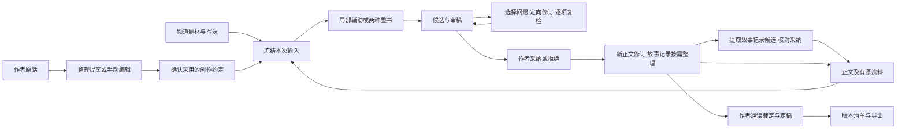

# 项目实现审阅与历史设计融入方案

日期：2026-11-13。核查基线：`bc28943fd93864f1212d44069f96e56a02facf7a`。16号设计文档在`d0a0024`加入，本轮同样纳入核查；代码基线的业务能力不因此变化。本轮按用户要求审阅当前真实代码，对照[13 产品使用场景与功能设计](13-产品使用场景与功能设计.md)、[14 需求调研](14-小说创作者痛点与需求调研.md)及历史构思，优先实现贯通作者工作的改动。

## 审阅结论与本轮决定

现有应用已经具备本机手写、版本保护、候选采纳、资料检索、预算与整书持久执行的基础。36题材与男女频已进入运行上下文；它们不能替代作者意图、人物状态、情节结构和修订交付。主要断点是作者的约定缺少统一来源、单次审稿无法直接返修、亲自写作的定稿路径被自动任务绑定，以及正文保存后缺少故事记录状态说明。

本轮在原有四个页面和相同领域服务上融入以下工作链，不把49个设计职责变成49个菜单或独立服务：

1. **想法 → 创作约定 → 后续辅助和整书。** 保留作者原话，区分情绪体验、核心追问、故事方向、终局、锁定结果、禁止项及开放细节；可手动填写，也可让模型整理为待确认提案。采用前可编辑；任务冻结已采用来源。
2. **审稿问题 → 最小局部修订 → 原问题逐项复检 → 候选比较。** 作者选择有引文的问题，复用现有patch与review，最多两轮，保留原稿、每轮改动及原问题复检；生成不会自动采纳。
3. **手写／导入稿 → 作者通读与裁定 → 当前版本定稿。** 不配置模型也能确认定稿；缺章、空稿、失效及既有批次篇幅限制仍阻断。有当前严重意见须先修复或明确有依据的作者裁定。
4. **保存正文 → 查阅当前故事记录 → 按需提取。** 写作侧栏展示按章序可用的前文陈述及原文依据，并提示本修订尚未整理或旧记录已失效；不冒称已实现真实时点状态推理。

普通 `ideation.explore` 现在仅生成供参考的advice；采用创作约定通过`intent.compile`提案或手动表单明确确认，防止普通创意采纳清空锁定项。新增两个实际动作 `intent.compile`、`revision.targeted`，运行注册由9项变11项。手动定稿是确定性操作，不增加付费模型调用。本文后续矩阵首先记录改动前基线，随后单列已融入内容，避免用计划冒充成果。

## 核查范围与证据方式

读取运行入口 [App.tsx](frontend/App.tsx)、[Writing.tsx](frontend/Writing.tsx)、[Records.tsx](frontend/Records.tsx)、[Workflow.tsx](frontend/Workflow.tsx)、[Library.tsx](frontend/Library.tsx)、模块注册、领域、Worker、API、Pydantic契约、数据库及测试；交叉核对01—14、16、行业实践及静态题材／模块审阅页。历史对话范围沿用13号文档已记录的H01—H07摘要；没有声称重新遍历所有账号和历史聊天。没有新开展市场占比、价格或付费意愿研究。

按“已实现主要链路／部分实现／缺失／创作效果未验证”分别判断。工程测试、界面可操作、模型输出和作者认可分开；静态审阅页或字段名不作为业务完成证据。

## 改动前的 U01—U13 场景核查

| 场景 | 工程状态 | 实际实现与证据 | 缺口及验证边界 |
| --- | --- | --- | --- |
| U01 空白起笔、卡点帮助 | 已实现主要链路 | `App.tsx` 无大纲建作品；`Writing.tsx` 直接编辑、保存、选区改写、卡点建议、拒绝和采纳；`Domain.save/accept/restore` 保留不可变修订和冲突校验 | 卡点建议还是模型自由文本，没有少量方向/后果的结构化选择。已有真实手写、改写、恢复记录；作者选择方向后是否更容易继续写、净收益未验证 |
| U02 情绪、钩子、方向到可写方案 | 部分实现 | 新作品有brief；`ideation.explore` 可产出并采用intent，自由文本world/characters/outline也可被后续上下文读取 | 没有三类输入的独立字段、作者原话/模型推导区分、核心取舍确认及最小人物世界包的串联入口。各模块能生成文字，但“少输入便形成可执行基线”仍靠作者搬运；整书规划主要依赖单次brief |
| U03 男女频、题材和机制装配 | 已实现工程链路；创作效果未验证 | 新 `genre_catalog.py/json` 复用36题材、28机制和男女频变体；`GenreSettings` 可选择、预览、采用；任务冻结profile并进入统一 `Worker.call`；reader来源和目录版本保护配置基线 | 此轮新增不代表72类文学质量全通过。已有作者明确要求仍须逐项优先；旧任务不追套新目录；跨配置恢复要求新批次是目前保守边界 |
| U04 作者定情节后补正文 | 已实现主要链路 | `writing.expand_plot` 读取固定条件及上下文，生成后审查并保存候选；半自动workflow接收完整章级plots，按政策采纳；固定结果/禁止项进入review | 输入只有instruction/fixed及自由写作设置，尚无显式“允许补充/不得改变”契约和场景产物。真实评测暴露篇幅及情节遗漏，正确停止不等于质量通过 |
| U05 比较打斗、描写和不同写法 | 部分实现 | 7条常用预设、自由writing_profile、选区替换、原稿差异、多个候选可切换比较 | 预设只是任务字符串，无版本化规则资产、偏好库、同一场景的成对试写入口、样本校准或应用内Skill加载。六类表达补测有篇幅未达标；文学改善待作者判断 |
| U06 人物当时所知与可用能力 | 部分实现，时点语义核心缺失 | facts有subject/kind/truth/story_time、章序和原文证据；Records支持按章序与文本筛选、回看来源；上下文区分belief/plan等 | 当前“时点”实质是章序过滤和文字匹配，不会按故事时间、事件有效区间求值。没有角色稳定ID/别名、认知取得事件、作者/角色/读者三视角、能力掌握与可用性状态卡；不能声称已经准确回答“这一刻能否施术” |
| U07 同期多线及伏笔回收 | 部分基础；结构化核心缺失 | `outline.plan` 产出文字大纲；自动Plan有章纲与ending；facts.kind可为promise，整书Completion可列承诺与引文 | 没有PlotThread、StoryEvent、EventRelation、Presentation、Foreshadow的可维护对象；没有线别、故事时间/叙述顺序映射、埋设/强化/回收生命周期、事件依赖表或泳道。静态审阅图不能视为应用已具备 |
| U08 书库到当前场景资料 | 已实现主要链路 | `LibraryPage` 可脱离作品使用；TXT/MD/EPUB导入、维基文库官方获取、正文搜索、阅读进度、UTF-16摘录和用途笔记；Writing仅发送勾选excerpt；library解析状态与coverage明确 | 官方EPUB曾失败，单页面不是全书；PDF/OCR、繁简/异体语义扩展、复杂版本编辑、书签及可重用命名资料包未完整实现。已有真实获取—搜索—摘录—选用证据，不等于资料适用性自动得到保证 |
| U09 已有长篇导入后继续 | 部分实现 | 当前 `/branches/{id}/import` 可将1MB内UTF-8 TXT/MD保存为一章，原件不覆盖；之后可编辑、审稿或提取事实 | 没有编码/章界预览、批量章节拆分、同名与重复导入映射、导入回执、反向人物/事件基线汇总。整个长篇文件会成为一个新章；若超25万字符会拒绝。不能将单文件导入称为长篇恢复闭环 |
| U10 前文修改后的后续修复 | 部分实现 | `revise_tx` 使目标及以后facts失效、后章标stale；工作流从最早失效章重新检查；旧候选/步骤有故事和正文版本守卫 | 当前为保守“全部后章”失效，不是基于依赖的精确影响分析；作者没有带证据、可选范围的影响清单或修订队列。手写/普通候选采纳后事实更新仍需独立操作，target本章stale=0并不表示故事记录已更新 |
| U11 从设定自主推进整书 | 已实现生产编排；完整业务未通过 | 自动章纲、正文、审查、最多两轮局部修订、采纳事实及检查点、暂停/取消/恢复、预算及独立版本；全文每6章审阅并分层汇总 | 一次生成完整章纲，尚非按阶段反馈滚动重排；“全文分段”不是已建模的卷/弧。新批次复制设定而不复制正文，尚无从既有长篇某卷范围接着跑的通用入口。两种36章已有真实正文，但终态待审、后章失效，不能称为整书验收通过 |
| U12 审稿到定稿交付 | 部分实现 | review有原文、理由、严重度和修法；自动返修有局部patch与复检；Completion区分生产与三层作者验收，导出固定版本并可备份恢复 | 作者侧主要显示原始JSON，没有可操作问题单、处理状态、选问题生成修订和“原问题复检”关联。Feedback当前只是复制要求。尤其纯手写/导入稿即使作者三层passed，`Domain.completion`仍硬依赖model workflow production_complete，无法走完整人工定稿路径 |
| U13 模型配置与成本控制 | 主要计量链已实现，设置体验部分 | 配置文件支持多个OpenAI Key及DeepSeek；脱敏状态、按账户模型、统一用量事件；USD共享/独立CNY、未知调用预留、明确换账户续跑、恢复不清零；旧连接测试脚本保留 | 工作台没有模型编辑及独立连接测试闭环，主要通过本地配置与CLI；连接状态configured表示填有Key，不表示连接可用。费用为配置估算，不掌握其他应用消费；模型质量与净收益未验证 |

## 改动前的 F01—F16 功能核查

| 功能 | 工程状态 | 证据与真正生效的范围 | 尚缺的核心能力 |
| --- | --- | --- | --- |
| F01 作品与章节 | 部分，基础管理已实现 | 作品/章节API，新建、重命名、排序、归档恢复、手写及新章导入 | 长篇导入预览、拆章、重复/同名映射、正式导入回执 |
| F02 创作意图 | 部分 | brief、intent文本、instruction/fixed、来源版本；任务上下文可读采用intent | 共享结构化作者契约：情绪/核心追问/方向、锁定结果、开放空间；从原话编译为可审方案、冲突与核心取舍 |
| F03 读者与题材 | 已实现运行装配；文学效果未验证 | 36题材×男女频及28机制，主辅与作者例外，装配预览、reader版本、队列快照、prompt按动作裁剪、配置基线校验 | 各题材真实原创任务的质量/收益证据；复杂组合语义冲突仍靠模型/作者判断 |
| F04 世界与社会 | 部分 | world.generate文字候选、手动采用world、题材相关主题参与生成；后续读取采用规则 | 规则/资源/制度实体和成长前提的可查结构及专门冲突视图；不应因此强迫作者填写完整百科 |
| F05 人物与状态 | 部分 | characters文本候选、knowledge/capability/resource/relationship事实、来源查阅 | 稳定人物身份、别名归并、档案/未来计划/当时状态、认知获取及能力可用条件 |
| F06 大纲多线伏笔 | 部分 | outline自由文本，Plan.chapters/ending，promise事实及全书承诺报告 | 卷/弧、事件/线别、先后因果与披露、伏笔生命周期及反向大纲；关系表本身也尚无，不只是缺图 |
| F07 章节与场景 | 部分 | Plot(number/title/plot/fixed)、作者批量情节及生成任务 | 可编辑章卡/场景卡、目标—阻力—选择—结果、视角和信息变化的共享结构；从自然语言解析后确认 |
| F08 正文局部辅助 | 已实现主要链路 | CodeMirror、保存冲突、选区重写、情节补写、候选编辑/拒绝/采纳、正文差异 | 适用样例的文学效果、真实输入法/完整无障碍等未完成验证；不应据工程通过声称全部创作质量通过 |
| F09 写法表达预设 | 部分 | 7条常用提示、自由writing_profile、恢复最近任务输入 | 有来源和版本的规则预设、样本、作品/卷/章/场景继承、作者偏好记录；本地fanren Skill不被普通API自动读取 |
| F10 审稿定向修订 | 部分 | Review.checks/findings、逐字引用校验、内部revise_chapter、自动复检 | 作者侧问题对象/类别/确定性、问题到patch到复检的关联；单次作者定向修订命令、批量问题清单、审稿误判裁定 |
| F11 故事记录影响 | 部分 | facts与来源版本、失效保留、全文精确搜索、手工更正、自动采纳事实同事务 | 事件语义、状态有效区间、身份、按实际故事时点求值、精确影响；手写后记录待更新提示及重建队列 |
| F12 资料书库 | 已实现主闭环；扩展部分 | 官方来源/本地文件、解析/索引范围、原文命中、阅读位置、摘录笔记、勾选发送 | PDF/OCR可后置；资料版本编辑、结构化研究卡、应用内样本提炼与预设校准尚缺 |
| F13 自动创作运行 | 已实现生产控制；范围规划部分 | 持久单Worker，预算/有限修订、任务SSE、暂停取消恢复、独立版本、换账户续跑 | 执行前的完整任务图预览、卷/弧范围、从既有正文指定区间继续、统一人工待决定项；不需49个独立服务 |
| F14 版本恢复 | 已实现主要保护；比较能力部分 | 正文CAS、不可变修订、候选修订、幂等回执、原稿比较恢复、账本保留及实际隔离恢复 | 全书/批次之间的成对差异、候选分组与清晰命名、面向用户的修订记录视图仍有限 |
| F15 完结导出 | 部分 | MD/TXT、完整书模型检查、当前故事版本三层评定、证据导出CLI | 手写作品人工定稿独立路径；导出前缺口清单、固定版本/范围清单、一次交付包；生产完成与正式作者定稿的独立状态 |
| F16 模型用量 | 已实现主要保护；配置工具部分 | 后端保管Key、多账户共享预算、独立币种、保守预留、失败详情、用量和模型事件 | 工作台内连接测试、按任务角色配置的多模型路由和更细可见成本/作者投入汇总；目前不需引入账号、收费、团队体系 |

## 已融入的页面、产物和相互关系

| 作者动作 | 实际入口与产物 | 下游怎样使用 | 保持的边界 |
| --- | --- | --- | --- |
| 整理想法 | 故事与审阅 → 创作约定；`intent.compile`生成带原话、字段来源的待采用intent | 提案可载入表单编辑；确认后保存新的已采用intent，记录提案来源和作者编辑／确认 | 不自动生成真相或正文，不强制填写，普通空白允许留空；最小人物世界包尚未形成一个组合任务 |
| 锁定作品方向 | 同页手动表单，或确认AI提案；`intent_contract`区分倾向、结果、禁止项和开放细节 | 写作与两种整书启动显示采用来源、提交basis；任务保存`author_contract_snapshot`；每次统一模型调用，包括修订和完结均读取快照 | 改约定不改旧稿；旧任务使用兼容空结构，原自由文本保留，不倒推新硬锁；情绪和钩子不变成每章硬检查 |
| 按原问题返修 | 写作 → 本章审稿 → 勾选有唯一引文的问题 → 生成最小修订候选 | `revision.targeted`冻结报告、正文及故事版本；最多两轮局部patch，每轮本章review与原问题逐项复检；`revision_trace`连接原问题、差异、结论及新证据 | 可选审美建议不强制；源版本变更停止调用。当前仅独立review，内嵌候选审稿和手动feedback尚需先重审保存稿；不自动采纳或重置原整书返修计数 |
| 查阅写到这里的记录 | 写作侧栏 → 故事记录；有效事实、认知／能力等陈述、章序、来源修订、逐字引文 | 直接准备`memory.extract`指令，作者可生成、核对并采纳故事记录候选 | 保存正文不宣称记忆已更新；目前按章序和最近范围，尚无真实故事时点投影、人物稳定身份或资源运算 |
| 亲自完成一本书 | 故事与审阅 → 作者定稿；`author_finalization`保存清单、裁定、故事版本及各章哈希清单 | 当前稿与记录匹配时显示`author_finalized`；后续正文、设定或目录变化使旧定稿失效，旧记录仍保留 | 不调用模型，不制造workflow，不自动把工程／文学／收益标通过；`production_complete`和`accepted`仍保持原语义 |

## 历史构思怎样落实，哪些继续排期

| 历史依据 | 合理设计取舍 | 本轮融入或后续最小任务 |
| --- | --- | --- |
| 01／03／05 架构与证据 | 模块化单体、确定性Worker、候选与正式稿分离、最小上下文；模块数不是Agent数 | 新能力复用ModuleSpec、Artifact、队列、采纳、原文patch及来源守卫；没有引入新框架或依赖 |
| 02／04 作者模块M0—M10、完整小说 | 按作者任务实现独立动作，再串联；完整包括结局和交付 | 作者定向修订与手写定稿补齐；两种36章真实作品仍待作者处理问题，不能由工具新增功能追认通过 |
| 06 创作模式／44项设置 | 分工、执行范围、采纳和模型分别设置；作者锁定优先；不做44格必填表 | 作品契约与任务指令先贯通；下步补场景约定、写法规则版本及作品→卷→章→场景继承 |
| 07 多线／事件／伏笔 | 先可维护的事件、关系和承诺表，再图；计划与已发生、故事时间与叙述位置分开 | 待补稳定ID的事件卡、线别、相对先后、披露位置和埋设／强化／回收状态；不以promise文本替代生命周期 |
| 08 人物认知／能力 | 档案、未来计划、当时状态分开；作者／人物／读者信息资格分开 | 本轮准确展示有源陈述和覆盖；下步人物ID／别名、获知事件、状态键和有效区间，再做查询投影。不能用同主体最新陈述盲目覆盖旧值 |
| 09／10／11 原著对标与写法Skill | 有来源的可选规则及原创试写；全书蒸馏非前置 | 目前7条任务预设并非版本化写法资产，项目Skill也不会自动进入普通API。后续接规则卡与样本校准，不启动全书训练 |
| 12 资料闭环 | 取得正文、索引范围、阅读、短词搜索、原文位置和主动选片段 | 主链保留；下步命名资料包与整书显式选包并冻结，当前单次`reference_ids`不会自动进入整书；PDF/OCR随实际用例扩展 |
| 13／14 场景与痛点 | 覆盖不同作者状态，以总投入和具体段落判价值 | 29项全覆盖核查，优先修三个断点；不把自用结果推广为市场比例或付费结论 |
| [16 参考仿写辅助](16-起点小说参考仿写辅助设计.md) | 选材料和学习目标→有依据拆解→选写法→本书应用→试写比较→偏好 | 仍为设计，未把普通勾选摘录冒称参考拆解。与后续规则卡、资料包及本书方案共用引用，不另建作品或复制外书事件 |
| 行业实践 | 创作说明、计划／反向大纲、连续性记录、未了事项、修订清单；先结构再润色 | 创作约定、修订追踪和作者定稿已落地；不将14阶段变为强制向导，也不规定所有支线必须封口 |

普通正文采纳不等于已更新故事事实；单次辅助后可按需提取并采纳，整书执行通过正文与事实同事务采纳推进。

历史两套模块编号必须区分：作者模块M0—M10是作者任务分组；静态细模块为M01—M24、T01—T12、Q01—Q06、S01—S07，共49项责任。运行时11个动作与Worker内部步骤承载其中部分职责：世界／人物／大纲的自由文本生成不能宣称完成全部实体管理；题材T专项目前主要是提示级覆盖；Q合并审稿不能称为5个独立审查员。真实应用合并为4页合理，9个概念入口不要求9个页面。

## 下一批最小实施任务与出口

这些属于本轮审阅后保留的明确缺口，不标为已经完成，也不全部延后到百章扩展阶段。

| 优先级 | 最小任务与相互关系 | 可审阅的验收出口 |
| --- | --- | --- |
| 下一批1 | 卡点方向变成带ID的场景计划，区分保存建议／采用方向／采纳正文 | 选方向B后直接补写，后续引用B；拒绝正文不更新事实；不再只是把advice标accepted |
| 下一批1 | 自然语言情节→固定事件／结果／禁止项／可补细节→确认→补写，与卡点计划共用场景约定 | 固定“交易失败、不战斗”逐项覆盖；普通新增细节可解释，新增关键资源或证据另列提案，不静默改变结果 |
| 下一批1 | 作者契约→最小人物世界／粗纲包→开头的组合动作，复用采用资料 | 只给三句话便得到可解释的可写方案；已有角色不反复重造；普通名字不逐项问作者 |
| 下一批1 | 当前任务恢复卡与有源反馈修订入口 | 刷新后直接看原任务、待审候选、停止原因和下一步；未知超时仍不自动重发；手动反馈分类和源引文可直接形成定向任务 |
| 下一批2 | 长篇导入章界／编码预览、重复与同名映射、导入回执，再小范围反向整理 | 多章原稿分别保存；作者确认范围后提取角色／事件候选，不把推测当事实；失败范围可回查 |
| 下一批2 | 人物身份、事件／承诺表与必要状态投影 | “未收到信、尚未学会、法器损坏、同事件多视角”四组查询有原文依据且不重复算资源；前文删除能定位失效回收 |
| 下一批2 | 版本化写法卡、参考拆解与本书应用、命名资料包 | 一段允许使用的参考材料可回源、选择可迁移机制并用于原创场景；单次与整书都明确冻结选用范围 |
| 后续扩展 | 真实卷／弧范围、滚动规划、精准影响队列、模型设置与连接测试 | 指定既有卷继续运行、实际卷末检查，来源和费用可复核，再扩大百章与题材专项验证 |

无需为这些任务引入账号收费、团队协作、平台运营、图数据库或49个独立服务。市场设想保持待验证，正式业务规则只记录本次明确选择的实际行为。

## 验收记录

工程与实际创作分别记录。核查与实现对应的定向测试覆盖作者原话／AI推导、冻结来源、旧请求幂等、来源变化、选问题patch和逐项复检、两轮封顶、手写独立定稿及改稿失效；原稿保存、账本与恢复保持原有回归。

本轮最终运行命令、检查数量、界面证据、是否真实调用及费用增量在[本轮验收记录](docs/acceptance/历史设计融入验收记录.md)记录。没有正式作者通读或投入对照的项目继续标未验证；原半自动18章／全自动15章的四份A/B候选及原稿仍由作者决定，不能因本次新增功能而自动采用。
