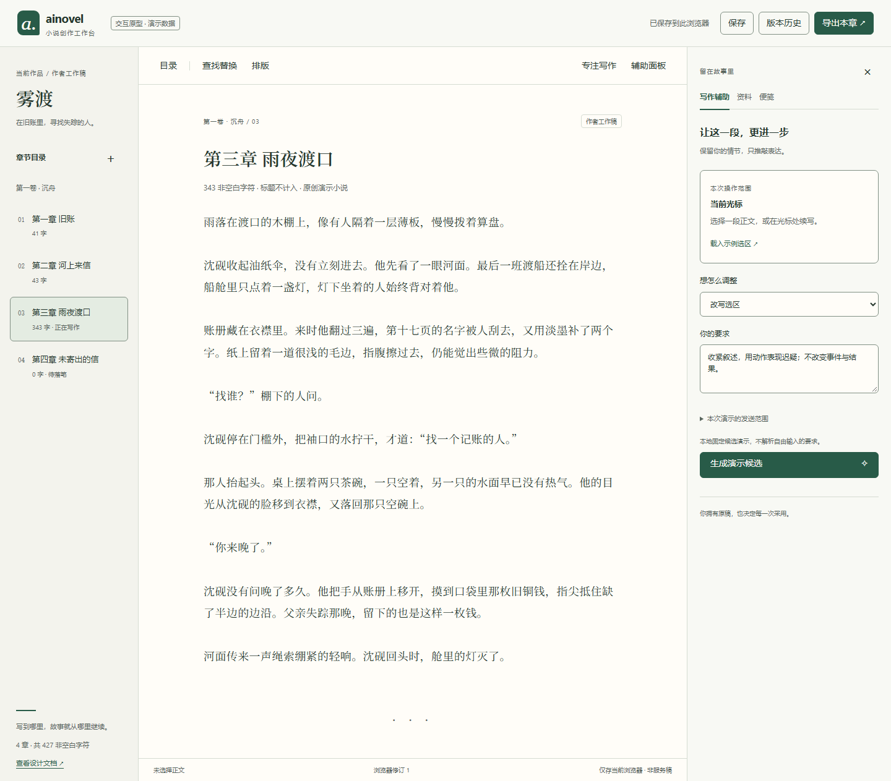

# 小说编辑器调研与设计

日期：2026-11-15。状态：**设计提案与可交互原型，尚未接入正式工作台**。

交付：[交互原型](novel-editor-prototype.html) · [验证记录](docs/acceptance/编辑器原型验收记录.md)。可直接用浏览器打开原型 HTML，无需账户、模型和后端。

本机预览：在 Node.js 24 环境运行 `node scripts/preview-editor-prototype.mjs`，打开 [原型预览](http://127.0.0.1:8895/novel-editor-prototype.html)。服务仅提供本次原型资源；用 Ctrl+C 停止。直接打开 HTML 的存储能力取决于浏览器策略，受限时可通过本机预览使用。

## 1. 结论与范围

建议在现有 CodeMirror 6 上改进小说写作体验：**章节目录在左、正文居中、资料与辅助按需在右展开，保存和恢复始终可达**。优先贯通手写、查阅、局部辅助、比较采纳与继续写作，再扩展复杂批量能力。

本次“编辑器”指 ainovel 的中文小说正文工作区，同时调研终端写作产品和底层编辑框架。研究以公开官方文档和本仓库实现为依据，未购买或逐一实装竞品；文档所述能力不代表实测稳定性、中文输入体验或文学效果。未列出的能力表示本轮没有充分核实，不表示产品不支持。

已有业务要求来自 [业务规范](BUSINESS_RULES.md)：作者拥有原稿和最终采纳权；正文优先；无需先建大纲才能手写；保存成功才显示已保存；候选先预览；取消和切章后的旧结果不能改动新目标；资料发送范围明确。本文件提出的优先级、布局和新增功能仍是方案，不自动升级为业务规则。

本次不改生产编辑器，不迁移稿件或存储，不调用付费模型。原型使用原创演示小说《雾渡》，本地脚本生成固定候选；保存仅指当前浏览器的原型存储，不能替代项目服务保存和独立备份。

## 2. 研究证据与取舍

以下均于 2026-11-15 检索。产品页面是滚动文档；旧帮助文档仅用于确认交互机制，不据此断言当前所有客户端完全相同。

| 对象 | 官方证据确认的功能 | 对本项目的启发 | 本轮不直接照搬 |
| --- | --- | --- | --- |
| Scrivener | 分段组织长稿、目录重组、资料与正文并排；快照命名与版本比较。[概览](https://www.literatureandlatte.com/scrivener/overview)、[快照](https://www.literatureandlatte.com/blog/use-snapshots-in-scrivener-to-save-versions-of-your-projects) | 章节是写作单元，资料近旁查阅；重要替换前可恢复，历史说明修改原因 | 完整出版排版、编译模板及多种文档视图不放进首屏 |
| Ulysses | 可隐藏界面，调整字体、固定滚动与高亮；目标覆盖单篇、分组与项目，支持多种计数口径。[编辑设置](https://help.ulysses.app/en_US/getting-started/details-and-tips)、[目标](https://help.ulysses.app/en_US/goals) | 专注模式和阅读排版；字数口径可见，选区与全章统计分开 | 不直接用英语词数评估中文产出；不把目标完成当作小说质量通过 |
| 橙瓜码字 | 官方引导列有章节目录、查找替换、排版、灵感记录、历史及同步状态；大纲可在侧栏查阅。[移动引导](https://news.chenggua.com/detail/11043.html)、[大纲升级说明（2021）](https://news.chenggua.com/detail/32784.html)、[答疑](https://mz.chenggua.com/question.html) | 中文网文需要低成本处理章名、目录、段落与备忘；本地保存和云端同步的状态要分清 | 拼字、榜单、强制锁定和稿费预测无本项目明确需求；历史文档的容量、同步频率不作为参数依据 |
| Obsidian | Markdown 阅读与编辑视图，以及控制语法显示的编辑模式。[视图与编辑模式](https://help.obsidian.md/edit-and-read) | 正文存储与阅读呈现可以分开；作者写作时不必被语法和工具占满 | 不把双链、图谱或插件安装变成写小说的前提 |
| Sudowrite | 选区改写、扩写、描写、自动／指定方向续写，结果在侧栏出现；Story Bible 汇集故事资料。[功能](https://docs.sudowrite.com/getting-started/dQph1snuwbfMWG9wRjsNug/features/dq7YUMNy5ZMvKUJiRAisyT)、[Rewrite](https://docs.sudowrite.com/using-sudowrite/1ow1qkGqof9rtcyGnrWUBS/rewrite/9hkeezeUsCiUCG4dRdEqjS)、[Story Bible](https://docs.sudowrite.com/using-sudowrite/1ow1qkGqof9rtcyGnrWUBS/what-is-story-bible/jmWepHcQdJetNrE991fjJC) | 常用辅助围绕明确动作与选区；输出独立于原稿，由作者决定是否替换 | 不把“改写”理解为授权改情节；不默认生成多候选增加费用 |
| Novelcrafter | Codex 存人物、地点、物品；可主动给场景附加条目，并预览提示词中的上下文。[Codex](https://www.novelcrafter.com/help/docs/codex/the-codex)、[场景上下文](https://www.novelcrafter.com/courses/codex-cookbook/codex-scenes) | 查阅资料与发送资料是两种动作；发送前展示实际来源 | 不把静态人物简介当成任意故事时点的真实状态；不无限塞入全部设定 |

证据冲突：Sudowrite 的 Rewrite 页面同时存在“短选区会读取 Synopsis”和“不读取 Story Bible 或其他上下文”的表述。本设计只借鉴选区入口及结果对照，不依据该页断言其上下文策略。ainovel 的发送范围须按自身实际请求生成。

归纳属于本次设计判断：成熟写作工具的价值不在功能数量，而在于正文组织、资料可达和可恢复编辑；AI 工具额外需要清晰的目标范围、上下文和采纳边界。以上不是竞品评分或用户统计结论。

## 3. 仓库现状与具体缺口

核对源码：[Editor.tsx](frontend/Editor.tsx)、[Writing.tsx](frontend/Writing.tsx)、[drafts.ts](frontend/drafts.ts)、[leaveGuard.ts](frontend/leaveGuard.ts)、[style.css](frontend/style.css)。基线提交为 `853d62d`。本表属于实现阅读结论，未在本次重新验收生产链路。

| 范围 | 已有实现 | 本次建议 |
| --- | --- | --- |
| 编辑内核 | CodeMirror 6；Markdown、折行、撤销／重做、行号、选区回调 | 保留内核；常规写作默认隐藏行号，将语法、行号变为可选设置 |
| 正文与目录 | 章名编辑、新建切章、上下移、归档恢复、字符数 | 精简首屏，目录显示状态和长度；整理操作收在明确入口 |
| 保存 | 约 900ms 防抖保存、浏览器草稿、修订校验、离开保护 | 沿用服务真值；保存状态可点击重试，冲突提供差异入口 |
| 辅助与候选 | 选区／补写表单、任务、差异对照、拒绝、采纳、候选编辑 | 把当前目标与动作放近选区，生成表单渐进展开；减少常驻说明 |
| 历史 | 读取版本、显示原文、恢复为新修订 | 增加可读的时间／原因／范围展示，比较后再恢复 |
| 查找替换 | 编辑内核并不自动等于有完整产品入口；现有 Editor 未挂载查找扩展 | 提供显式入口，先实现本章字面查找和有计数的替换；跨章另行预览 |
| 查阅与笔记 | 有书库、上下文与继续写作便笺；多个功能在工作台分散呈现 | 右栏按需查阅，返回正文保留位置；便笺与小说事实分开 |
| 字体与布局 | 已有中文排版及缩放规则 | 用户可调正文大小、行距；专注模式保留保存状态和退出入口 |

历史方案 [13号文档 F08/F14](13-产品使用场景与功能设计.md) 已定义“手写→选区辅助→对照采纳→继续写”的方向；本次细化编辑器，不重建一套作品、版本和模型账户系统。

## 4. 作者任务与功能分期

### 4.1 主要路径

1. **直接写**：打开作品与章 → 光标回到上次位置 → 写作 → 自动保存。没有人物卡、大纲或模型也能开始。
2. **卡在一段**：选择正文 → 选择改写／扩写 → 写要求 → 核对发送范围 → 生成 → 比较 → 采用或保留原文 → 回到原位置。
3. **知道情节但不想逐字写**：切换到“按情节补写” → 输入事件、结果和禁止项 → 显示插入位置 → 候选预览 → 作者采用。
4. **需要资料**：打开人物／资料 → 看来源及适用时点 → 返回正文；只有显式选入的外部资料进入请求。
5. **写错或改坏**：撤销最近编辑，或打开版本历史 → 比较当前稿与旧稿 → 恢复为新修订 → 可再次回到恢复前版本。
6. **全自动任务有待审章**：从整书创作进入该候选 → 比较、核对和处理；不在正文工具栏另建一个含义不同的“一键全书生成”。

### 4.2 完整功能目录

P0 表示下一步产品验证建议；“沿用”仍需回归，不表示重做。P1/P2 是待反馈确认的后续候选。

| 编号 | 功能 | 具体行为／范围 | 建议阶段 | 原型覆盖 |
| --- | --- | --- | --- | --- |
| E01 | 正文编辑 | 中文输入、粘贴、段落、撤销／重做、选区、长文滚动 | P0 沿用 | 原生文本编辑；内核撤销体验另验 |
| E02 | 章节与目录 | 新建、切章、标题、排序、归档恢复；可选卷不强制 | P0 沿用 | 新建、切章、标题；其余沿用现有产品 |
| E03 | 保存与恢复 | 未保存／保存中／已保存／失败；草稿与正式保存分开 | P0 沿用 | 浏览器保存、失败重试、刷新恢复 |
| E04 | 本章查找替换 | 字面匹配、上／下一个、选区定位、替换一个／全部、命中数 | P0 新入口 | 可操作；仅当前章 |
| E05 | 专注与排版 | 收起两栏、可退出、字号行距和浅／深色；不改正文 | P0 | 可操作 |
| E06 | 阅读统计 | 本章和选区的非空白字符；不计标题，不称平台字数 | P0 | 实时统计 |
| E07 | 局部辅助 | 改写、扩写、续写；范围与应用方式绑定 | P0 整理 | 固定演示候选与预览 |
| E08 | 按情节补写 | 事件、结果、禁止项；插入位置明确 | P0 沿用 | 设计定义，未模拟完整表单 |
| E09 | 候选比较 | 当前原文与建议分别显示；采用、放弃、基线失效 | P0 沿用 | 可采用、放弃；旧稿拦截 |
| E10 | 历史版本 | 版本、原因、正文；恢复新增修订，原稿保留 | P0 整理 | 可比较及恢复 |
| E11 | 资料与发送范围 | 人物、章节资料、引用出处；查看不等于发送 | P0 整理 | 演示资料及勾选范围 |
| E12 | 写作便笺 | 记录卡点和下一步，按章保存；不自动成为事实 | P0 | 可编辑并刷新保留 |
| E13 | 导出 | 当前章／选定版本 TXT、Markdown，顺序和正文一致 | P0 沿用 | 当前章 TXT 下载 |
| E14 | 格式整理 | 段首缩进、空行、中英文标点；预览差异再应用 | P1 | 文档定义，未提供按钮 |
| E15 | 审稿定位 | 报告问题定位到确切修订与选区，展示证据和过期状态 | P1 沿用扩展 | 文档定义 |
| E16 | 词语扫描 | 可选重复词、口头禅、称谓及自定义词；逐项忽略或处理 | P1 | 文档定义；参见18号设计 |
| E17 | 本章提纲 | 作者可看／改章纲，区分未来计划与实际正文 | P1 | 资料页只读演示 |
| E18 | 改稿影响 | 前文改变时提示后文资料／报告过期，回到来源复核 | P1 沿用扩展 | 候选基线变化为最小示例 |
| E19 | 跨章检索替换 | 先展示匹配章、修订和影响；逐章或批量确认，失败可追踪 | P1 待确认 | 未实现 |
| E20 | 目标和写作记录 | 自设每日目标，标清新增净字数／修改量；可关闭 | P1 待确认 | 未实现；不显示虚构日更数据 |
| E21 | 多窗口与并排阅读 | 正文和旧章／资料并排；相同稿件写入冲突受保护 | P1 | 原型多窗口变更锁定，不能自动合并 |
| E22 | 批注及锚点 | 作者批注绑定修订和段落；变更后重定位或失效 | P2 待需求 | 未实现 |
| E23 | 实时协作与富排版 | 多人光标、评论、图片表格、出版分页 | P2 待需求 | 未实现；没有依据先更换内核 |

## 5. 信息架构与视觉设计



更多状态：[候选对照](docs/acceptance/editor-prototype/candidate.png) · [320px 窄屏](docs/acceptance/editor-prototype/mobile.png)。截图仅展示原型，不代表生产工作台已变更。

### 5.1 桌面布局

```text
作品 / 当前写作版本             原型标识       保存 · 历史 · 导出
┌────────────┬──────────────────────────┬──────────────────┐
│ 章节目录    │ 查找 · 排版 · 专注         │ 写作辅助 / 资料 / 便笺 │
│ 卷与章节    │                          │ 当前目标、要求       │
│ 当前章状态  │ 章名                     │ 发送范围            │
│ 新建章节    │                          │ 生成 → 独立候选     │
│            │ 宽度受控的中文正文         │ 原文 / 建议 / 采用  │
│ 写作提示    │                          │                    │
└────────────┴──────────────────────────┴──────────────────┘
                  字符统计 · 当前范围       本地保存位置说明
```

目录建议约 224px，辅助栏约 320px；正文阅读列建议 38—44 个汉字，宽度随用户字号调整，不以挤满剩余空间为目标。辅助栏关闭时正文保持舒适行宽。原型为便于审阅默认打开辅助栏；正式产品建议记住作者上次状态，首次打开可收起。

首屏常驻：作品、章名、正文、保存状态、目录开关、辅助开关；查找、历史、导出与排版有明确文字入口。模型账户、预算明细、提示词模板、全部扫描维度和高级参数按需展开。

配色延续项目绿色强调色与低饱和纸色：正文 `#26382f`，次要文字 `#59665e`，主强调 `#285b48`，纸面 `#fffdf8`，控件边界 `#819084`。状态通过文字和符号共同表达。正文默认 18px、1.95 行高；界面以 14—16px 为主，中文宋体仅用于稿件及章名。没有阅读字体网络请求。

### 5.2 窄屏与放大

- 1100px 以下辅助栏切为独立工作区；打开辅助时正文暂隐藏，回到正文恢复位置，避免两栏挤成细条。
- 760px 以下目录也切为独立工作区。任何时刻都有“返回正文”入口；目录、辅助与正文顺序切换，不要求横向滚动。
- 320 CSS px 下工具栏换行，候选比较纵向堆叠；章名和连续字符可断行。弹窗限制在视口内并纵向滚动。
- 专注模式隐藏两栏，保留“退出专注”、保存和主操作。文本放大 200% 后不截断控件；功能性弹窗以原生 dialog 管理焦点。

### 5.3 功能入口细节

| 位置 | 内容 | 显示时机 |
| --- | --- | --- |
| 顶部 | 保存状态及保存、版本历史、导出 | 持续可达；失败时增加持续提示 |
| 正文工具栏 | 目录、查找替换、排版、专注、辅助开关 | 始终可见，窄屏换行 |
| 选区附近 | 改写、扩写、说明选中长度 | 正式产品建议浮动工具条；键盘及辅助栏始终有等价入口 |
| 辅助栏 | 当前章／选区、动作、要求、发送范围 | 用户打开时显示，不自动把整书发送给模型 |
| 候选区 | 原文、建议、基线、采用、放弃、生成中取消 | 与当前任务绑定；不抢正文焦点 |
| 版本历史 | 时间、原因、比较、恢复为新修订 | 用户打开时显示；恢复前解释影响 |

原型为了可发现性，使用固定的“载入示例选区”按钮演示选区路径；正式产品不保留此按钮。

## 6. 关键交互契约

### 6.1 编辑、保存、切章

正式实现继续沿用服务端 revision 与浏览器草稿：输入先更新编辑状态和恢复草稿，防抖提交；同一章写入串行，结果绑定目标和提交快照。作者继续输入时，旧响应不能把新输入标为已保存。中文 composition 未结束时不触发快捷提交或重建编辑实例。

| 状态 | 可见反馈 | 允许动作 |
| --- | --- | --- |
| 未保存 | “未保存” | 继续写、手动保存 |
| 保存中 | “保存中…” | 可继续输入；旧提交完成不清除新脏状态 |
| 已保存 | 实际位置及成功时间 | 正常切章、导出 |
| 保存失败 | 持续提示原因与内容仍在本窗口 | 重试、下载当前稿；失败时切章须保护草稿 |
| 多窗口冲突 | 原稿／本地稿范围与差异入口 | 保留两稿后显式合并；不按最后时间自动覆盖 |

原型用单份带格式版本的 localStorage 快照保存演示数据，采用 Web Locks 串行化原型写入并比较存储代次；其他窗口写入后立即停止本窗口保存，保留当前稿以便下载。无法获得该锁的浏览器只提供当前窗口编辑和下载，明确显示未保存。原型不实现正式服务冲突合并，不声称具有磁盘持久性或独立备份保障。

### 6.2 查找替换

默认本章、字面匹配、区分大小写，不启用正则；开始查找不修改正文。展示当前命中和总数，下一处可循环。替换当前一处后更新计数；“全部替换”明示当前章和数量，由用户确认后一次应用，保存恢复前版本。查找窗口关闭后焦点回正文并保留命中选区。

正式实现的替换应使用 CodeMirror 单个 transaction，使其可通过一次撤销返回；跨章替换另行设计，不复用“本章全部”按钮。

### 6.3 AI 辅助与上下文

生成冻结：作品／工作版本／章节、保存修订、正文快照、选区 UTF-16 起止、原文校验、指令、已采用约定、主动勾选资料和账户预算。展示的发送范围必须由这份真实快照生成，不用固定文案代替实际发送。

原型范围：改写和扩写要求非空选区；续写定位到光标，有选区时在选区末尾插入；用户可查看演示发送清单，人物卡和章纲的开关只影响演示范围说明，生成后的候选保留生成时范围与要求。原型不向外部模型发出请求，固定候选不解释用户自由输入的要求，生成按钮旁明确提示这一限制。

| 情况 | 预期行为 |
| --- | --- |
| 未选区点击改写／扩写 | 显示“先选一段正文”，保留要求；不得偷偷改成全章 |
| 生成中 | 显示目标与处理状态，禁用重复生成；可取消；正文仍可编辑 |
| 生成失败 | 输入和目标仍在，可重试；原稿不变 |
| 取消或切章 | 清除活动请求的应用资格；晚到结果不能改变当前章 |
| 候选就绪 | 原文和建议分开；“采用并替换选区”或“在光标处插入”明确区分 |
| 作者修改原稿／标题／恢复版本 | 候选标为基线变化，不能继续直接采用；需重新发起或人工比较 |
| 采用 | 再次验证完整目标和基线；保留采用前稿，原子更新正文和采纳回执；回到正文 |
| 修改候选 | 正式产品保留编辑前候选和检查，原检查失效；原型未提供候选编辑 |

“故事资料已读”“条目被引用”不代表事实正确或人物知晓；当前故事时点的状态查询继续走已有业务能力。内容扫描、模型审查和作者文学判断分开表达。

### 6.4 历史恢复与导出

历史按章节稳定 ID 归属。比较先显示当前稿与所选历史全文；恢复生成新修订，不删除被替换稿。恢复按钮说明章节与版本。原型每次成功内容保存产生一个演示修订，历史随存储容量增长；不自动裁剪，容量失败时保留本窗口内容并提供下载。正式产品的保留与清理策略仍待业务确定。

导出使用明确作品版本和章节清单；原型仅下载当前章 TXT，包含章名与当前输入，另以“原型写作便笺 · 非正文”单列非空便笺，未保存时也能作为救援副本。正式投稿导出须提供是否包含便笺的明确选项，不能混入稿件。导出后浏览器接收下载不等于已核对磁盘文件，更不等于发表。

### 6.5 键盘和可访问操作

- 浏览器原生文本选择、复制粘贴与撤销保持；不占用 Ctrl+F 等常用浏览器操作。
- 新增 Ctrl/Cmd+S 保存、Ctrl/Cmd+Shift+F 查找、Ctrl/Cmd+Shift+Enter 切换专注，排版弹窗提供说明。组合输入中不执行这些快捷动作。
- 弹窗有标题、关闭按钮和 Escape；关闭后返回触发入口。原型使用原生 dialog，历史恢复后回到正文。
- 工具、目录和分区切换使用按钮；当前章使用 aria-current；状态使用 status，持续错误使用 alert；焦点外框清晰可见。
- 中文真实输入法、屏幕阅读器及完整 WCAG 符合性仍需在实际设备检查，自动化组合事件不能代替真实输入法验证。

## 7. 编辑内核与接入方案

### 7.1 内核比较

| 方案 | 官方说明 | 与当前项目的匹配 | 建议 |
| --- | --- | --- | --- |
| CodeMirror 6 | 文档、选区与变更通过状态和 transaction 管理；位置按 UTF-16 单元。[指南](https://codemirror.net/docs/guide/)、[变更示例](https://codemirror.net/examples/change/) | 仓库已使用 state/view/commands/markdown/merge，纯正文与差异能力可复用 | 继续使用，补查找入口及阅读主题；先做体验验证 |
| Tiptap / ProseMirror | Headless 富文本、扩展和 schema；开源与付费能力边界分别列出。[官方介绍](https://tiptap.dev/docs/editor/getting-started/overview) | 适合块结构、图片表格和丰富文档操作；当前正文模型迁移及锚点兼容需新增工作 | 只有确认富文本需求后再做原型比较；不默认迁移 |
| Lexical | 编辑状态、节点、选区、命令及可选扩展，提供 React 集成。[官方介绍](https://lexical.dev/docs/intro) | 可搭自定义富文本编辑器，但编辑、序列化和版本兼容均需接入验证 | 作为后续候选，不因框架名称更换现有能力 |
| 原生 textarea | 浏览器原生文本控件 | 无构建可打开，适合验证布局、流程和错误状态；缺少内核级装饰与变更映射 | 仅用于本次独立原型，不替换生产编辑器 |

CodeMirror 官网首页本轮直接抓取返回 403；系统指南及变更示例可通过官方检索结果核对。没有据此推断具体版本的性能或中文兼容性。上述产品比较未新增、升级或下载依赖。

### 7.2 组件与状态边界

建议在已有 Writing 协调层逐步拆出：`ChapterNavigator`（目录）、`ManuscriptToolbar`（动作）、`Editor`（文档与选区）、`WritingInspector`（辅助／资料／便笺）、`CandidateReview`（比较与采纳）、`RevisionHistory`（历史）、`EditorPreferences`（显示偏好）。名称仅用于说明职责，不要求本次提前创建生产组件。

复用现有 API 和领域对象：chapter.id、branch.id、revision、artifact.candidate_revision；不以章名、章序或当前面板作为采纳目标。保存／恢复／采纳仍由服务端比较版本，前端禁用按钮不能代替服务校验。

选区处理统一为 UTF-16 的 `[start,end)`；显示字符数可以按 Unicode 码点排除空白，两种计数不能混用。章内 emoji、增删行、CRLF 导入归一化及候选过期是正式接入的必要样例。CodeMirror selection/update 回调保持增量事务，不在每次键入后重建实例。

### 7.3 推荐实施顺序

1. **布局与阅读**：复用现有 Editor/保存链路，仅整理工具栏、左右栏和字号设置；验证长中文、200% 放大和窄屏。
2. **查找与目录**：挂载明确的 CodeMirror 查找能力；本章替换保持单事务和撤销；原有目录整理继续可达。
3. **候选与资料**：统一展示实际发送快照，固化选区、目标与基线；调整候选比较空间，不改变作者采纳契约。
4. **历史与恢复**：用现有历史 API 补充时间、原因和比较；重跑保存失败、切章、旧响应与并发冲突用例。
5. **真实使用反馈**：以两次有明确目标的写作／改稿会话记录操作步骤、误触、查阅往返和主观感受，再决定扫描、批注、跨章替换和每日目标。

性能验证建议样本：3千字、3万字单章与500章目录；记录首次可写、连续输入、检索替换和峰值内存，并与现有工作台比较。这些是待执行的样本建议，不是已取得的性能结论，也不是强制限制。

## 8. 原型操作脚本与验收

| 编号 | 操作 | 应观察到的结果 |
| --- | --- | --- |
| A01 | 编辑正文，等待保存，刷新 | 浏览器保存成功后可恢复；标题、便笺归属正确 |
| A02 | 新建章节，写作后切回第三章 | 新章独立，原章保持；空章仍可输入 |
| A03 | 查“雨”，替换一处或确认替换全部 | 展示真实命中数，只改当前章；历史保留修改前稿 |
| A04 | 载入示例选区→改写→生成 | 显示演示发送范围和原文／建议；生成不改正文 |
| A05 | 采用候选，打开历史 | 正文改变；采用前版本可比较、可恢复为新修订 |
| A06 | 候选就绪后修改正文 | 提示基线变化，采用按钮禁用 |
| A07 | 生成中取消或切章 | 当前正文不变，旧结果不能套入另一章 |
| A08 | 排版中选择“下一次生成失败”后生成 | 明确失败，可重试；要求与原稿保留 |
| A09 | 排版中选择“模拟保存失败”，编辑后保存 | 持续失败提示；可下载当前稿，恢复正常后重试 |
| A10 | 两个窗口打开同一原型，一边保存 | 另一窗口锁定保存，保留当前稿，不能静默覆盖 |
| A11 | 切换资料开关、便笺、专注及字号 | 范围说明和阅读布局变化，不改正文 |
| A12 | 键盘打开／关闭弹窗；320／768／1440 宽度及200%文字 | 可返回、焦点可见、无页面横向溢出、控件可操作 |
| A13 | 下载当前章 TXT | 文件名、标题、正文与当前稿一致，未调用网络 |
| A14 | 浏览器拒绝存储／存储结构损坏 | 不显示已保存、不覆盖损坏存储；保留当前窗口并可下载 |

实际结果与未验证项单列于[验收记录](docs/acceptance/编辑器原型验收记录.md)，不把原型通过写成正式编辑器或文学质量验收通过。

## 9. 待作者反馈的设计决定

- 章纲、资料和便笺谁更常用，是否值得默认展开；原型默认展示辅助仅用于评审。
- 是否需要富文本内容；目前建议保留正文／Markdown，出版样式走导出。
- 是否确有跨章替换、段落批注、每日目标和多人协作需要；不因竞品存在就排进首版。
- 历史保存周期、自动快照频率与容量清理政策，继续按真实稿件规模确定。

本次原型足以评审布局、路径与保护提示；真实输入手感、长篇性能、模型生成质量和服务端持久化需要在正式接入后分别验证。
