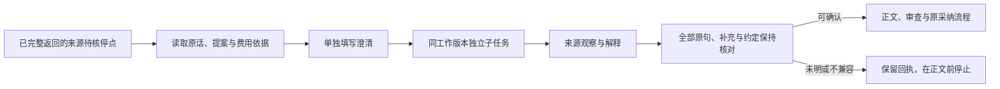

# 半自动作者来源澄清与同版本续接

日期：2026-11-16。接续[作者来源范围及参考首次复检](2026-11-16-authored-source-scope.md)。本轮将正文前的来源待核停点接回实际创作任务；工程验证与模型质量、作者文学判断分别记录。

## 作者入口和流程

入口为“整书创作 → 任务与检查点 → 补充作者情节来源，保留原话与费用”。适用于开启情节核对的新半自动任务：来源步骤已完整返回，但角色回指或范围仍待确认，尚无正文候选。原话仍待核对不代表作者写错，范围明确的称谓无需补姓名。

1. 读取正式依据，查看原作者情节、已有补充、来源提案、当前章位、原账户及剩余额度。
2. 单独填写澄清，可保留可空的审计原因。原情节、完整计划和采纳政策保持；真正改变方向另建批次。
3. 明确点击“创建并开始”，同一工作版本创建独立子任务，父任务只追加续接关系和审计。
4. 子任务先独立观察／解释组合来源，再逐项核对全部原句、补充、固定条件和采用创作约定。
5. 来源及保持均可确认后，按原策略进入正文、审查、候选及维护；未知或违背仍停在正文前。

界面不提供原plots、章数、账户或额度覆盖字段。补充来源区分作者与授权操作者，原因仅用于审计；补充不代表文学认可。没有完整来源回执、未知派发、格式失败、已有候选或后章已开始的停点不适用此入口。过去未冻结来源政策的任务不自动升级。

## 稳定性与数据关系

预览绑定原任务、完整工作版本正文修订／哈希、故事与配置、原来源、完整计划、政策和费用。正式提交在写入前再次核对，源资料或其他窗口变更时返回冲突，输入保留。

发送前在本窗口保存原请求和稳定标识。提交结果未知或成功回执不符合原请求时，只查询原标识；404／null不作为重新发送依据。明确拒绝后，保留草稿，重新读取并显式确认新依据后才可新提交。晚预览和晚POST按目标、请求序号过滤；中文组合输入不触发提交。

子任务不改旧正文、计划、修订轮次、旧失败或来源解释。名义剩余额度与辅助调用的有效余额分别核对，沿用原共享币种账本和未知预留，不重复扣祖先。原生未知调用仍禁止换账户重发。

独立审查确认并修复一处账户兼容问题：最初澄清子任务须保持原配置，但该限制曾误套到所有后代。现在已知来源及保持完成后，既有正式续跑可明确选择配置账户；通过真实提交登记、创建事件和续接链核实，旧来源／保持结果和费用不重做。未知保持仍在创建换账户子任务前阻止。

## 当前验证证据

| 范围 | 实际结果 |
| --- | --- |
| 后端私有受影响组合 | 238通过，191.65秒；203输入保持，对应该轮冻结源码 |
| 后端最终窄修后 | 36原生专项通过，41.82秒，包含账户切换修复及负例 |
| 最终独立审查 | 精确11路径／6生产字节匹配，39通过，37.62秒；206输入保持 |
| 根工作区受影响组合 | 363通过，140.56秒；205个Python输入保持 |
| 根前端 | 551单测通过；类型检查通过 |
| 界面独立无头 | 36通过，其中6新用例与30个仅端口适配的既有用例；原始差异和旧日志保留 |
| 最终后端下的正式API界面链 | 新副本1条通过，594输入保持；未知POST后只查原nonce，原稿、步骤、产物及既有费用行保持 |
| 根完整后端及全项目无头 | 2374后端通过，826.34秒；125全项目无头通过，6.8m，包含正式API查询链；单worker、零重试 |

独立审查报告SHA256为`f181619917b053dc2efb42f738c2cf4f2bf4b0b30a206004f70c2bcce8a82e0a`；两账户误挡的修前探针、修后回归，以及审查自身的错误断言日志均保留。私有测试环境的旧editable路径错误已通过显式PYTHONPATH修正，不是生产功能通过的证据。

桌面、320宽、实际文字2倍、键盘、焦点、组合输入、409、刷新恢复和晚响应均有专项。旧整页长图会被预览工具大幅缩小，补充可读截面后单独检查，不以缩略图宣称已看清全部中文。对比度及控件尺寸的局部测量不宣称完整WCAG认证。

## 质量及剩余出口

保持核对依赖模型语义判断，并不构成自然语言或文学正确性的证明。本轮尚无真实既有小说的澄清、正式稿件采纳或付费调用，日常实例尚未更新。

完成当前稳定性和发布验证后，继续真实长篇、跨卷、半自动及全自动整书任务。旧两部36章、18／15章候选、原报告及累计预算保留；作者尚未评价的文学质量和总投入收益不标通过。

## 提交标识查询及原生设施补验

接受的原标识可能包含斜杠、中文、问号、换行或百分号字面量。原路径GET的slash案例正式复现为3通过／1失败；标准path尝试仍有换行回归，全字符路径尝试另有percent别名问题（4通过／4失败）。percent现象仅是在该TestClient／ASGI链的实证，不推广为所有HTTP栈都会双解码。最终保留旧GET，新加标准query GET，工作台用URLSearchParams传递原值；不改POST或原标识，不把404／null当重发许可。

11项query正反例及旧主线通过，原业务及费用行保持。新的项目内正式API无头用例实跑query：POST202已创建后丢响应，刷新后同一标识经历404、null和实际GET恢复，只1POST和3GET，最后仍是同一queued子任务；逐行核对chapters、task_steps、artifacts和usage.calls费用表。没有后台Worker，后续正文完整生产另由36项后端原生及独立candidate_recheck验证，二者范围分开报告。

原生用例采用动态预留回环socket、独立临时数据和控制标识，不在生产注册测试路由。4项guard覆盖隔离、证据目录保护、控制消息及孤儿期限实际退出／SQLite备份。Windows首轮venv父子PID识别和连接with不关闭导致的文件锁均保留并修复；显式关闭快照及备份连接，最终进程正常退出。Linux仅作代码兼容审查，没有冒称已执行。正式原生及六项新增交互均已纳入项目全量用例。

最终2374后端、551前端（26文件）、125无头、48既有Node及API生成、类型、格式、构建通过。374输入在三个阶段前后及跨阶段逐项相同，7dist保持，JS为`index-C07bI1St.js`。后端日志SHA256 `96cd2d2dccc55038ed499361176b7b224197aa65770b636d52ce48a4687ad2e3`，浏览器日志SHA256 `d2c0706c0156d02964fa068a482a98b59c0a13cb5848fc1f4d5335864e4594c7`。本轮完整Root工程回归无失败，前述私有发现与失败原件均保留。

Root已实际查看1280×900桌面和320×900实际2倍文字的可读截面，输入、焦点、按钮与未核实状态完整可见。旧整页长图不改，不以其缩略图替代此检查。完整日志、图片及原生证据仍在仓库外。

[721307a精确CI](https://github.com/matthewdailytools/ainovel/actions/runs/43767030673)已success：2324后端（1522.28秒）、514前端、118无头（7.0分钟）。这是上轮作者来源范围与参考复检提交，不冒称当前桥接、query或新原生设施已远端通过。日常仍未更新，真实小说、付费质量与文学／收益出口不提升。
