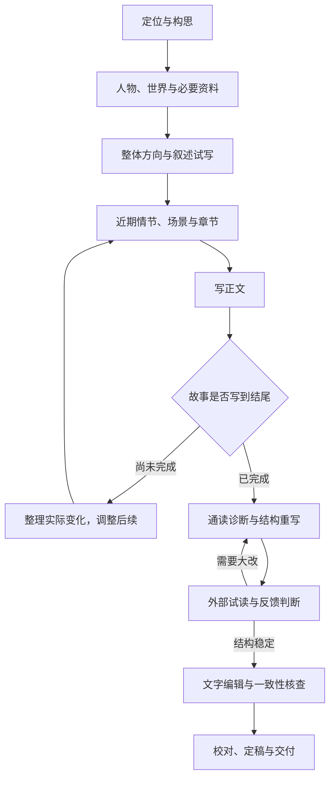

# 一部小说的整体创作流程：职业作者与编辑实践

整理日期：2026-11-12。

本文独立讨论小说创作，不依赖任何软件项目、AI 模块或技术方案。依据是小说作者公开的创作讲授与访谈、出版社编辑工作说明，以及专业编辑机构的实践资料。

**职业创作没有统一规定的步骤表。更值得借鉴的是：找到适合自己的起稿方法，让故事形成完整初稿，再用不同层次的阅读、反馈和修订逐步完成作品。** 大纲可以先做，也可以从初稿中反向整理；结构编辑、文字编辑和校对则应明确各自解决的问题。[职业作者对大纲与探索式写作的讨论](https://writingexcuses.com/12-26-qa-on-outlining-and-discovery-writing/)、[Penguin 编辑团队的工作说明](https://www.penguin.co.uk/about/company-articles/job-roles-in-editorial)

文中的十四阶段是对这些实践的综合整理，便于实际执行，不是某家机构颁布的行业标准。表格、检查条件、记录模板与安排建议属于本文的实操归纳；不代表所有职业作者都会使用相同表单或顺序。

## 一、先选择两条路线

### 1. 创作路线：大纲先行、探索式、混合式

| 路线 | 如何开始 | 写作中做什么 | 容易出现的问题 | 应对办法 |
| --- | --- | --- | --- | --- |
| 大纲先行 | 先设计人物、主要事件、结局与场景顺序 | 按计划起稿，允许人物与细节改变计划 | 规划过细，迟迟不动笔；正文像大纲扩写 | 在已经能够写出场景时开始试写，让试写检验计划 |
| 探索式写作 | 从人物、声音、意象、困境或一个场景出发 | 通过写作发现故事，之后整理实际写成的结构 | 事件不断增加，却没有形成整体；后期重写量大 | 定期反向梳理正文，识别真正的主线与结局方向 |
| 混合式 | 知道主要人物、核心困境和若干转折，近期详细、远期粗略 | 写一段、验证一段、调整下一段 | 每次有新想法就推翻整书 | 把新想法与现有因果、人物动机和结局联系起来再决定 |

这些路线都出现在职业作者的实践中。Writing Excuses 的作者讨论特别提到：探索式初稿可以通过反向大纲诊断结构，而且同一作者的不同作品也可能需要不同流程。雪花写作法则代表由简到繁逐层设计的一条路线。[Writing Excuses](https://writingexcuses.com/12-26-qa-on-outlining-and-discovery-writing/)、[Randy Ingermanson 的雪花写作法](https://www.advancedfictionwriting.com/articles/snowflake-method/)

尚无稳定个人方法时，可以先尝试混合式：保留全书方向，细化眼前要写的部分，再根据正文调整。这里是便于上手的建议，不是对三种路线的效果排名。

### 2. 交付路线：整书完成后交稿，或边写边连载

| 事项 | 整书完成后交稿 | 边写边连载 |
| --- | --- | --- |
| 首要生产目标 | 得到可整体修订的完整稿件 | 持续交付可读章节，并维护长线结构 |
| 前文修改空间 | 在交稿、出版等节点前可较大范围重写 | 已发布内容形成读者记忆，大改需要额外处理 |
| 反馈时机 | 可在初稿中、整书自修后或编辑介入时获取 | 章节发布后不断收到局部反馈 |
| 修订组织 | 能把结构重写与文字精修分成较完整轮次 | 章级、情节弧级和全书级修订交错进行 |
| 排期重点 | 起稿、重写、试读、编辑与交稿时间 | 稳定写作、存稿缓冲、阶段规划与收尾能力 |

两条交付路线不对应某一种题材。文学小说、类型小说和网络小说均可能采用不同安排。出版社编辑的实际工序也会因机构和作品而调整，不能把一种出版社的术语当成全球统一规定。[Penguin 对编辑岗位及工序差异的说明](https://www.penguin.co.uk/about/company-articles/job-roles-in-editorial)

## 二、十四阶段总览

| 阶段 | 核心问题 | 主要产物 | 进入下一步的判断 |
| --- | --- | --- | --- |
| 1. 定位与阅读研究 | 我要写怎样的书，主要提供什么阅读体验？ | 创作意图、读者定位、参考阅读笔记 | 作者知道自己准备写什么，也愿意持续投入 |
| 2. 核心构思 | 什么人物遇到什么困境，这件事为什么值得展开？ | 一句话故事、核心矛盾、关键问题 | 构思能产生选择与后果，而不只是背景介绍 |
| 3. 人物与关系 | 谁在推动故事，他们为什么这样行动？ | 主要人物简表、关系矛盾、变化方向 | 关键行为有动机，主要关系存在张力 |
| 4. 世界与资料 | 什么条件决定人物能做什么、不能做什么？ | 必需设定、资料笔记、待核查清单 | 眼前场景可写，决定主线的关键条件有依据 |
| 5. 全书结构 | 故事怎样发展，最后如何结束？ | 含结局的梗概、主要转折、故事线安排 | 起点到终点之间存在可理解的联系 |
| 6. 叙述方案与试写 | 谁来讲，怎样讲，读起来是什么感觉？ | 视角方案、试写片段、表达约定 | 作者能持续使用这种叙述方式写下去 |
| 7. 分部与情节弧 | 长篇怎样分阶段推进？ | 分部或分卷安排、阶段目标与结果 | 每个阶段有独立作用，并改变后续处境 |
| 8. 场景与章节编排 | 近期具体写哪些场面，按什么顺序呈现？ | 场景清单、近期章纲 | 下一批场景有内容可写，排列理由清楚 |
| 9. 初稿写作 | 如何把设想真正写成完整叙事？ | 连续正文、写作记录、待修清单 | 故事写到结尾，主要段落不再只是占位说明 |
| 10. 通读诊断 | 实际写成的小说有什么问题？ | 反向大纲、整书诊断、修订优先级 | 知道最需要修的几类问题和具体位置 |
| 11. 结构重写 | 怎样让主线、人物、节奏和结局成立？ | 重写稿、调整后的结构 | 全书层面的问题得到处理，新增修改能衔接 |
| 12. 外部试读与再修订 | 真实读者读到了什么，在哪里受阻？ | 试读反馈、编辑意见、修改决策 | 重要反馈已判断并处理，未采纳的意见有理由 |
| 13. 文字编辑与一致性核查 | 每一页是否清楚、准确，并保持作品声音？ | 精修稿、统一记录表、已处理疑问 | 大结构稳定，语言与事实问题得到处理 |
| 14. 校对、定稿与交付 | 最终读到的版本是否准确完整？ | 定稿、交付材料、归档版本 | 正文、目录、版面和附件相符，没有遗留占位内容 |

阶段 1—8 可以交错进行；探索式作者也可以在写出初稿后补做其中一部分。阶段 10—13 经常循环，试读也可以提前。十四阶段描述需要完成的工作，不要求机械地一次走完一个阶段。



## 三、准备与设计：阶段 1—6

### 阶段 1：明确创作意图、读者和阅读体验

**具体做法：**

1. 写下自己真正想写的内容：某种人物处境、关系、情绪、问题或世界体验。
2. 选择主要类型与读者方向，判断作品更依赖情节、人物、语言、氛围，还是它们的组合。
3. 阅读相关作品，记录它们怎样开场、提供怎样的体验、如何转换节奏和结束。
4. 区分可学习的写法与自己要写的具体内容，找出本书值得投入的部分。
5. 判断工作量：篇幅方向、可用时间、资料难度和自己是否具备持续写作的条件。

**产物：** 一页左右的创作说明。篇幅只为方便使用，不是硬性规定。

**完成判断：** 能说明“我想让读者经历什么”和“为什么由我来写这本书”。如果目标只是自由探索，也可以先明确自己最想探索的内容。

参考阅读可以研究：某场戏如何建立期待、人物怎样通过行动显露性格、信息何时交给读者。作者的阅读、观察与写作积累，是 Penguin 所访作者反复谈及的实践；阅读数量不宜统一规定。[Penguin 作者的写作建议](https://www.penguin.co.uk/discover/articles/authors-writing-advice-how-to-write-debut-novel)

### 阶段 2：把灵感发展成能持续展开的故事

灵感可以是一个画面、一种设定或一句对话。进一步追问：

- 谁与这件事有切身关系？
- 他想获得、避免、保住或理解什么？
- 什么力量使这件事变得困难？
- 他为什么必须参与，为什么不能轻易离开？
- 他会作出什么选择，这个选择又造成什么后果？
- 到结尾时，哪个问题应当获得回应？

可用的一句话模板：

> 在______处境下，______想要______，却受到______阻碍；他必须______，并面对______后果。

模板适合检查情节驱动故事。对以人物意识、语言或氛围为中心的小说，可以改问“什么经验被逐步揭示”“读者的理解如何变化”，不强行补上外部任务或反派。

**产物：** 一句话构思，以及一段能够说明发展方向的简述。

**完成判断：** 能继续提出具体场景与人物选择。只有“宏大世界观”“某种特殊能力”，通常还需要找到让人物进入其中的事件。

### 阶段 3：建立能够行动的人物与关系

先处理会直接影响故事的主要人物：

| 人物维度 | 要写清什么 |
| --- | --- |
| 外在处境 | 工作、身份、家庭、资源及当下面临的压力 |
| 欲望与恐惧 | 想得到什么，害怕失去什么，为什么在乎 |
| 行为方式 | 在压力下倾向隐瞒、对抗、妥协、逃避，还是寻求帮助 |
| 限制与矛盾 | 能力边界、认知偏差、相互冲突的价值或责任 |
| 关系 | 需要谁、亏欠谁、误解谁、与谁利益冲突 |
| 发展方向 | 可能成长、堕落、醒悟，或者保持信念并影响他人 |

随后用实际场景验证人物：让他面对一个有代价的决定，检查行为是否自然。人物小传可以提供材料，但小传的长度本身不能证明人物鲜活。

**产物：** 主要人物简表、关键关系，以及少量能够体现人物的场面。

**完成判断：** 能解释关键行动；不同人物不能轻易互换位置与台词。

人物不必都发生显著转变。Sanderson 的人物课程明确讨论了相对稳定、依靠自身特质持续吸引读者的人物；其课程也提醒，有些作品的声音、幽默或主题比情节机制更重要。[人物课程第六讲](https://www.brandonsanderson.com/blogs/blog/customizing-your-character-brandon-sandersons-writing-lecture-6-2025)

### 阶段 4：准备必要设定与事实资料

准备的深度由故事需要决定：

- 现实题材：职业流程、生活条件、具体地点、时代背景，以及相关人物的实际经验。
- 历史题材：时间、地理、制度、称谓、技术与日常生活，记录事实依据和创作改动。
- 幻想或科幻：会影响人物选择与问题解决的规则、限制、代价及例外。
- 悬疑或谜题故事：真相发生的顺序、证据来源、谁知道什么，以及读者何时获得线索。

把资料分成“决定情节、现在必须核实”和“可以起稿后补查”两类。对后者在草稿中留下明确标记，避免为一个非关键细节中断整段创作。

**产物：** 可查阅的资料笔记、必需设定、尚待核实的问题。

**完成判断：** 足以写近期场景；不能依赖一个尚未成立的关键事实解决主线问题。

资料准备应服务人物和场景。设定资料可以很多，正文只在读者需要时呈现相应内容。

### 阶段 5：形成全书方向与主要结构

**具体做法：**

1. 确定开篇的生活状态、关系或核心困境。
2. 找到使局面无法照旧继续的事件或认识变化。
3. 设计若干重要转折：新选择、新事实、关系变化、失去与获得。
4. 检查事件之间的联系：前面的行动为什么会带来后面的局面？
5. 确定高潮与结尾方向，尤其是主角在关键时刻如何选择。
6. 安排支线的进入、交织与结束，避免与主线争夺空间却没有作用。

**产物：** 一份包含结局的故事梗概，以及主要转折清单。它不同于面向读者、通常避免剧透的宣传简介。

**完成判断：** 能解释开篇到结尾之间的联系。结局可以调整，但调整后应重新检查前文铺垫。

三幕式、英雄旅程、节拍表等可以作为诊断工具；是否使用取决于作品。不要把转折固定在某个字数百分比，当成所有小说的质量标准。

“建立期待—让读者感到推进—提供回应”是 Sanderson 提出的一种实用检查视角：开篇引导读者关心什么，过程中如何继续关心，结尾如何回应。这里将它作为检查工具，而不是情节的唯一模型。[Sanderson 情节课程第二讲](https://www.brandonsanderson.com/blogs/blog/brandon-sandersons-2025-guide-to-plot-lecture-2)

### 阶段 6：决定叙述方式，并用试写检验

需要作出或试验的选择：

- 谁在讲述：第一人称、限知第三人称、全知叙述等。
- 跟随哪些人物，什么时候切换，读者能知道多少。
- 按时间顺序写，还是使用回忆、插叙、倒叙或多线交错。
- 叙述距离、语言密度、幽默程度、心理描写与场景描写的比例。
- 不同人物的语言和观察方式怎样区分。

试写开场，再选一个需要对话、冲突、心理活动或重要信息揭示的场面。观察这种写法能否同时承担本书的重要任务。

**产物：** 可继续沿用的试写片段与简短叙述约定。

**完成判断：** 不仅开篇有感觉，进入普通章节后仍然写得动。探索式作者可以从这一阶段起步，再反推人物和整体方向。

## 四、从整体规划进入正文：阶段 7—9

### 阶段 7：把长篇拆成分部、分卷或情节弧

短小说未必需要分卷；篇幅较长、人物较多或连载周期较长时，可以按阶段组织。

每个阶段回答：

1. 从什么局面开始？
2. 哪个问题、欲望或关系处于中心？
3. 压力如何发展，人物如何应对？
4. 阶段的转折或集中爆发发生在哪里？
5. 结束时，事情、关系或理解发生了什么变化？
6. 哪些后果会进入下一阶段？

**产物：** 分部说明或情节弧清单；近期可详细，远期保留方向。

**完成判断：** 各阶段具有不同作用。删除或互换其中一段时，能看出对全书的影响。

写字板在访谈中介绍过先考虑人物、大事件、开头、结尾和重要节点，再填充细节的方法。这是长篇网络小说作者的一种实践，并不意味着所有长篇都必须使用同样的大纲长度。[中国作家网访谈](https://www.chinawriter.com.cn/n1/2018/0226/c405057-29833762.html)

### 阶段 8：编排场景，再考虑章节边界

**场景**组织一个连续的叙事片段，**章节**组织读者一次阅读中的分段和停顿。二者不必一一对应：一章可以有多个场景，一个较长场景也可能跨章。

为近期场景做简短记录：

| 字段 | 用途 |
| --- | --- |
| 视角、时间、地点 | 确定读者从哪里进入场面 |
| 当前处境 | 承接前面已经发生的事情 |
| 人物意图或关注点 | 决定人物在场面中注意什么、怎样行动 |
| 压力或发现 | 让局面、认识或感受发生变化 |
| 行动与反应 | 把人物选择具体写出来 |
| 结果 | 说明场面结束时有什么不同 |
| 后续联系 | 引出下一个场面，或与其他线形成呼应 |

这是便于检查的场景卡，不要求每个场面都具备激烈冲突。沉思、日常相处和氛围场面也可以有作用，例如改变读者对人物的认识、积累情感或调整节奏。

行动型场景可以参考“目标—阻力—结果”；承接型场景可以参考“反应—权衡—决定”。这是 Randy Ingermanson 介绍、源自 Dwight Swain 的一套场景分析方法，适合需要强化行动因果的段落，不宜机械套用到每一页。[场景写作方法](https://www.advancedfictionwriting.com/articles/writing-the-perfect-scene/)

**产物：** 近期场景清单，随后组合成章纲。

**完成判断：** 知道下一场具体要写什么，以及它为什么出现在这里。章末可以留下问题、决定、余韵或情绪落点，不必每章强行制造危险。

### 阶段 9：写出能够从头读到尾的初稿

初稿阶段可以同时做适量修改，但需要观察修改是否阻碍整书推进。个别作者会边写边精修；另一些作者会快速写完再重写，不应统一规定。

建议每次写作采用以下小循环：

1. **回到当前局面。** 阅读紧邻正文与相关资料，弄清人物现在在哪里、知道什么、想做什么。
2. **明确本次要完成的片段。** 可以是一场对话、一段行动、一个发现或一个心理过程。
3. **起稿。** 写出具体动作、语言、观察与感受，允许新细节出现。
4. **检查衔接。** 人物为什么这样说、这样做；信息与空间关系是否清楚。
5. **记录实际变化。** 计划与正文不同时，以实际写成的内容重新考虑后续。
6. **留下下次入口。** 记下下一步准备写什么，以及尚未解决的问题。

为问题选择合适处理时机：

| 问题 | 此时怎样处理 |
| --- | --- |
| 关键动机不成立，导致后面无法继续 | 先解决相关结构或人物问题，再推进受影响部分 |
| 一处资料尚未核实，但不影响情节成立 | 清楚标记，放入核查清单 |
| 某句话不够漂亮，但意思清楚 | 可以留待文字修订 |
| 正文出现比原计划更好的发展 | 判断是否改善整书，再调整后续与必要铺垫 |
| 不停改开篇，却始终写不到中段 | 暂停局部打磨，先验证整个故事是否写得通 |

**产物：** 有开始、发展和结尾的完整初稿，附待修清单。零星核查标记可以保留；大段情节仍写着“这里发生大战”“此处两人和解”，则尚未完成相应正文。

**完成判断：** 故事已经能作为一部小说从头读到尾，不要求每一页都达到最终质量。

## 五、让初稿成为成稿：阶段 10—14

### 阶段 10：拉开距离，通读实际写成的小说

时间允许时，先暂时离开稿件，再以读者身份整书阅读。间隔多久取决于交付安排；没有适用于所有作者的固定天数。

通读时先记录问题，避免每看一页就进入逐句修改。重点观察：

- 哪些地方想继续读，哪些地方注意力下降？
- 人物的行为和情感变化是否可以理解？
- 前文建立的期待，后文有没有继续发展与回应？
- 信息是在需要时出现，还是过早倾倒、过晚补交？
- 结尾是否得到前文支持，高潮之后是否还有必要的情感落点？

接着做**反向大纲**：依据正文，而非原计划，逐章或逐场记下实际发生的事、人物变化和该段功能。它有助于发现重复、断裂、失衡和没有发挥作用的部分。[职业作者对反向大纲的讨论](https://writingexcuses.com/12-26-qa-on-outlining-and-discovery-writing/)

**产物：** 反向大纲、问题位置、整书修订说明。

**完成判断：** 能把“感觉不好”转成可处理的问题，例如“主角在第六章突然信任对方，前五章缺少使信任成立的事件”。

### 阶段 11：优先进行结构重写

按影响范围处理问题，通常先动大的，再动小的：

1. 故事中心与整体方向。
2. 主线发展、重大因果与结局。
3. 主要人物的动机、关系与发展。
4. 支线分量、叙述视角与信息安排。
5. 场景的增删、合并、移动或重写。

不要一发现问题就只补解释。先判断是否应改变事件、让人物作出不同选择、增加具体经历，或删除造成问题的段落。

修订计划至少记下：**问题在哪里、为什么影响阅读、准备怎么改、会牵动哪些前后文。** 修改结局可能牵动开篇；删去一场戏可能同时删掉线索和关系铺垫，要一并处理。

**产物：** 结构重写稿，及必要的连带调整。

**完成判断：** 不仅局部改善，修改后的全书也能衔接。出版社把结构修改与后续文字、制作工序区分开来，正体现了这类工作范围的差异。[Penguin 编辑工作流程](https://www.penguin.co.uk/about/company-articles/job-roles-in-editorial)

### 阶段 12：获取外部反馈，判断后再修订

可以邀请熟悉目标类型的试读者、写作伙伴，或由编辑评估。早期也可以请人看未完成稿，但应说明当前稿件成熟度，以及希望得到什么帮助。

给试读者的问题应尽量落到实际阅读体验：

- 从哪里开始愿意继续读？哪里想跳过或停下？
- 哪个人物的选择让你不理解？具体在哪里？
- 哪些信息不清楚，哪些解释显得重复？
- 你原本期待后面发生什么？
- 结尾给了你怎样的感受，哪些部分没有得到满足？

**先收集反应，再判断修法。** “这一段读不下去”值得认真看；“把主角改成另一种人”只是读者提出的一种解决方案。Writing Excuses 的反馈讨论特别强调区分读者反应与替作者开出的修改方案。[反馈的采纳与判断](https://writingexcuses.com/15-51-feedback-when-to-listen-and-when-to-ignore-with-special-guest-mahtab-narsimhan/)

整理反馈时分为：事实或理解问题、多人反复出现的体验问题、目标读者偏好，以及作者需要坚持的创作选择。多人提到同一问题会提高处理优先级，但人数不能代替作者判断。

**产物：** 反馈汇总、采纳或不采纳的决定、再修订稿。

**完成判断：** 重要意见已得到判断；若涉及主线与人物的大改，返回结构重写，不急着进入终校。

### 阶段 13：文字编辑与一致性核查

在大结构相对稳定后，集中提高每一段的阅读质量。

**文字层面：**

- 句子是否清楚，代词是否有明确指向。
- 对话是否符合人物、场景和当时关系。
- 叙述是否反复解释读者已经理解的内容。
- 细节是否准确、具体，并承担作用。
- 语言节奏与叙述距离是否适合当前场面。
- 是否存在无意的视角跳转、表达重复或语体不一致。

**一致性层面：**

- 人名、地名、称谓、术语的写法。
- 年龄、日期、时间跨度、行程与事件顺序。
- 人物关系、外貌、伤势、物品归属和行动条件。
- 规则及例外是否一致，关键能力是否有相应依据。
- 特殊文本的处理，例如信件、短信、梦境和回忆。

专业小说编辑会使用 style sheet 记录文字规范、人物、时间线、情节线和幻想设定等，便于作者及后续编辑查阅。中文写作可以据此建立自己的“用词与连续性记录表”，不必照搬英语标点规则。[CIEP 小说统一记录表实践](https://www.ciep.uk/resource/fiction-style-sheets.html)

**产物：** 精修稿、统一记录表、已处理的编辑疑问。

**完成判断：** 保持作品声音的同时减少表达障碍与无意矛盾。若文字修改改变了情节含义，应重新检查关联场面。

不同机构对 line editing、copyediting 等工种的划分会有重叠；实务中应先说清此次工作覆盖结构、表达、语法还是一致性，避免只说“润色一下”。[Penguin 对编辑工序和职责的说明](https://www.penguin.co.uk/about/company-articles/job-roles-in-editorial)

### 阶段 14：校对、定稿与交付

在正文已稳定后，处理最后的错误与交付细节：

1. 检查错别字、漏字、重复字、标点、异常空格和格式。
2. 检查章节顺序、编号、章名、目录与正文是否一致。
3. 搜索所有待查、待补、临时人名及内部修改标记。
4. 核对实际交付文件，防止遗漏章节或混入旧版本。
5. 如果经过排版，检查排版后的页面或电子阅读版本，包括分节、段落、特殊文本和目录跳转等。
6. 按实际投稿或交付要求准备梗概、作者资料、简介及其他材料，明确哪个文件是最终稿。
7. 保存定稿与可辨认的历史版本，记录最后修改内容。

**产物：** 完整定稿、实际需要的交付材料、归档记录。

**完成判断：** 要交给读者或编辑的那个版本已被检查，而不只是作者手上的源稿检查过。

出版编辑说明中，文字编辑之后还会有制作及校样环节。因此，校对不能替代结构修订，排版后也不能完全省略检查。[Penguin 编辑团队的工序说明](https://www.penguin.co.uk/about/company-articles/job-roles-in-editorial)

## 六、网文连载怎样调整这套流程

连载把写作、修订、交付和反馈压在同一周期内。需要额外考虑的是：哪些内容已经发出、还有多少调整空间，以及后续故事能否持续。

丁墨在访谈中谈到，连载前会准备存稿，但读者反馈可能促使她重写；她也区分了真正写出问题与读者尚未看到后续解释的情况。这说明存稿能提供缓冲，但不能代替判断，也不能保证无需返工。其个人更新量与存稿量不应直接作为其他作者的标准。[武汉大学《写作》杂志发布的丁墨访谈](https://m.thepaper.cn/newsDetail_forward_26761013)

以下安排是结合上述实践作出的流程建议：

### 1. 开书前

- 弄清主要人物、核心阅读体验、初期故事与结局方向。
- 试写并修订开篇，检验正文是否兑现简介所引导的期待。
- 实际写一段时间，估计自己可持续完成多少合格正文，再制定更新安排。
- 准备与自身节奏相匹配的存稿，给生病、资料核查和返工留空间。
- 整理近期情节、人物状态和关键线索，避免开书后每天从零构思。

### 2. 每次更新前

- 看清上一段结束在哪里，避免情绪、动作或信息突然断开。
- 检查本章是否有值得读的内容，是否与前后发展相关。
- 处理明显的动机、逻辑、信息与设定错误。
- 做基本文字检查，确认发布的是正确章稿。
- 更新后记录实际发生的变化，以及下一段需要承接的事项。

### 3. 每个情节弧或分卷结束时

- 回看这一阶段实际写成什么，与原计划有什么差别。
- 处理遗留关系、冲突、线索和重要承诺。
- 判断下一阶段是否有新问题、新压力或新的情感发展。
- 检查是否重复使用同一种冲突与解决方式。
- 根据剩余故事、写作负荷和存稿情况调整近期安排。

### 4. 面对读者反馈

先区分：确实有错、表达使人误解、读者尚不知道后续，以及偏好不合。先定位正文证据，再决定修改。记录有价值的意见，避免每条评论都立即改变长线情节。

已发布内容如果需要较大修改，应同时考虑读过旧稿的读者和正在读新稿的读者，明确修订范围与衔接办法。具体操作取决于发布方式，不假定所有平台允许相同修改。

### 5. 进入收尾时

- 根据尚待处理的故事线安排剩余篇幅，逐步让主要矛盾汇合。
- 避免不断引入需要大量篇幅解释的新人物与新问题。
- 给重要关系、选择后果和高潮后的情绪留出空间。
- 结尾留续作可能性时，仍要判断本书的核心体验是否得到回应。
- 完结后如准备出版或重新交付，再做全书层面的结构与文字修订。

## 七、贯穿全程的五份记录

这些记录可以合并在一个笔记本里，也可以分开保存。用途是减轻记忆负担，不要求写得比小说还复杂。

| 记录 | 保存内容 | 更新时机 |
| --- | --- | --- |
| 创作说明 | 作品意图、读者方向、主要阅读体验、叙述方式 | 开始时建立，重要方向调整后更新 |
| 故事梗概与反向大纲 | 计划怎样发展，以及正文实际上怎样发展 | 规划时、阶段结束时、整书诊断时 |
| 人物、世界与连续性记录 | 人物关系、规则、时间线、术语及重要状态 | 相关内容确定或发生变化时 |
| 线索与未了事项 | 承诺了什么、在哪里出现、准备怎样处理、是否已经处理 | 埋设、推进、改变或回收时 |
| 待查与修订清单 | 问题位置、影响、处理方式、牵动范围与完成情况 | 起稿、通读、反馈和修订过程中 |

连续性记录可参考 CIEP 的小说 style sheet；反向大纲可参考 Writing Excuses 的结构诊断。把它们组合成五份记录，是本文为执行方便作出的归纳。[CIEP](https://www.ciep.uk/resource/fiction-style-sheets.html)、[Writing Excuses](https://writingexcuses.com/12-26-qa-on-outlining-and-discovery-writing/)

注意分清三种内容：**计划发生的事、正文已经写出的事、人物自己相信的事。** 人物的猜测与谎言不一定是故事真相，原计划也可能已被正文改变。

## 八、怎样判断“一部小说已经完成”

可以分四个层面检查，而不只看字数或章数：

| 层面 | 核对问题 |
| --- | --- |
| 叙事完成 | 本书主要处理的问题是否已经展开并得到相应回应？结尾是否有前文支持？ |
| 人物与体验完成 | 关键选择及后果是否写出？主要关系是否得到必要处理？作品想提供的体验是否成立？ |
| 文稿完成 | 是否仍有缺失场景、断裂衔接、未处理的重要矛盾或内部占位说明？ |
| 交付完成 | 最终文件是否完整、顺序正确、经过相应校对，且能明确辨认版本？ |

开放式结局可以不回答所有问题，悲剧也不必让主角如愿，系列小说还可以留下后续空间。关键在于作者是否有意识地选择这种结尾，以及这部作品本身是否已构成足够完整的阅读体验。

完成检查还应尊重作品类型。人物必须成长、每章必须反转、每条支线必须封口、开篇必须在固定字数内出现危机，都不宜当成小说的通用硬标准。

## 九、可直接使用的简短模板

### 作品创作说明

```text
暂定书名：
我最想写的内容：
主要读者与类型方向：
希望提供的阅读体验：
一句话构思：
主要人物与核心关系：
主要困境或中心问题：
结尾方向／尚待探索的问题：
叙述方式：
需要优先核查的资料：
计划的交付方式与可用写作时间：
```

### 场景或章节准备

```text
承接的局面：
视角、时间、地点：
本段关注的人物与事情：
具体发生什么：
人物怎样行动或反应：
结束时发生的变化：
读者此时知道什么、期待什么：
与后续的联系：
正文写成后需要更新的记录：
```

### 修订任务

```text
问题及位置：
正文依据／试读反应：
影响哪个层面：结构、人物、信息、节奏、表达或一致性？
准备采用的修改：
需要连带调整的前后文：
修完后怎样判断有效：
处理结果：
```

### 整书修订顺序

```text
完整初稿
→ 通读与反向大纲
→ 确定优先问题
→ 结构重写
→ 外部试读与反馈判断
→ 必要的再重写
→ 文字精修与一致性核查
→ 最终文件或校样检查
→ 定稿、交付与归档
```

如果试读发现结构问题，就回到结构；如果校对时发现改动影响剧情，就重新检查相关段落。修订轮数取决于问题是否解决，没有统一要求必须“三稿定稿”或“修改五遍”。

## 十、资料来源与适用边界

下列均为作者、出版社或编辑专业机构直接发布的资料；访谈中的创作做法来自受访作者本人。本文没有用公开资料证明某条流程能保证畅销、签约或文学质量，也没有把个别作者的日产量、存稿量与大纲长度当成行业基准。

| 来源 | 主要用途 | 适用边界 |
| --- | --- | --- |
| [Randy Ingermanson：雪花写作法](https://www.advancedfictionwriting.com/articles/snowflake-method/) | 由简到繁设计故事的一条路线 | 作者个人方法，不是唯一正确流程 |
| [Writing Excuses：大纲与探索式写作问答](https://writingexcuses.com/12-26-qa-on-outlining-and-discovery-writing/) | 不同起稿方法、场景准备与反向大纲 | 多位职业作者经验，不能转化成统一格式要求 |
| [Sanderson：2025 情节课程第二讲](https://www.brandonsanderson.com/blogs/blog/brandon-sandersons-2025-guide-to-plot-lecture-2) | 读者期待、推进与结尾回应 | 一种情节分析框架 |
| [Sanderson：2025 人物课程第六讲](https://www.brandonsanderson.com/blogs/blog/customizing-your-character-brandon-sandersons-writing-lecture-6-2025) | 人物差异、稳定人物及不同作品重心 | 不要求所有人物都有同一种成长弧 |
| [Randy Ingermanson：场景写作](https://www.advancedfictionwriting.com/articles/writing-the-perfect-scene/) | 行动与承接场景的组织 | 作者对 Dwight Swain 方法的介绍，适用时采用 |
| [Writing Excuses：反馈何时采纳、何时忽略](https://writingexcuses.com/15-51-feedback-when-to-listen-and-when-to-ignore-with-special-guest-mahtab-narsimhan/) | 区分阅读反应与修改处方 | 作者仍需作出判断 |
| [CIEP：小说统一记录表](https://www.ciep.uk/resource/fiction-style-sheets.html) | 用词规范、人物、时间线与世界设定的连续性 | 英语编辑实践，中文应按自身需要调整 |
| [Penguin：编辑岗位与职责](https://www.penguin.co.uk/about/company-articles/job-roles-in-editorial) | 结构编辑、文字编辑、制作与校对的区别 | 具体称谓和分工随出版社变化 |
| [Penguin：作者谈小说写作](https://www.penguin.co.uk/discover/articles/authors-writing-advice-how-to-write-debut-novel) | 阅读、观察、起稿与个人方法的多样性 | 个人建议，不是效果保证 |
| [中国作家网：写字板访谈](https://www.chinawriter.com.cn/n1/2018/0226/c405057-29833762.html) | 中文长篇网文的主线、大纲与重要节点 | 个案经验；网页发布于 2018 年，访谈发生于 2015 年 |
| [武汉大学《写作》杂志：丁墨访谈](https://m.thepaper.cn/newsDetail_forward_26761013) | 连载、存稿、读者反馈与作者判断 | 个案经验；网页发布于 2024 年，访谈发生于 2023 年 |

本文讨论可持续使用的创作与编辑工作方法，不涉及当前平台签约门槛、推荐规则、榜单趋势、稿酬或市场收益预测。
