# 炼字工坊编辑器功能与用户导航分析

调研日期：2026-11-20。样本为 Chrome 已登录的桌面网页、一本只有一卷一章的空白作品。通过实际切换主导航、展开向导、AI 模式菜单、智能体选择器、设置、生成详情及回收站核对界面。本文的「可见」表示界面或说明中存在该能力，「已打开」表示进入了对应页面或弹层。补查打开了章节排序与多选、正文历史、跨对象搜索替换、TXT 导出及番茄发布预检，并实测重新打开编辑器后恢复已有灵感草稿。截图裁去浏览器界面或遮盖作品名、账户余额和部分候选文本。涉及写入、发送给模型、扣费、删除、导入、发布和同步的执行结果均未实测。[调研页面入口（需登录后进入作品）](https://lianzigongfang.com/)

## 结论

- 编辑器用顶部五个标签切换创作对象，左侧卷章目录作为常驻定位器，主区随标签更换。它把「写哪一章」与「处理哪类资料」分成两个坐标，适合在正文、设定和规划间往返。
- 流程入口和对象入口并行。作者可以从目录直接写，也可以从灵感向导开始，或让炼字大师根据作品进度推荐下一步。设定、大纲、章节各有本地操作，AI 面板再提供跨模块入口。
- 最明显的导航成本是重复入口与多层目录。在本次窗口宽度下，章节操作靠横向工具条承载，靠右的动作需要额外发现。打开 AI 后，浮层在该窗口覆盖了工作台，查照正文需要来回切换。
- 适合 ainovel 借鉴的是常驻章节定位、对象附近的 AI 动作、按进度显示下一步，以及分开呈现历史版本、删除恢复和生成记录。AI 的执行方式需要和 ainovel 的作者分工、结果采纳及任务范围分别表达。

## 1. 信息架构与导航层级

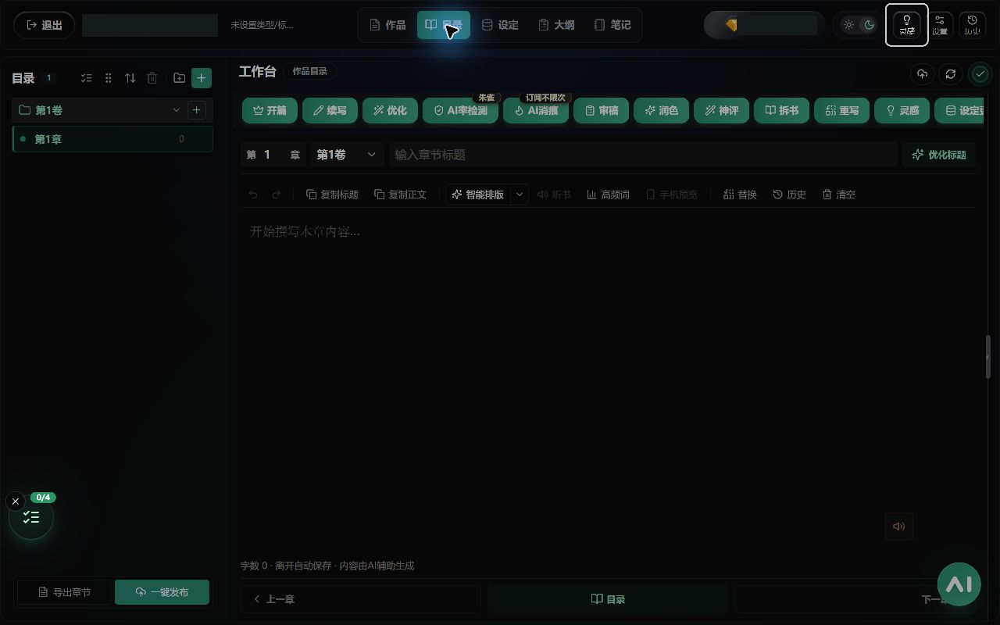

**图 1　目录与正文。** 顶部切换模块，左侧固定卷章和交付入口。正文上方分两行显示 AI 动作与文本操作，本文所见的最右侧按钮包含灵感和设定更新。右下浮钮打开 AI。宽窗口还显示可点击修改的作品名和类型／标签摘要。

| 层级 | 已观察的入口与结果 | 用户如何判断当前位置 |
| --- | --- | --- |
| 作品边界 | 编辑器网址定位作品，顶部有「退出」 | 浏览器标题包含作品名。未点击退出确认目的地 |
| 一级对象导航 | 作品、目录、设定、大纲、笔记 | 当前标签高亮，主区「工作台」旁显示作品信息、作品目录、设定数据、大纲卷纲或写作笔记 |
| 常驻章节导航 | 左侧卷章树，卷可折叠，章节可选中；底部上一章、目录、下一章 | 卷名、当前章选中样式、章号与所属卷；首末章的上下章按钮禁用 |
| 模块内部导航 | 设定目录按对象类型，大纲目录按总纲及卷章，笔记目录按文件夹与笔记 | 主区内有模块目录标题，可折叠该目录；左侧全局章节目录仍留在原位 |
| 章节内命令 | AI 写作工具、标题区、编辑工具条、正文、字数与章间导航 | 工具按操作层次分行；正文区维持当前章上下文 |
| 跨模块工具 | 顶部灵感、设置、生成详情、余额、日夜外观入口；浮动 AI 和新手引导 | 向导、设置及记录以弹层打开展示；AI 面板有炼字大师、智能体标签 |
| 数据与交付 | 云同步、模块导入导出、章节导出、一键发布 | 工作台标题栏有双向云同步和自动保存状态；模块与章节拥有各自的导出入口 |

「目录」既是一级标签，也出现在章间导航和多个模块目录标题中。顶部标签用来选择工作区，常驻树用来定位卷章，局部目录用来选择当前模块内的资料。同名在各自区域里能理解，同时显示时要依赖空间位置和上下文辨别。设定和大纲页允许隐藏内部目录，这能减少一层列表对主区的占用。

## 2. 功能盘点

| 模块 | 功能和操作对象 | 界面所见及限制 |
| --- | --- | --- |
| 作品 | 书名、标签、叙述视角、发布平台、目标字数、作品简介、文风说明；核心内容含世界观、主角、等级／规则、外挂机制 | 书名、简介、文风和核心内容旁有对应 AI 按钮。还有字数规划、网文潜力评估及作品信息导入导出。视角和发布平台字段提示可被 AI 对话引用 |
| 目录管理 | 新建卷、全局新建章、卷内新建章、折叠卷、章节多选管理、章节排序、正倒序、章节更多操作 | 一卷一章下看到管理入口。回收站已打开并显示空态，界面说明删除的章节可恢复。未提交新增、删除或移动 |
| 正文编辑 | 章号、所属卷、标题、正文、字数、撤销恢复、复制标题或正文、智能排版与配置、听书、手机预览、高频词、批量查找替换、历史和清空 | 空白章可定位标题和正文输入区，听书和手机预览禁用。底部提示离开自动保存；替换入口说明可作用于正文、设定或大纲。已查看历史保留规则和批量替换配置，未执行实际恢复、替换或正文持久化 |
| 章节 AI 助手 | 开篇、续写、优化、审稿、润色、神评、拆书、重写、灵感、AI 标题优化、设定更新，以及检测类工具 | 标题优化提示支持批量；重写提示走审批，保存后覆盖原正文。灵感入口说明一次五个，可写入笔记，默认不参考正文。设定更新说明按未整理章节增量提取。检测及文风相关工具记录至入口层，效果与付费规则未测 |
| 设定 | 角色、设定、伏笔三类目录；标题、内容或标签搜索，排序，查看弃用条目，多选管理；新增与弃用条目 | 角色目录为空时提供新增入口。角色灵魂涉及原型、气质、表达、决策和情感卡；另外可见 AI 设定生成、AI 取名、设定更新、智能导入和设定数据导入导出 |
| 大纲 | 总纲、卷纲、章纲；生成各级大纲、从总纲提取卷纲、智能导入章纲以及模块导入导出 | 已见总纲的编辑／预览、立即保存和撤销恢复；卷树标明章数与章纲「未填写」状态。可见新建卷、新建章节并创建章纲、章纲多选及删除入口。未验证章纲与正文的删除联动 |
| 笔记 | 新建目录、新建笔记、标题和内容编辑、目录收起、导入导出 | 已见空态和新建指引。笔记与「灵感」之间存在写入提示；未验证引用范围与目录移动 |
| 写作环境 | 日夜外观、阅读背景、主题色、字体、正文字号、AI 回复字号、段落排版、语法高亮 | 设置弹层已打开。阅读背景色在夜间暂停；角色与设定高亮从相应条目标题取词。设置面板将自定义词和高频词高亮分开保存 |
| 保存与流转 | 自动保存状态、上传到云端、从云端拉取、章节导出、一键发布、分模块导入导出 | 云同步提示覆盖基础信息、核心构架、设定及纲要等，拉取遇冲突会提示处理。作品、设定、大纲和笔记的标准导入导出标注订阅会员专享。章节交付面板明确提供 TXT 和番茄发布，均要求订阅。实际文件、平台回执及同步覆盖规则未验 |
| 生成详情 | 最近生成记录，按提示词标题、作品标题、模型搜索 | 已打开，样本显示暂无生成记录。记录字段、统计口径、失败详情和重试方式待有记录时核对 |

## 3. 起步、写作及维护的典型路径

### 3.1 从点子或已有材料立项

顶部「灵感」打开创作向导。向导并列四种起点，作者按手头已有的材料选择。

| 起点 | 界面表达的流程 | 实测深度 |
| --- | --- | --- |
| 灵感火花 | 基本信息（频道、赛道）→ 世界观 → 主角人设 → 金手指 → 生成立项 | 页面进入时已有世界观步骤，显示第 2/5 步及 55% 进度。已见一组九张世界观候选卡，每张可编辑，可换一批或提交自定义答案；未产生新候选或立项 |
| 仿写立项·经典 | 上传 TXT 或选榜单参考书 → 分析前十章 → 生成立项书 | 打开向导首页并核对卡片说明 |
| 智能导入立项 | 粘贴已有想法 → 补全字段 → 整理为立项书并写入工作台 | 核对卡片说明，未检查写入前后的差异或回退 |
| 熔炉仿写 | 选择一至三本参考书 → 九维度分析 → 自选融合配方 → 生成立项书；材料入口含榜单、粘贴正文和 TXT | 核对卡片说明，未验证可用榜单、九维度字段或产物质量 |

世界观步骤同时显示步骤序号和百分比，给出了两个阶段线索。界面未在该步骤说明 55% 由哪些子任务计算，作者更容易用「正在选世界观」判断接下来要做什么。卡片同时有整卡选择和独立编辑两个动作，区分了接受思路与先改细节。重新打开同一作品时，页面提示恢复上次未完成的草稿，也可选择另起灵感流程。现场选择恢复后回到第 2/5 步和已有候选，界面说明步骤、已选方案及生成结果存于本浏览器。跨设备恢复和重选上游后下游如何处理仍未验证。

**图 2　重新进入作品时的恢复提示。** 两个按钮直接区分继续上次进度和开始新流程。

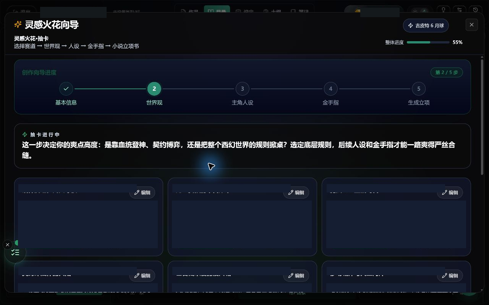

**图 3　世界观抽卡。** 顶部流程条记录创作阶段，卡片右上角的编辑和整卡选择是两个不同动作，换批和自定义输入在卡片列表下方。

### 3.2 手写、补写及编辑

进入「目录」后，卷章树和正文区同时可用；空白章直接给出标题和正文输入区。作者可以先写正文，再从章节工具进入开篇、续写、审稿、润色等操作。浏览前后章有固定按钮，章节树则承担跳转到非相邻章节的任务。样本中「完善作品信息」待办出现在 AI 面板里，正文输入区仍可访问。空白章的实际落盘和空设定时发动 AI 是否有前置条件均未测。

### 3.3 规划、回查与交付

「大纲」提供总纲到卷纲、章纲的逐层规划入口，也允许在卷内直接新建章节和章纲；「设定」聚集角色、设定和伏笔，可通过搜索查回资料，已有正文还可以走设定更新入口；「笔记」容纳临时灵感。写作期可从「历史」、章节回收站、生成详情分别寻找文本版本、删章恢复和模型调用记录。交付期从左侧章节区走导出或发布，分模块导出与云同步在各自的工作区可见。上述路径已确认入口，实际数据流转尚未验证。

## 4. AI 面板的两套路由

| 层级 | 炼字大师 | 智能体 |
| --- | --- | --- |
| 起始页 | 新会话、历史会话切换及重命名，新建对话；完善作品信息待办；「继续下一步」、续写、重写、润色、生成大纲 | 样本默认展示「小说全能助手」，有梳理全书逻辑、打磨这一章、接着往下写、一起想剧情 |
| 选择能力 | 对话类型与工作模式菜单、模型选择、快捷指令、创作设置 | 可搜索助手或创作方向，选择器可见小说全能助手和角色设计师等入口；可选模型、引用资料和创作偏好 |
| 上下文 | 输入框可用 @ 引用作品资料，有上传入口；作品字段显示了部分可引用字段 | 界面提供 @ 引用；全能助手的产品说明提到可联动修改角色设定和各级大纲，并在保存前逐项比较 |
| 执行反馈 | 菜单显示「创作 · Agent」跟随作品进度；审批模式逐步审阅结果，自动模式按创作设置推进，任务模式持续续写到目标章节 | 此次核对的是助手选择和预设任务，未运行多对象修改，逐项对比属于界面说明 |

工作模式藏在输入框底部，与模型、创作设置相邻，适合发起任务前调整。其差别主要体现在审阅与执行范围。章节工具条、炼字大师预设、智能体预设都提供续写相关入口，新手更容易找到熟悉的动作，但需要进入后才能理解它们到底共享什么上下文、会写到哪里、如何保存。设定更新也横跨章节页和设定页，呼应同一任务的两个出发点。几个入口的实际执行器、提示和产物是否一致，当前证据不足。

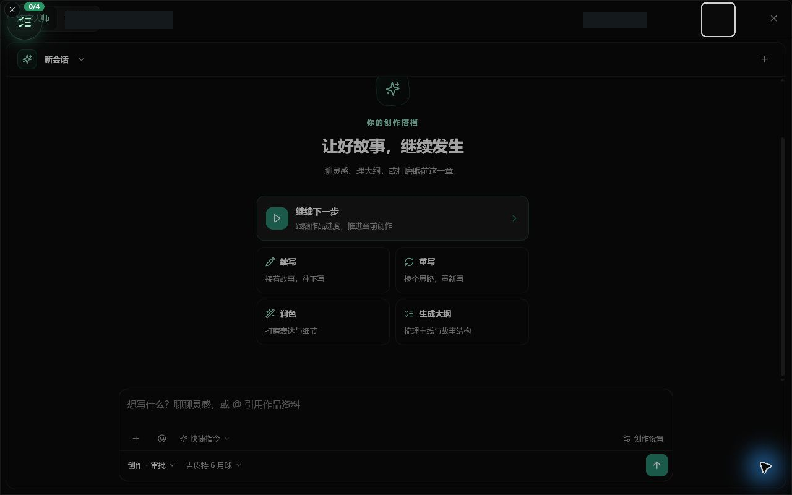

**图 4　炼字大师主页。** 默认动作是按作品进度继续，续写、重写、润色和大纲以卡片呈现。历史会话在页首，引用、指令、设置和模型位于输入框附近。「Enter」发送，「Shift+Enter」换行。

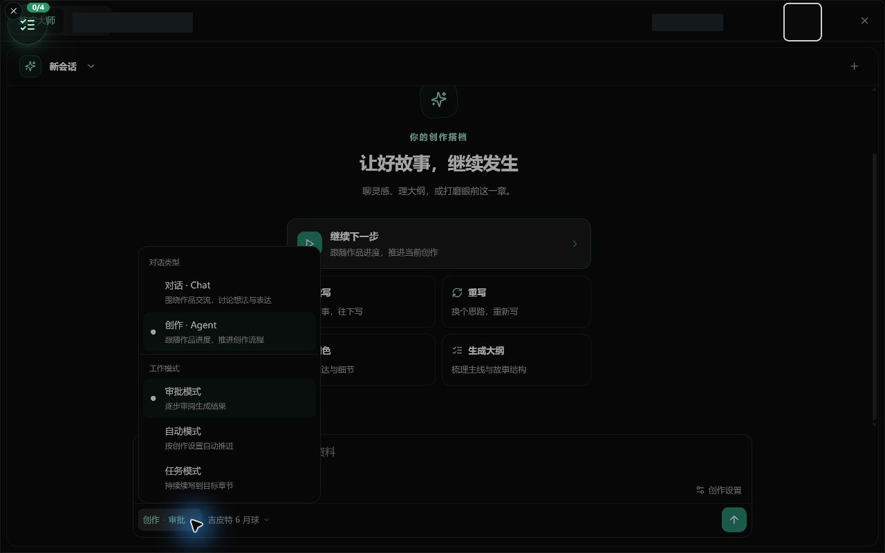

**图 5　对话类型和工作模式。** 「对话 · Chat」围绕作品讨论，「创作 · Agent」跟随作品进度。工作模式独立选择审批、自动或任务模式。目标章、逐步审核和异常停止尚未跑通验证。

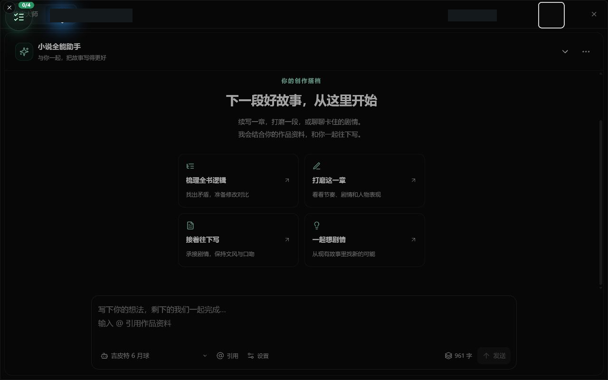

**图 6　智能体对话。** 选择器位于顶栏，旁边有更多会话操作。输入区提供模型、作品资料引用、创作偏好和上下文字数构成入口，可在发送前识别引入资料的规模。

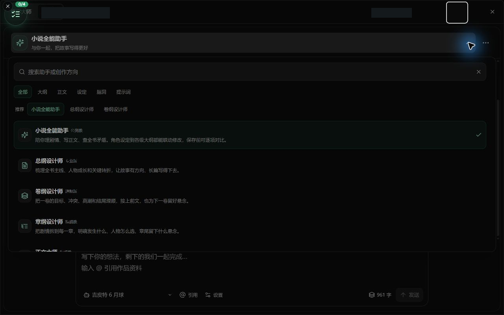

**图 7　智能体选择器。** 可搜索助手或创作方向，按全部、大纲、正文、设定、脑洞、提示词筛选，并给出推荐。实见十项如下，版本标签按现场界面记录。

| 助手 | 版本标签 | 在选择器中的任务说明 |
| --- | --- | --- |
| 小说全能助手 | 公测版 | 理剧情、写正文、查全书矛盾，允许跨角色和各级大纲形成修改对比 |
| 总纲设计师 | 专业版 | 全书主线、人物成长、关键转折 |
| 卷纲设计师 | 旗舰版 | 卷目标、冲突、高潮、结尾，兼顾前后卷衔接 |
| 章纲设计师 | 旗舰版 | 逐章事件、人物选择、章尾悬念 |
| 正文大师 | 旗舰版 | 结合前文和章纲续写、重写、扩写、润色 |
| 角色设计师 | 专业版 | 性格、动机、关系及前后文行为一致性 |
| 伏笔设计师 | 旗舰版 | 伏笔、知情人、秘密揭晓时机 |
| 设定设计师 | 专业版 | 世界观、势力、力量体系、金手指及规则冲突 |
| 脑洞大师 | 专业版 | 开书点子、卡文时的剧情方向 |
| 提示词大师 | 专业版 | 为创作阶段生成、优化或重构提示词 |

## 5. 导航质量与摩擦

| 观察 | 对用户的影响 | 可迁移的设计判断 |
| --- | --- | --- |
| 五个一级标签加常驻章节定位 | 跨模块回查时仍能看到正在写的章；对长篇写作尤其有价值 | 用固定章节锚点保留对象上下文，并在设定、大纲或笔记打开时显示其作用范围 |
| 左侧全局卷章树与模块内目录并列 | 章节和资料都可快速找回。在大纲页两棵卷章树职责尤其相近，容易点错 | 用「正文章节」「总纲／卷纲／章纲」等对象化名称区分两棵树，模块目录支持收起 |
| 文本动作被分成正文工具与 AI 工具，但横向都较密 | 当前窗口下工具栏右端出现裁切，截图只露出前段，而可访问性树仍有重写、设定更新等后段动作 | 把高频操作留在首屏，低频操作归入带文字的菜单，确保窄窗可发现 |
| AI 面板可从浮动入口打开，本次窗口中覆盖工作台 | 有足够空间显示任务卡和对话，边读正文边核对候选则要切换 | 宽屏让正文和 AI 对比并排，窄屏提供明确的返回正文位置和当前目标 |
| 向导、待办和「继续下一步」共同引导 | 无头绪时有可选下一步；已有写作计划的作者同时面对多个引导入口 | 引导可折叠，下一步写出具体对象和预期产物，并保留直接写作入口 |
| 自动保存、手动云同步、历史、生成详情与回收站分别承担恢复相关职责 | 用户可能把「有生成记录」当成「正文已经保存」，或混淆本机保存和云同步 | 在对应对象上明确显示保存状态、最近同步、候选采纳状态及恢复位置 |

## 6. 对 ainovel 的参考优先级

1. **优先打通章节工作流。** 给当前作品、工作版本、卷章和正文一个稳定坐标；从设定与大纲返回时保留章节和编辑位置。线程式「继续」可以提供下一步，但应先明确任务目标。
2. **再统一 AI 动作的目标和结果。** 把入口放在作者正在处理的对象旁。对每项生成展示输入范围、目标版本、候选与采用状态。作品级规划、章节级正文、选区级修订应能一眼分辨。
3. **保留 ainovel 的创作模式语义。** 建议、半自动、全自动描述作者和 AI 如何分工；逐步审批、自动采纳、持续几章描述执行与授权。参照竞品菜单时可借鉴其便利性，业务上继续分别表达创作分工、采纳政策和整书或阶段范围。[本项目业务规范](BUSINESS_RULES.md)
4. **让立项与维护都能渐进展开。** 一句话或空白稿可起步，人物、世界、主线及设定维护随需要展开。生成记录可追溯到任务和候选；正文版本可独立恢复；正式事实仍依照采用和证据维护。

## 7. 二级操作与界面证据

### 作品、设定、大纲和笔记

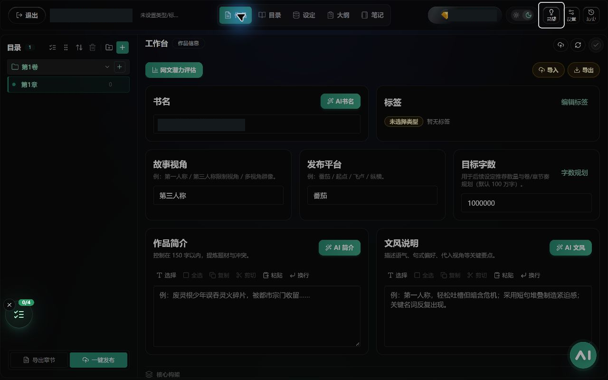

**图 8　作品信息。** 书名、简介、文风的 AI 按钮紧邻字段。类型和标签是独立编辑入口。目标字数说明它用于设定推荐数量及卷章节奏规划，默认值为 100 万字。简介建议 150 字以内。核心构架在下方，长文本还有选择、全选、复制、剪切、粘贴、换行工具。

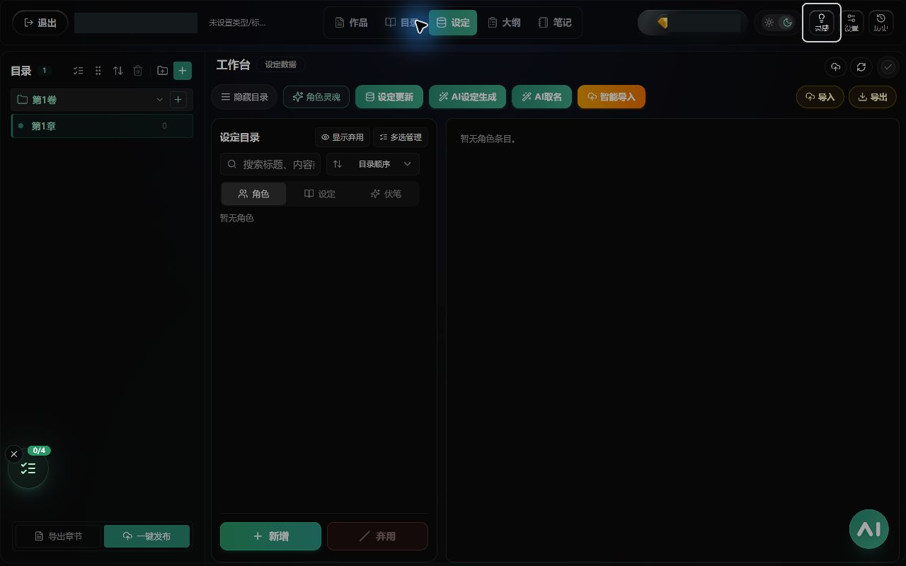

**图 9　设定数据。** 左栏仍是正文章节，中间是设定目录，右边是选中条目。角色、设定、伏笔共用局部目录，顶部操作面向整个模块，底部新增和弃用面向条目。

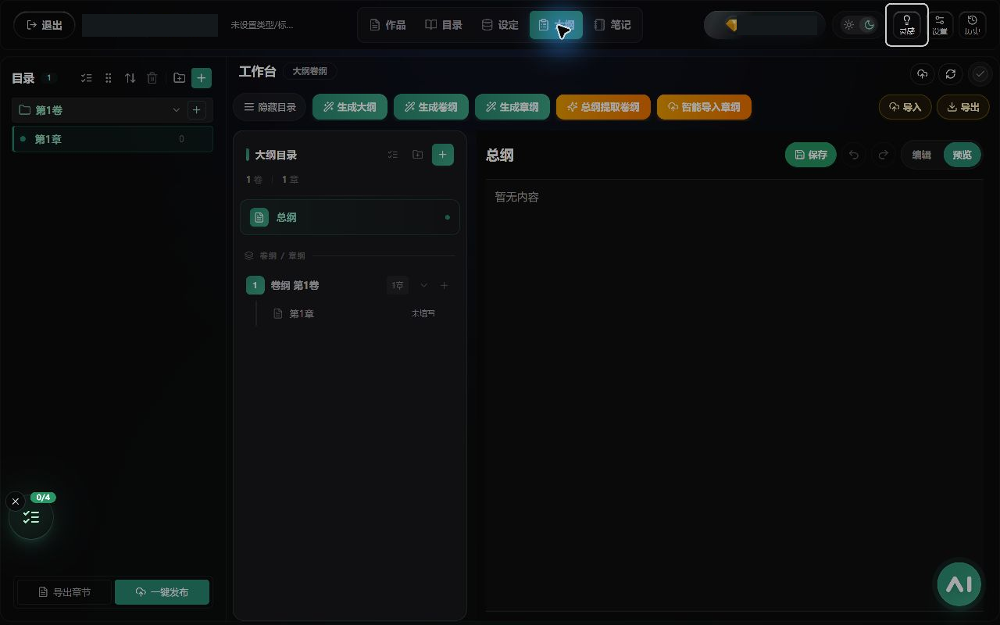

**图 10　大纲卷纲。** 章节树与大纲树并列，有总纲、卷纲和带「未填写」状态的章纲。总纲提供编辑、预览和保存。大纲页的新建动作可以同时建立章与章纲。

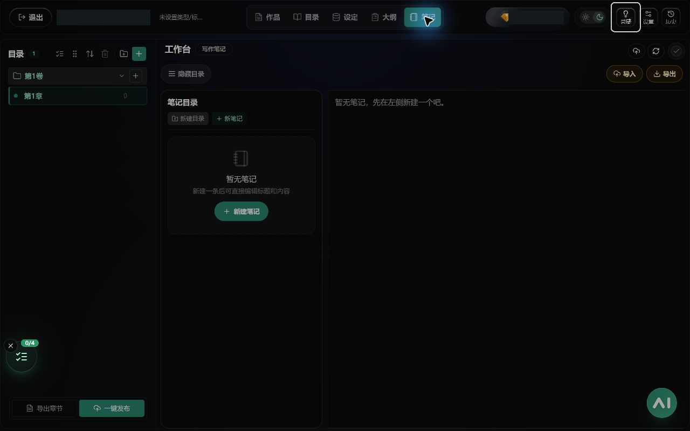

**图 11　写作笔记。** 空态直接提供新建笔记，左侧还可创建目录。顶部的隐藏目录可给笔记内容让出空间。

### 章节排序、多选与编辑恢复

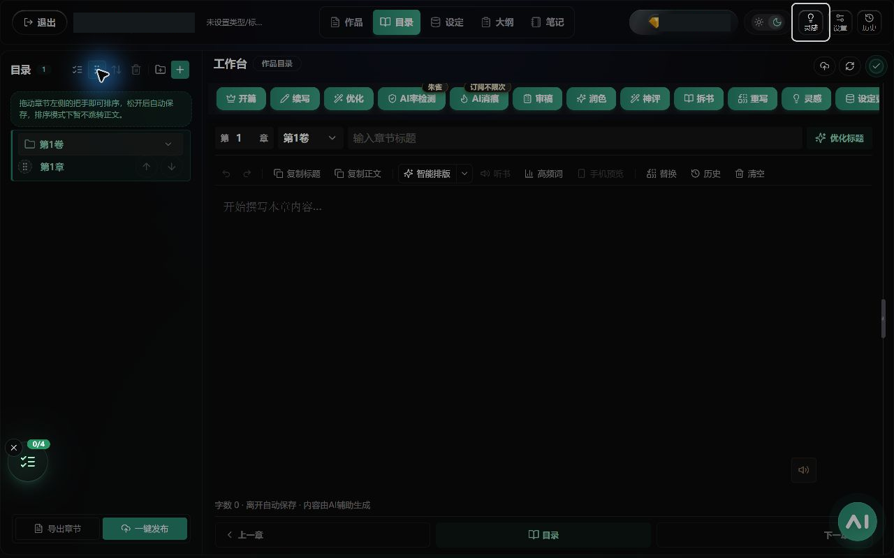

**图 12　章节排序模式。** 左侧显示拖拽把手及上移、下移。界面提示拖动松手后自动保存，排序期间不跳到另一章，正倒序切换暂时禁用。单章样本只验证模式和按钮，未改变排序。

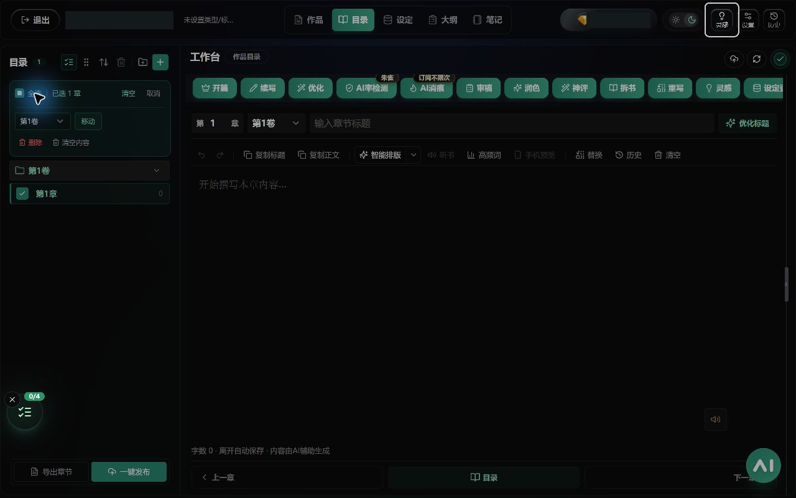

**图 13　章节多选。** 勾选后显示已选数量、全选、清空选中和取消。指定目标卷后可移动，另有「删除」和「清空内容」。二者作用不同，确认内容和回滚只查看到了入口。

**图 14　历史版本。** 界面声明本浏览器每章保留最近 10 个正文版本，恢复前先备份当前正文，云端保留当前正文。清除浏览器数据或换设备后本地历史不可用。列表展示时间、字数和恢复按钮。回收站另管整章删除，现场打开为空，清空按钮禁用。

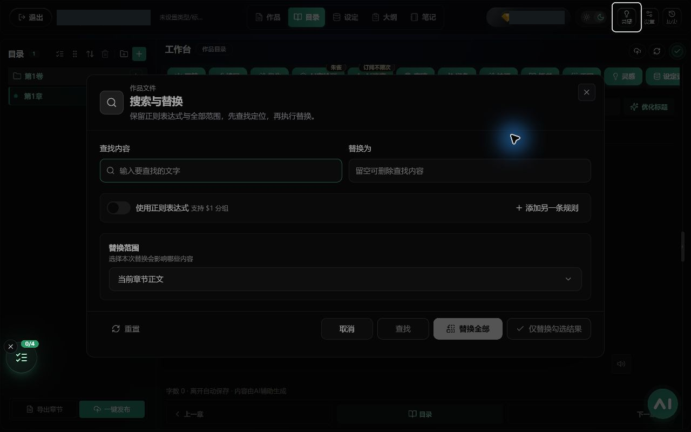

**图 15　搜索与替换。** 支持多条规则、正则表达式和分组引用，留空替换值表示删除匹配内容。有先查找、全部替换、仅替换勾选结果、重置入口。范围菜单实见当前章、全部章节正文、设定资料、分卷卷纲、章节章纲、组合范围和作品全部内容。未用非空稿执行，匹配高亮和预防误覆盖的效果未验。

### 导出、发布、设置及生成记录

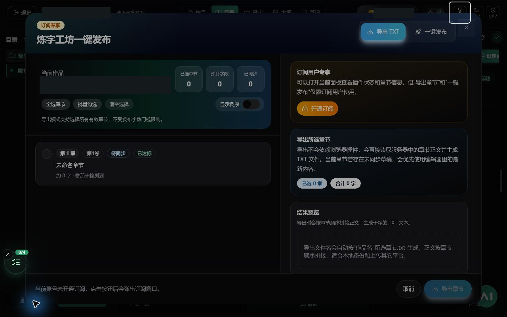

**图 16　导出 TXT。** 与「一键发布」共享一个弹窗，通过右上标签切换。可全选或批量勾选，有选中章数、预计字数、同步计数和倒序开关。界面称导出按章序拼接正文，不受发布字数门槛限制，无需浏览器插件，读取服务器章节时可优先使用当前章未同步的编辑草稿。当前账号可查看配置，实际导出需要订阅。

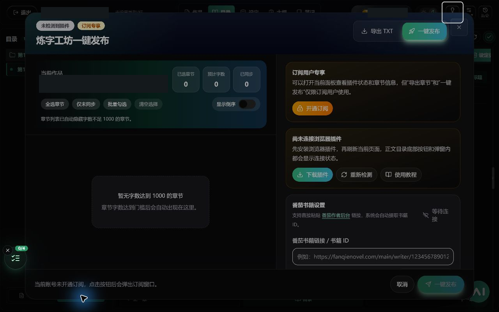

**图 17　番茄发布预检。** 章节列表自动隐藏不足 1,000 字的章节，可筛仅未同步项。右侧检查浏览器插件，提供下载、重新检测、教程，以及番茄作者后台作品链接／书籍 ID。当前样本未达字数门槛、未检测到插件、账号未订阅，因此验证到预检层。

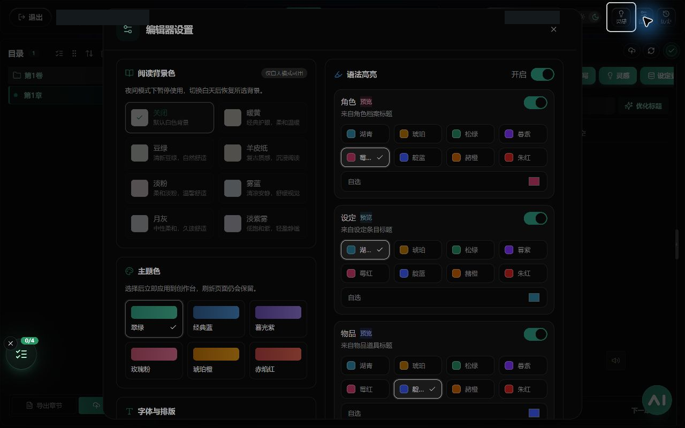

**图 18　编辑器设置。** 阅读背景和主题色独立，日间背景有关闭及七种配色。字体与排版包含正文字号、AI 回复字号、行间距和段落间距。语法高亮可按角色、设定、物品分别开关和配色，支持自选颜色；另有自定义词，高频词高亮独立保存。正文宽度分隔条的辅助说明提供拖动及 Home/End 最小／铺满。

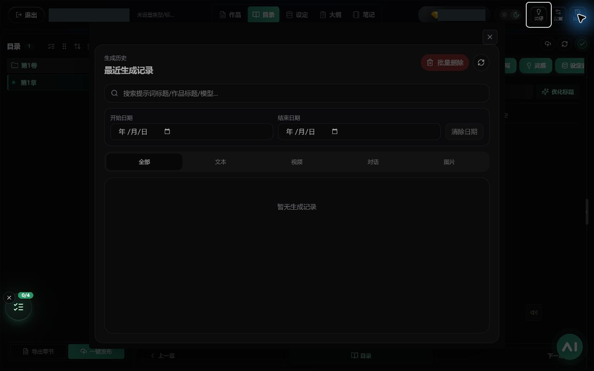

**图 19　最近生成记录。** 可按提示词标题、作品标题或模型搜索，也可选起止日期，按全部、文本、视频、对话、图片切换，同时提供刷新及批量删除入口。媒体标签说明历史面板的筛选范围，编辑器可否直接生成相应媒体仍需单独取证。

## 8. 覆盖范围

- 已进入并核对：五个主标签、创作向导首页及已有的世界观抽卡步骤、编辑器设置、AI 两个标签及工作模式菜单、智能体选择器、最近生成记录、章节回收站、章节排序和多选、正文历史、批量替换、TXT 导出和番茄发布预检。
- 已见但未执行：正文修改和持久化、章节增删排序、批量替换、创作与审稿调用、审批和自动续写、同步与冲突处理、导入导出、发布、订阅与计费。章节、记录和设定样本为空或规模很小，无法用本次现场观察判断长篇性能、真实模型质量或实际多对象写回。
- 观察限于登录账号的当前作品及桌面窗口。移动端、账号角色差异、非空历史恢复、非空任务详情和完整键盘焦点顺序尚未覆盖。界面分析按当前窗口评价了显示和入口发现性，未将这些观察扩展为所有尺寸的结论。
- 二级菜单中尚有部分入口仅确认了按钮名或提示，例如角色灵魂的保存、设定智能导入的字段映射、章纲批量生成参数和章节 AI 工具的真实输出。当前账号的会员执行、插件联动和多章非空状态需要相应条件才能验证。
